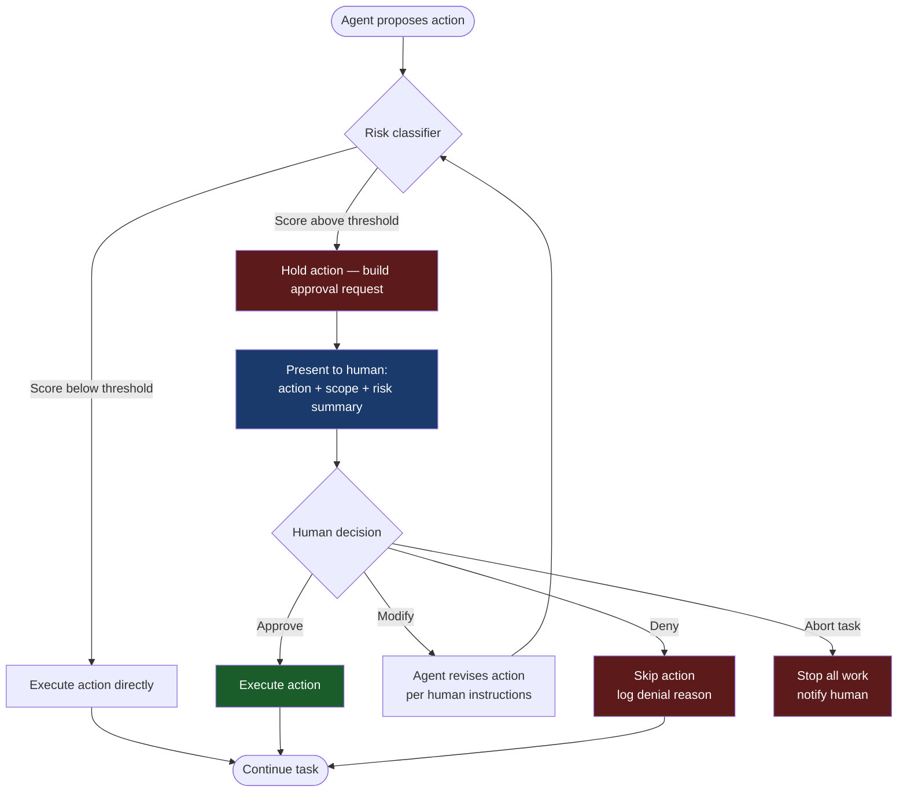

# K02 — High-Risk Action Gate

## Intent

Block execution of any action whose blast radius, irreversibility, or security impact exceeds a defined threshold until a human explicitly approves it.

## Problem

Not all actions in an agent's repertoire carry the same weight. Sending a read query and sending an email to 10,000 customers are both "tool calls," but their consequences are orders of magnitude apart. A purely phase-based checkpoint (K01) may not fire at the right granularity — the dangerous action might be buried mid-phase, or the phase structure may not align with risk boundaries. Without an action-level gate, a momentarily confused agent or a subtly malicious prompt can trigger a catastrophic irreversible action before any human has a chance to intervene.

## Solution

A risk classifier evaluates each candidate action before execution. Actions that exceed the configured risk threshold are held and presented to the human for approval. The agent cannot proceed with that action until approval is received. Actions below the threshold execute normally without interruption.

The risk classifier uses a combination of:
- **Action class**: is this a write, delete, send, deploy, or financial operation?
- **Blast radius**: how many users, records, or systems are affected?
- **Reversibility**: can this be undone in under 5 minutes?
- **Novelty**: has this agent executed this exact action class successfully before?

The gate is enforced in the execution layer, not in the planner. The planner may schedule any action; the gate fires at dispatch time.

## Structure

<details>
<summary><b>High-Risk Action Gate Flow</b></summary>



</details>

## When to Use

- Any agent that has access to tools with destructive, financial, or communication side effects
- Deployments, mass data writes, external API calls that cannot be undone (emails, SMS, webhooks)
- Multi-tenant systems where one action can affect multiple customers
- Agents operating in production environments where mistakes are expensive
- When the action class list is known in advance and can be enumerated (allows a static allowlist)
- Compliance domains where certain actions require a human audit trail regardless of context

## When NOT to Use

- Sandboxed environments where all actions are ephemeral (test databases, preview environments)
- Actions that have been pre-approved en masse by a human with full knowledge of scope
- High-frequency, low-latency pipelines where the gate would become a bottleneck — consider async audit (K06) instead
- Actions the agent has executed thousands of times in identical conditions with zero failures (Trust Ladder Level 4 for that action class)

## Implementation Notes

**Defining the risk threshold:**
Use the BRIDE heuristic from the family README. Each dimension scores 0–1. Actions scoring ≤ 2 total require gating. Adjust thresholds per deployment context — a financial system may gate at ≤ 3.

**Static allowlist / denylist:**
Maintain an explicit allowlist of action signatures that have been pre-approved and a denylist of action classes that always require gating. The classifier only needs to score actions that fall in neither list.

**What to show the human:**
```
HIGH-RISK ACTION GATE
─────────────────────
Action:       <tool name + parameters>
Blast radius: <N records / N users / N systems>
Reversible:   <Yes / No / Partially — <how>>
Risk score:   <N/5>
Reason:       <why this crossed the threshold>

Actions available: [Approve] [Modify] [Deny] [Abort task]
```

**Timeout behavior:**
Unlike K01 checkpoints, a gate that times out must default to DENY, not proceed. An unanswered gate must never silently auto-approve. Notify the human that the action was held and requires their attention.

**Layering with K01:**
K02 complements K01. K01 governs phase transitions; K02 governs individual high-risk actions that may occur within a phase. Both can be active simultaneously.

**Implementation sketch:**
```
function dispatchAction(action, context):
    if DENYLIST.matches(action):
        return gateForApproval(action, context, reason="always-gated action class")
    
    if ALLOWLIST.matches(action):
        return execute(action)
    
    score = riskClassifier.score(action, context)
    // score components: blastRadius, reversibility, novelty, actionClass
    
    if score.total > RISK_THRESHOLD:
        approval = awaitHumanDecision(
            buildGateRequest(action, score),
            timeout=GATE_TIMEOUT,
            onTimeout=DENY
        )
        
        if approval.action == APPROVE:
            return execute(action)
        if approval.action == MODIFY:
            return dispatchAction(approval.revisedAction, context)
        if approval.action in [DENY, ABORT]:
            logDenial(action, approval.reason)
            return DENIED
    
    return execute(action)
```

## Tradeoffs

| Force | Impact |
|-------|--------|
| Latency | Gate adds human response time to any high-risk action; acceptable if high-risk actions are rare |
| Throughput | Minimal impact if the allowlist is well-tuned — most actions clear it without gating |
| Oversight | Precise: only actions that exceed the threshold are reviewed, avoiding alert fatigue |
| Trust erosion | Poorly calibrated thresholds gate trivial actions, training humans to approve without reading |
| Security | Strong barrier against prompt injection attacks that attempt to trigger destructive tools |
| Blast radius | Containment guarantee — the worst case is bounded by what a human consciously approves |

## Related Patterns

- [K01 — Human-in-the-Loop Checkpoint](K01-human-in-the-loop-checkpoint.md) — K01 gates phase transitions; K02 gates individual actions within phases; use together
- [K04 — Review Before Side Effect](K04-review-before-side-effect.md) — K04 is a broader form covering all external state changes; K02 is narrower, filtering by risk score
- [K05 — Draft/Preview Before Apply](K05-draft-preview-before-apply.md) — K05 is the lightweight variant for file writes specifically; K02 covers any action class
- [K03 — Failure-Threshold Escalation](K03-failure-threshold-escalation.md) — K03 escalates after repeated failure; K02 gates before first execution
- [Family J — Security](../../J-security-trust/README.md) — J's human-approval-gate is a security-scoped variant of K02; K02 is the general form

## Example

An agent is building a customer communication workflow. It successfully executes dozens of low-risk read and transform operations without gating. When it reaches the step `send_email(recipients=["all"], subject="...", body="...")`, the risk classifier scores it: blast radius = 50,000 users (1.0), reversible = No (0.0), action class = external communication (high). Score: exceeds threshold.

The gate fires. The human sees: "Send email to 50,000 recipients — irreversible — approve?" The human reviews the email content, notices a typo in the subject line, chooses Modify, corrects the subject, and approves. The corrected email is sent.

Without the gate, the email with the typo would have been sent to 50,000 customers with no recourse.

## Sources

- **Anthropic Engineering** — AI safety company; authors of Claude; recommends human-in-the-loop for irreversible actions. [Building Effective Agents](https://www.anthropic.com/engineering/building-effective-agents)
- **Google Cloud Architecture Center** — Google's cloud architecture team; explicitly names Human-in-the-Loop as an agent design pattern. [Choose a Design Pattern for Agentic AI](https://docs.cloud.google.com/architecture/choose-design-pattern-agentic-ai-system)
- **Microsoft Azure Architecture Center** — Microsoft's cloud architecture team; stresses human participation in multi-agent workflows. [AI Agent Design Patterns](https://learn.microsoft.com/en-us/azure/architecture/ai-ml/guide/ai-agent-design-patterns)
- **AWS Prescriptive Guidance** — Amazon Web Services architecture team. [Agentic AI Patterns](https://docs.aws.amazon.com/prescriptive-guidance/latest/agentic-ai-patterns/agent-patterns.html)
