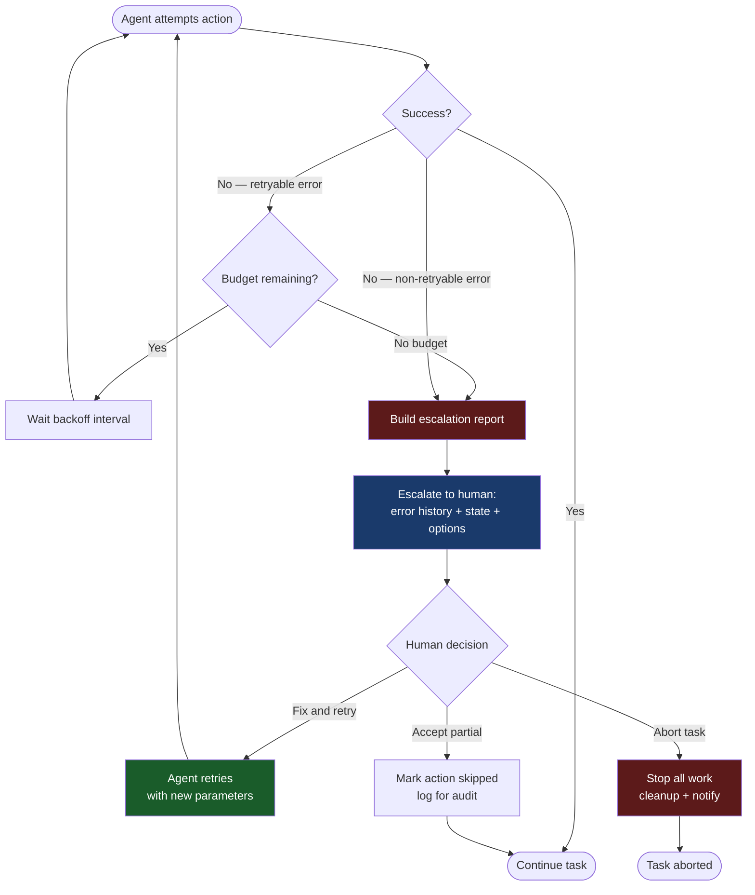

# K03 — Failure-Threshold Escalation

## Intent

Escalate to a human when an agent's retry budget or error count for a task or action class is exhausted, rather than looping indefinitely or failing silently.

## Problem

Autonomous agents employ retry logic and self-correction to handle transient failures. This is desirable — it reduces noise and keeps pipelines running. However, retrying indefinitely on a problem the agent cannot solve wastes resources, delays human awareness, and may amplify harm (e.g., a misconfigured action that fails repeatedly but leaves partial state on each attempt). Without a hard escalation boundary, agents can spin in failure loops for hours before anyone notices.

A secondary failure mode is silent degradation: the agent stops retrying but reports partial success, hiding the unresolved failure from downstream systems and the human operator.

## Solution

Every retryable operation is wrapped with an error budget. When the budget is exhausted — or when a non-retryable failure occurs — the agent escalates to a human rather than continuing or silently failing. Escalation includes the full failure context: what was attempted, how many times, what errors occurred, and what state was left behind.

The human receives enough information to decide: fix the root cause, provide guidance for the agent to retry with new parameters, accept partial completion, or abort.

Escalation is the human-facing exit point from the reliability retry chain (Family I). The agent does not attempt to guess a resolution — it surfaces the impasse.

## Structure

<details>
<summary><b>Failure-Threshold Escalation Flow</b></summary>



</details>

## When to Use

- Any agent that uses retry logic — escalation must be the exit from every retry loop
- Long-running pipelines where a stuck step would block downstream work indefinitely
- Actions with external dependencies (APIs, databases, network) where failures may be persistent rather than transient
- When partial completion is possible but the human must decide whether it is acceptable
- Agents that write state incrementally — a mid-task failure may leave inconsistent state the human needs to know about
- Regulated domains where all failures must be acknowledged by a human operator

## When NOT to Use

- Ephemeral tasks where failure simply means retry-from-scratch with no state concern
- Failures that have a deterministic programmatic resolution the agent is authorized to apply (e.g., rate limit → wait and retry at a known interval)
- Low-stakes background tasks where silent skip-and-log is the correct behavior and the human has explicitly authorized it
- Situations where the escalation channel itself (e.g., human notification) is known to be unavailable — fallback to a dead-letter queue instead

## Implementation Notes

**Error budget configuration:**
Define budgets per action class, not globally. A network read may retry 5 times over 30 seconds; a financial write may escalate on the first non-transient error.

```
errorBudgets:
  network_read:      retries: 5, backoff: exponential, maxWait: 30s
  api_call:          retries: 3, backoff: linear, maxWait: 60s
  database_write:    retries: 2, backoff: fixed(5s), maxWait: 10s
  financial_action:  retries: 0, escalateImmediately: true
```

**Escalation report format:**
```
ESCALATION — Budget Exhausted
──────────────────────────────
Task:         <task name>
Action:       <action that failed>
Attempts:     <N attempts over T seconds>
Errors:       <deduplicated error list with counts>
Current state: <what partial state was written, if any>
Affected:     <records / users / systems impacted>

Options available:
  [Retry with new params: <suggest parameter change>]
  [Accept partial: skip this action, continue task]
  [Abort: stop task, initiate cleanup]
```

**State documentation at escalation time:**
Before escalating, the agent must record a snapshot of current task state to a durable store. If the human's resolution takes time, the agent must be able to resume from that snapshot rather than restarting from scratch.

**Non-retryable escalation:**
For non-retryable errors (auth failure, schema mismatch, permission denied), escalate immediately with the specific error class prominently labeled. Do not use generic retry budget messaging — these require different human actions.

**Implementation sketch:**
```
function executeWithEscalation(action, context):
    budget = errorBudgets.get(action.class)
    attempts = 0
    errors = []
    
    while attempts <= budget.maxRetries:
        result = attempt(action)
        
        if result.success:
            return result
        
        if not result.isRetryable:
            return escalate(action, [result.error], context, reason="non-retryable")
        
        errors.append(result.error)
        attempts += 1
        
        if attempts <= budget.maxRetries:
            sleep(budget.backoff(attempts))
    
    // Budget exhausted
    stateSnapshot = captureCurrentState(context)
    return escalate(action, errors, context, stateSnapshot, reason="budget-exhausted")

function escalate(action, errors, context, snapshot=null, reason):
    report = buildEscalationReport(action, errors, context, snapshot, reason)
    response = awaitHumanDecision(report, timeout=ESCALATION_TIMEOUT)
    
    if response.action == RETRY_WITH_NEW_PARAMS:
        return executeWithEscalation(action.revise(response.params), context)
    if response.action == ACCEPT_PARTIAL:
        logSkip(action, errors)
        return SKIPPED
    if response.action == ABORT:
        runCleanup(context)
        return ABORTED
```

## Tradeoffs

| Force | Impact |
|-------|--------|
| Latency | Escalation introduces human response time, but only after the retry budget is exhausted — a last resort, not the fast path |
| Throughput | Blocks the task at the point of failure; unblocks only when human responds |
| Oversight | Human sees only failures that the agent could not resolve — signal-to-noise ratio is high |
| Partial state risk | Forces human awareness of incomplete writes before they cause downstream corruption |
| Trust | Honest escalation builds more trust than silent failure or spurious retries |
| Alert fatigue | Poorly tuned budgets that escalate too eagerly will train humans to dismiss escalations |

## Related Patterns

- [K01 — Human-in-the-Loop Checkpoint](K01-human-in-the-loop-checkpoint.md) — K01 is proactive (checkpoints at planned points); K03 is reactive (fires only on failure)
- [K02 — High-Risk Action Gate](K02-high-risk-action-gate.md) — K02 gates before first attempt; K03 escalates after N failed attempts
- [K06 — Human-on-the-Loop Monitoring](K06-human-on-the-loop-monitoring.md) — K06 can observe failure patterns and alert; K03 is the hard escalation path when the agent itself gives up
- [Family I — Reliability](../I-reliability/README.md) — K03 is the human-facing exit from Family I's retry and self-healing chains

## Example

An agent is processing a batch of 1,000 invoice records, writing results to a payments database. On record 847, it encounters a database write timeout. It retries twice more (budget: 3 attempts). The third attempt also times out.

The agent escalates: "Database write failed 3 times on record 847. Records 1–846 written successfully. Error: connection timeout. Current state: snapshot saved. Options: [Retry after DB maintenance window], [Skip record 847 and continue], [Abort]."

The human investigates, discovers the database host was temporarily overloaded, and responds "Retry in 5 minutes." The agent resumes from the snapshot and completes records 847–1000 successfully.

Without escalation, the agent would have either looped indefinitely on record 847 or silently skipped it and reported 1,000 records processed — hiding the gap from downstream reconciliation.

## Sources

- **Anthropic Engineering** — AI safety company; authors of Claude; recommends human-in-the-loop for irreversible actions. [Building Effective Agents](https://www.anthropic.com/engineering/building-effective-agents)
- **Microsoft Azure Architecture Center** — Microsoft's cloud architecture team; stresses human participation in multi-agent workflows. [AI Agent Design Patterns](https://learn.microsoft.com/en-us/azure/architecture/ai-ml/guide/ai-agent-design-patterns)
- **AWS Prescriptive Guidance** — Amazon Web Services architecture team. [Agentic AI Patterns](https://docs.aws.amazon.com/prescriptive-guidance/latest/agentic-ai-patterns/agent-patterns.html)
- **OpenAI Engineering** — AI research company. [A Practical Guide to Building AI Agents](https://openai.com/business/guides-and-resources/a-practical-guide-to-building-ai-agents/)
