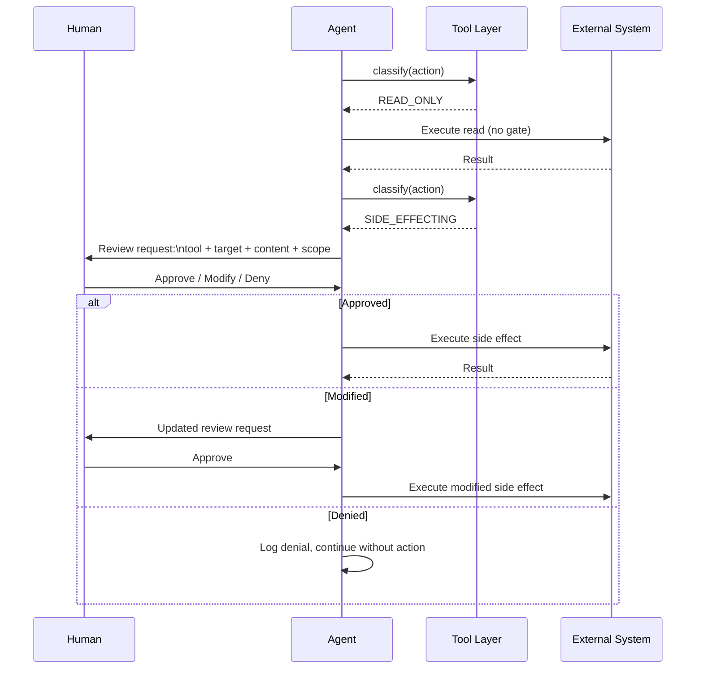

# K04 — Review Before Side Effect

## Intent

Require human review of any action that changes external state before that action is executed.

## Problem

Agents interleave read operations (harmless, reversible) with write operations (potentially harmful, hard to reverse) throughout their execution. In a fast-moving autonomous pipeline, write operations can be dispatched without the human ever seeing what specifically is being changed. The problem is not that writes occur — it is that writes occur without the human having reviewed the specific content and scope of the change.

This is distinct from K02 (risk scoring) and K01 (phase gates). K04 is unconditional for a defined class: any action that modifies external state. It does not require a risk score calculation or a phase boundary — the trigger is the action type itself.

## Solution

The agent maintains a classification of its tool set: read-only tools vs. side-effecting tools. Before dispatching any side-effecting tool call, the agent pauses and presents the full proposed action to the human — target, content, and scope — and waits for approval. The human may approve, modify, or deny. Only after explicit approval does the action execute.

Read-only operations are unaffected. The human is never asked to approve a SELECT query or a file read. The pattern targets only state-changing operations: writes, deletes, updates, sends, posts, deploys.

This pattern is the explicit human-review form of the "minimal footprint" principle: the agent does not act on external state without the human's eyes on the specific change.

## Structure

<details>
<summary><b>Review Before Side Effect Flow</b></summary>



</details>

## When to Use

- Agents in production environments where external state changes are expensive or hard to undo
- New agents or new action classes operating at Trust Ladder Level 0–1
- Any agent that touches user-owned data, financial records, or communication channels
- Workflows where the human is the authoritative source of truth for what the correct change is — the agent proposes, the human decides
- Compliance contexts where a human sign-off on each state change is a regulatory requirement
- Agents that operate on behalf of multiple tenants — review prevents cross-tenant contamination

## When NOT to Use

- Agents executing in a fully sandboxed environment where all state changes are ephemeral
- Action classes for which the human has explicitly granted blanket approval (e.g., "write all intermediate computation results to tmp/")
- High-throughput pipelines with dozens of small writes per second — use K05 (batch preview) or K06 (async monitoring) instead
- Trust Ladder Level 3–4 for a specific action class with a proven track record

## Implementation Notes

**Tool classification:**
Maintain an explicit side-effect manifest alongside the tool registry. Every tool is tagged READ_ONLY or SIDE_EFFECTING at registration time. Unclassified tools must default to SIDE_EFFECTING — failing open on the side of caution.

```
toolRegistry:
  - name: read_file        class: READ_ONLY
  - name: search_database  class: READ_ONLY
  - name: write_file       class: SIDE_EFFECTING
  - name: delete_record    class: SIDE_EFFECTING
  - name: send_message     class: SIDE_EFFECTING
  - name: call_api         class: SIDE_EFFECTING  // default for unknown
```

**Review request format:**
```
SIDE EFFECT REVIEW
──────────────────
Tool:    <tool name>
Target:  <file path / record ID / endpoint / recipient>
Action:  <create / update / delete / send>
Content: <full proposed payload or diff>
Scope:   <N records / N users / estimated impact>

Actions available: [Approve] [Modify] [Deny]
```

**Batching side effects:**
If the agent plans multiple side effects in sequence, present them as a batch review rather than individual prompts. This reduces human interruption frequency while maintaining full visibility.

```
BATCH SIDE EFFECT REVIEW — 3 actions
─────────────────────────────────────
1. write_file: /config/settings.json
   <diff>
2. update_record: user_id=4421, field=email
   <new value>
3. send_notification: user_id=4421
   <message content>

Actions: [Approve All] [Review Individually] [Deny All]
```

**Granularity calibration:**
At Trust Ladder Level 1, review every individual side effect. At Level 2, group side effects by type and review per type rather than per instance. At Level 3, review only the first instance of a new action class, then allow subsequent instances in the same session.

**Implementation sketch:**
```
function executeAction(action, context):
    classification = toolRegistry.classify(action.tool)
    
    if classification == READ_ONLY:
        return execute(action)
    
    // SIDE_EFFECTING — require review
    reviewRequest = buildReviewRequest(action, context)
    
    if context.hasBatchPending():
        context.addToBatch(reviewRequest)
        return DEFERRED
    
    response = awaitHumanDecision(reviewRequest, timeout=REVIEW_TIMEOUT)
    
    if response.action == APPROVE:
        return execute(action)
    
    if response.action == MODIFY:
        modified = action.applyModifications(response.changes)
        return executeAction(modified, context)  // re-classify and re-review
    
    if response.action == DENY:
        logDenial(action, response.reason)
        return DENIED
```

## Tradeoffs

| Force | Impact |
|-------|--------|
| Latency | Every side effect waits for human response; unsuitable for any real-time write pipeline |
| Throughput | Significant reduction; mitigated by batching multiple side effects into one review |
| Oversight | Complete — the human sees every state change before it happens |
| Trust erosion | Reviewing trivial writes trains humans to rubber-stamp; use calibrated granularity |
| Error prevention | Catches wrong targets, wrong content, unintended scope before any damage occurs |
| Audit trail | Natural: every approved side effect is a human-endorsed change |

## Related Patterns

- [K01 — Human-in-the-Loop Checkpoint](K01-human-in-the-loop-checkpoint.md) — K01 is coarser (phase-level); K04 is finer (per-side-effect); use K01 for phase gates and K04 within phases
- [K02 — High-Risk Action Gate](K02-high-risk-action-gate.md) — K02 fires on risk score; K04 fires on action class unconditionally — combine for defense in depth
- [K05 — Draft/Preview Before Apply](K05-draft-preview-before-apply.md) — K05 is K04 scoped specifically to file/document writes with diff presentation; K04 is the general form
- [K06 — Human-on-the-Loop Monitoring](K06-human-on-the-loop-monitoring.md) — K04 blocks execution; K06 observes execution; use K04 when blocking is required, K06 when it is not

## Example

An agent is tasked with updating user profile records based on a CSV import. It reads the CSV (READ_ONLY — no gate), reads the existing database records (READ_ONLY — no gate), then computes the diff.

Before writing, it presents a batch review: "3 side effects: update user 1201 email from a@x.com to b@x.com; update user 1304 name from 'John' to 'John Smith'; delete user 1409 (account marked inactive)."

The human reviews and notices that user 1409's deletion was not in the original brief — the "inactive" flag was meant to be set, not used as a deletion trigger. The human denies the delete, approves the two updates, and adds a note: "Set inactive=true on 1409 instead."

The agent processes the two approved updates, then — treating the modification as a new side effect — presents "update user 1409 inactive=true" for approval. The human approves. All changes are now intentional.

## Sources

- **Anthropic Engineering** — AI safety company; authors of Claude; recommends human-in-the-loop for irreversible actions. [Building Effective Agents](https://www.anthropic.com/engineering/building-effective-agents)
- **Google Cloud Architecture Center** — Google's cloud architecture team; explicitly names Human-in-the-Loop as an agent design pattern. [Choose a Design Pattern for Agentic AI](https://docs.cloud.google.com/architecture/choose-design-pattern-agentic-ai-system)
- **Microsoft Azure Architecture Center** — Microsoft's cloud architecture team; stresses human participation in multi-agent workflows. [AI Agent Design Patterns](https://learn.microsoft.com/en-us/azure/architecture/ai-ml/guide/ai-agent-design-patterns)
- **OpenAI Engineering** — AI research company. [A Practical Guide to Building AI Agents](https://openai.com/business/guides-and-resources/a-practical-guide-to-building-ai-agents/)
