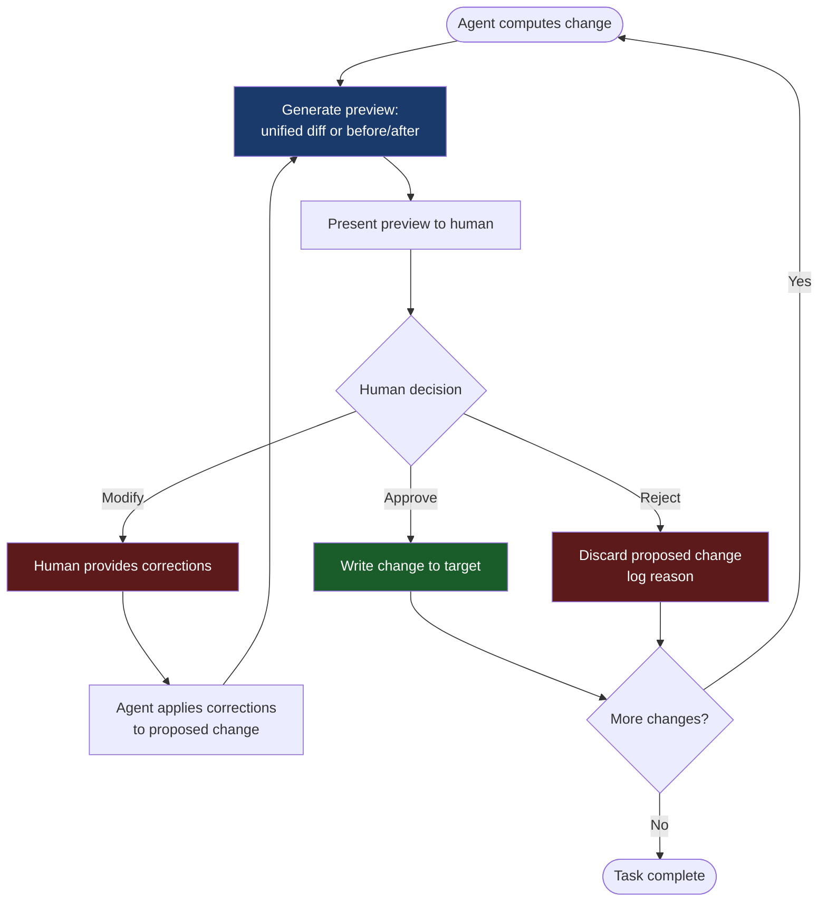

# K05 — Draft/Preview Before Apply

## Intent

Show the human a diff or preview of a proposed file, document, or data change and require explicit confirmation before writing it.

## Problem

File writes and document edits are among the most common side effects in agentic workflows — code generation, config updates, content editing, report generation. The problem is that a write is often presented as binary: the agent either writes or it doesn't. The human has no opportunity to see the exact change in context — what was there before, what will be there after, what was removed — before the write commits.

Without a preview, the human's only option is to review after the fact, compare to a previous version, and manually revert if something is wrong. In multi-file workflows this becomes untenable. The diff — the precise delta between before and after — is the most information-dense representation of the change and the most efficient surface for human review.

## Solution

Before any write operation, the agent generates a preview of the proposed change. For text files, this is a unified diff. For structured data, this is a before/after comparison of the affected fields. For new files, this is the full content. The agent presents this preview and waits for confirmation.

The human may approve the full diff, request modifications, or reject it. Only after approval does the write execute. The pattern can be layered: multiple files can be previewed as a combined diff with per-file approve/reject granularity.

This pattern is K04 (Review Before Side Effect) specialized for the file/document write case, with the added requirement of a structured diff presentation.

## Structure

<details>
<summary><b>Draft/Preview Before Apply Flow</b></summary>



</details>

## When to Use

- Any agent that writes, edits, or deletes files, documents, or structured records
- Code generation and refactoring agents — the diff is the primary review artifact
- Configuration management agents — config errors are often invisible until they cause failures
- Content editing agents where the human is the author and the agent is a collaborator, not an autonomous writer
- Agents that modify multiple files — a combined multi-file diff review is far more efficient than post-hoc review
- Trust Ladder Level 1–2 for file-writing action classes

## When NOT to Use

- Writes to ephemeral or scratch files that are never the final artifact (temp files, build artifacts, intermediate state)
- High-frequency writes where previewing each one is impractical — consider K06 monitoring with batch rollback capability instead
- Binary files (images, compiled artifacts) where a diff is not human-readable — these require K04 (scope/metadata review) rather than K05
- Agents that have blanket write approval for a specific directory with well-understood scope (e.g., "write all logs to /logs/")

## Implementation Notes

**Diff generation:**
For text files, generate a unified diff (context lines: 5 by default). For JSON/YAML, generate a semantic diff that highlights added, changed, and removed keys — not just raw text diff. For new files, show the full content with a "NEW FILE" header.

**Preview format:**
```
DRAFT PREVIEW — 2 files changed
────────────────────────────────
File 1: src/config/database.yaml  [MODIFIED]
─── before
+++ after
@@ -12,3 +12,3 @@
-  host: localhost
+  host: prod-db.internal
   port: 5432

File 2: src/config/cache.yaml  [NEW FILE]
+++ (new)
+ host: redis.internal
+ port: 6379
+ ttl: 300

Actions: [Approve All] [Approve File 1 Only] [Approve File 2 Only] [Modify] [Reject All]
```

**Multi-file workflows:**
Batch all changes computed in one planning step into a single combined preview. This reduces the number of interruptions and lets the human see the full scope of the change at once. Do not present file-by-file unless the human requests it.

**Modification flow:**
When the human requests a modification, the agent must update the in-memory proposed change — not re-run the original generation step, which might produce a different result. The modification is applied as a delta on top of the proposed change, and the updated diff is presented again.

**Regeneration vs. modification:**
If the human's feedback is substantive (changes the approach, not just fixes a detail), offer to regenerate from scratch with the new instructions rather than patching the existing proposal.

**Implementation sketch:**
```
function applyChangesWithPreview(changes, context):
    preview = generateDiff(changes)
    // changes: list of {target, before, after}
    
    response = awaitHumanDecision(
        formatPreview(preview),
        timeout=PREVIEW_TIMEOUT
    )
    
    if response.action == APPROVE_ALL:
        for each change in changes:
            write(change.target, change.after)
        return APPLIED
    
    if response.action == APPROVE_SUBSET:
        for each change in response.approvedChanges:
            write(change.target, change.after)
        return PARTIALLY_APPLIED
    
    if response.action == MODIFY:
        changes = applyHumanCorrections(changes, response.corrections)
        return applyChangesWithPreview(changes, context)  // re-preview
    
    if response.action == REJECT:
        logRejection(changes, response.reason)
        return REJECTED
```

## Tradeoffs

| Force | Impact |
|-------|--------|
| Latency | One human review per change batch; acceptable if changes are batched well |
| Throughput | Minimal impact when changes are batched; high impact if every file triggers a separate preview |
| Oversight | Human sees the exact delta before it lands — most effective review surface available |
| Modification cost | Regenerating a diff after modification is cheap; prevents wasted write-revert cycles |
| Trust erosion | Low — the diff is concrete and easy to scan; humans don't need to approve blindly |
| Cognitive load | Multi-file diffs can be large; offer per-file granularity as an option for large changesets |

## Related Patterns

- [K04 — Review Before Side Effect](K04-review-before-side-effect.md) — K05 is K04 specialized for file writes with diff presentation; use K04 for all other side effect types
- [K01 — Human-in-the-Loop Checkpoint](K01-human-in-the-loop-checkpoint.md) — K05 previews can serve as the checkpoint artifact inside a K01 phase gate
- [K02 — High-Risk Action Gate](K02-high-risk-action-gate.md) — K02 gates by risk score; K05 gates by action type (any file write); use together when writes are also high-risk
- [K06 — Human-on-the-Loop Monitoring](K06-human-on-the-loop-monitoring.md) — if blocking on every write is too slow, K06 with rollback capability is the non-blocking alternative

## Example

A code-generation agent is tasked with refactoring a module to use a new API. It computes changes to 4 files. Rather than writing immediately, it presents a combined diff preview.

The human reviews the diff and notices that in `services/auth.ts`, the agent replaced `user.id` with `user.userId` throughout — correct for the new API — but also changed `admin.id` to `admin.userId` in one place, where `admin` is a different type that does not have a `userId` field.

The human marks File 2 (`services/auth.ts`) as needing modification and provides the correction: "revert the admin.id change only." The agent applies the correction, presents an updated diff for File 2, the human approves it, and all 4 files are written.

Without the preview, the `admin.userId` reference would have been written, causing a runtime type error that would only surface during testing.

## Sources

- **Anthropic Engineering** — AI safety company; authors of Claude; recommends human-in-the-loop for irreversible actions. [Building Effective Agents](https://www.anthropic.com/engineering/building-effective-agents)
- **Google Cloud Architecture Center** — Google's cloud architecture team; explicitly names Human-in-the-Loop as an agent design pattern. [Choose a Design Pattern for Agentic AI](https://docs.cloud.google.com/architecture/choose-design-pattern-agentic-ai-system)
- **OpenAI Engineering** — AI research company. [A Practical Guide to Building AI Agents](https://openai.com/business/guides-and-resources/a-practical-guide-to-building-ai-agents/)
- **AWS Prescriptive Guidance** — Amazon Web Services architecture team. [Agentic AI Patterns](https://docs.aws.amazon.com/prescriptive-guidance/latest/agentic-ai-patterns/agent-patterns.html)
