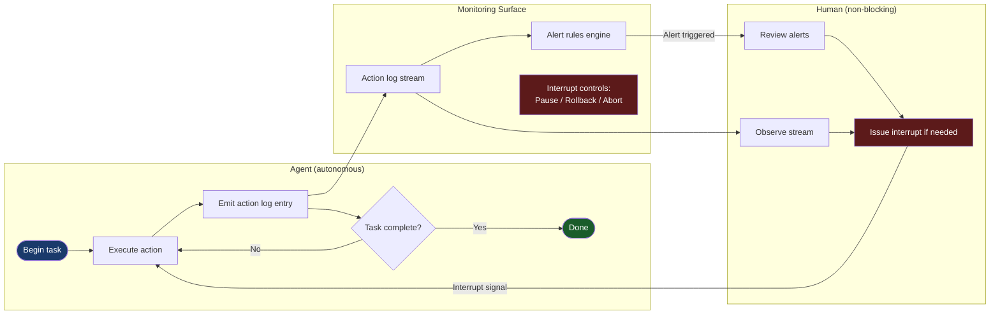

# K06 — Human-on-the-Loop Monitoring

## Intent

Allow the agent to execute autonomously while a human observes the stream of actions and can intervene at any point, without being in the critical path.

## Problem

The blocking patterns (K01–K05) provide strong oversight but at the cost of throughput and latency. For agents operating at Trust Ladder Level 2–3 on well-understood action classes, requiring synchronous human approval for every action is wasteful and defeats the purpose of automation. But fully removing humans from the process — letting the agent execute entirely unobserved — removes the ability to catch subtle drift, unexpected scope expansion, or emerging failure patterns before they compound.

The gap is a non-blocking oversight mode: the human can see what the agent is doing in real time and can intervene if something looks wrong, but the agent does not wait for the human's permission to proceed.

## Solution

The agent executes autonomously and emits a structured action log in real time to a monitoring surface the human can observe. The human watches at their own pace — they may observe continuously, check in periodically, or set up alert rules that notify them when specific conditions are met.

The human retains the ability to interrupt the agent at any time. The interrupt mechanism may include: pause (agent finishes current action, then waits), rollback (undo the last N actions), or abort (stop immediately, run cleanup). The agent never polls for human approval — it only responds to an explicit interrupt signal.

This pattern is the non-blocking complement to K01–K05. It does not replace them for high-risk actions; it is the appropriate oversight level for routine actions executed by a trusted agent.

## Structure

<details>
<summary><b>Human-on-the-Loop Monitoring Flow</b></summary>



</details>

## When to Use

- Agents operating at Trust Ladder Level 2–3 on established action classes
- Long-running background tasks where blocking the agent on each step is impractical
- Pipelines where throughput matters and most actions are routine, but a human must retain override capability
- As the baseline oversight layer for any autonomous agent — even fully trusted agents benefit from an observable action log
- When the human is an expert who can spot subtle errors quickly if they see the action stream, but does not need to approve each step
- As an audit mechanism: even if the human never intervenes, the log provides a full record of what the agent did

## When NOT to Use

- Actions with irreversible consequences at high blast radius — K02 (gate) is required regardless of trust level
- New agents or new action classes with no established track record — start with blocking patterns (K01/K04) and downgrade to K06 as trust is earned
- Situations where the human cannot realistically watch the stream (e.g., the agent executes 10,000 actions per minute) — alert rules must carry the monitoring load in that case
- When the regulatory requirement is synchronous human approval, not just observability

## Implementation Notes

**Action log entry structure:**
Each log entry must be structured, not free-form prose, to enable alert rules and automated anomaly detection.

```json
{
  "timestamp": "2026-08-24T14:32:11Z",
  "action_id": "a-0847",
  "tool": "write_file",
  "target": "src/services/auth.ts",
  "classification": "SIDE_EFFECTING",
  "parameters": { "path": "src/services/auth.ts", "bytes": 2841 },
  "result": "SUCCESS",
  "duration_ms": 143,
  "task_context": "phase-2-refactor",
  "anomaly_flags": []
}
```

**Alert rules:**
Define alert conditions that trigger proactive human notification rather than requiring the human to watch the stream continuously:

```
alertRules:
  - condition: action.classification == "SIDE_EFFECTING" AND action.blast_radius > 1000
    notify: immediately
  - condition: action.result == "FAILURE" AND count(last=5min) > 3
    notify: immediately  // escalation trigger — feeds into K03
  - condition: action.tool NOT IN approved_tool_set
    notify: immediately
  - condition: task.duration > expected_duration * 2
    notify: warning
```

**Interrupt handling:**

The agent must poll for interrupt signals at defined checkpoints within its execution loop — between actions, never mid-action. The interrupt signal types:

- **PAUSE**: agent completes the current atomic action, then enters a wait state. Human can resume or abort.
- **ROLLBACK(N)**: agent undoes the last N actions using its rollback log, then pauses.
- **ABORT**: agent stops immediately and runs cleanup.

For the rollback capability to work, every SIDE_EFFECTING action must record its inverse operation at execution time.

**Rollback log:**
```
rollbackLog:
  - action_id: a-0847
    inverse: { tool: "restore_file", target: "src/services/auth.ts", content: <original> }
  - action_id: a-0848
    inverse: { tool: "restore_record", id: 4421, values: <original> }
```

**Implementation sketch:**
```
function executeAutonomously(task, monitoringChannel):
    rollbackLog = []
    
    for each action in task.plannedActions:
        // Check for interrupt signal (non-blocking poll)
        interrupt = monitoringChannel.poll()
        if interrupt:
            handleInterrupt(interrupt, rollbackLog)
            return
        
        result = execute(action)
        
        if action.classification == SIDE_EFFECTING:
            rollbackLog.append(buildInverse(action, result))
        
        logEntry = buildLogEntry(action, result)
        monitoringChannel.emit(logEntry)
        alertEngine.evaluate(logEntry)
    
    monitoringChannel.emit(taskCompleteEvent(task))

function handleInterrupt(interrupt, rollbackLog):
    if interrupt.type == PAUSE:
        awaitResume()
    if interrupt.type == ROLLBACK:
        for each entry in rollbackLog.last(interrupt.count):
            execute(entry.inverse)
        awaitResume()
    if interrupt.type == ABORT:
        runCleanup()
```

## Tradeoffs

| Force | Impact |
|-------|--------|
| Latency | None — agent never waits for human; maximum throughput |
| Throughput | Full autonomous throughput maintained |
| Oversight | Weaker than blocking patterns — the human may not see a problem until after several actions |
| Intervention window | Shrinks as the agent runs faster; fast agents may complete before the human can respond to an alert |
| Auditability | Excellent — complete structured action log regardless of whether the human ever looked |
| Trust dependency | Requires established trust in the agent; inappropriate for new agents or action classes |

## Related Patterns

- [K01 — Human-in-the-Loop Checkpoint](K01-human-in-the-loop-checkpoint.md) — K01 blocks; K06 observes; use K01 at phase boundaries even when K06 is the default monitoring mode
- [K02 — High-Risk Action Gate](K02-high-risk-action-gate.md) — K02 must remain active even when K06 is the primary oversight mode; K06 does not replace gating for irreversible high-risk actions
- [K03 — Failure-Threshold Escalation](K03-failure-threshold-escalation.md) — K06 alert rules can feed directly into K03 escalation; when the monitoring stream shows N failures in T minutes, trigger K03
- [K04 — Review Before Side Effect](K04-review-before-side-effect.md) — K04 blocks on each side effect; K06 is the non-blocking alternative; choose based on trust level
- [K05 — Draft/Preview Before Apply](K05-draft-preview-before-apply.md) — K05 blocks on file writes; K06 + rollback is the non-blocking alternative for trusted agents

## Example

A data-enrichment agent runs nightly, processing 5,000 customer records with 12 enrichment steps each. The agent has run 47 times over 3 months with a 99.8% success rate on this exact task. Operating at Trust Ladder Level 3, it uses K06 monitoring rather than blocking gates.

The monitoring stream shows the first 2,000 records completing normally. At record 2,001, an alert fires: "3 FAILURE results in 2 minutes — tool: enrich_address — target: US ZIP codes." The human is notified. They check the stream, see that the address-enrichment API is returning 503s, and issue PAUSE.

The agent completes its current record and pauses at 2,001. The human investigates, finds the external API is in a maintenance window (unexpected — it was not in the published schedule), and configures the agent to skip the address-enrichment step for this run. The agent resumes and completes the remaining 3,000 records.

Without K06 monitoring, the agent would have failed silently on 3,000 records or looped into K03 escalation anyway — but much later, after exhausting its retry budget.

## Sources

- **Anthropic Engineering** — AI safety company; authors of Claude; recommends human-in-the-loop for irreversible actions. [Building Effective Agents](https://www.anthropic.com/engineering/building-effective-agents)
- **Google Cloud Architecture Center** — Google's cloud architecture team; explicitly names Human-in-the-Loop as an agent design pattern. [Choose a Design Pattern for Agentic AI](https://docs.cloud.google.com/architecture/choose-design-pattern-agentic-ai-system)
- **Microsoft Azure Architecture Center** — Microsoft's cloud architecture team; stresses human participation in multi-agent workflows. [AI Agent Design Patterns](https://learn.microsoft.com/en-us/azure/architecture/ai-ml/guide/ai-agent-design-patterns)
- **AWS Prescriptive Guidance** — Amazon Web Services architecture team. [Agentic AI Patterns](https://docs.aws.amazon.com/prescriptive-guidance/latest/agentic-ai-patterns/agent-patterns.html)
- **OpenAI Engineering** — AI research company. [A Practical Guide to Building AI Agents](https://openai.com/business/guides-and-resources/a-practical-guide-to-building-ai-agents/)
