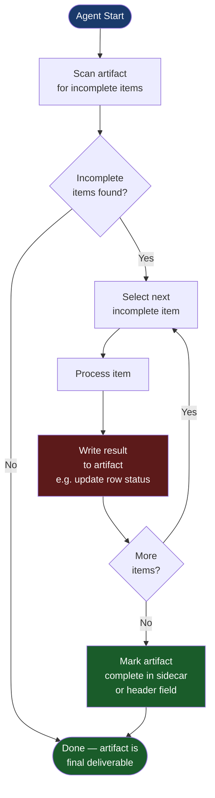

# Artifact State

**Family:** L — Memory & State
**Also known as:** File-as-State, Document State, Implicit State via Artifacts
**Related patterns:** [External Durable State](external-durable-state.md), [Checkpoint State](checkpoint-state.md), [Provenance-Tagged Memory](provenance-tagged-memory.md)

## Problem

An agent produces outputs — files, documents, reports, code — as part of its work. If state is tracked separately from these artifacts, they drift out of sync: the state store says "done" but the file is stale, or vice versa. Managing two parallel representations of progress is redundant and fragile. Meanwhile, the artifacts themselves contain everything needed to reconstruct progress, but are never consulted as a source of truth.

## Forces

- Produced artifacts are durable and already live outside the context window.
- Maintaining a separate state store synchronized with artifacts adds coordination overhead.
- The artifact is the deliverable; it is the most authoritative record of what was done.
- Reading artifact content to infer state is slower than reading a dedicated state field.
- Some artifact formats (structured files, databases, versioned docs) are richer state stores than a simple KV entry.

## Solution

Treat produced artifacts as the primary state carrier. The agent writes to the artifact (appends rows, updates fields, creates files) and reads from it to determine what has been done and what remains. The artifact is both the output and the progress tracker.

Structured artifacts work best: a CSV with a `status` column, a JSON file with per-item result fields, a database that is itself the deliverable, or a document with a completion checklist. The agent queries the artifact rather than maintaining a shadow state.

For unstructured artifacts (prose documents, images), a lightweight sidecar metadata file (e.g., `artifact-name.meta.json`) can carry status fields without polluting the artifact itself.

Key design choices:
- **Artifact schema doubles as state schema:** add status/result columns to the deliverable format.
- **Idempotent writes:** appending or upserting to the artifact must be safe on retry.
- **Agent startup:** scan the artifact to find incomplete items before doing any work.
- **Sidecar pattern:** when the artifact format cannot carry metadata, use a co-located sidecar file.

## Structure

<b>Artifact State — Data Flow</b>

## Implementation Notes

- **Best artifact formats for state:** SQLite files, CSV/TSV with status columns, JSON Lines (JSONL) with result fields, Excel workbooks with status columns.
- **Scan cost:** reading the whole artifact on startup can be expensive for large files; add an index or maintain a separate incomplete-item pointer.
- **Concurrent writes:** if multiple agents write to the same artifact, use file locking or a row-level lock. SQLite's WAL mode handles light concurrency; heavy concurrency needs a proper database (see [Shared-Memory Gateway](shared-memory-gateway.md)).
- **Sidecar pattern:** `report.csv` + `report.csv.meta.json` — keep the sidecar co-located and name it deterministically.
- **Failure mode — partial write:** a crash mid-write can corrupt the artifact. Use atomic writes (write to temp, rename) or transactional formats (SQLite).
- **Failure mode — format coupling:** changing the artifact schema mid-task invalidates the state encoded in earlier rows. Version the schema or migrate before resuming.
- **Cost tradeoff:** reading large artifacts on every startup is wasteful. Cache the last-processed position or use a lightweight index.

## Examples

**1. Bulk data extraction.** An agent processes a 50,000-row CSV of customer records. Each row has a `status` column (`pending`, `extracted`, `failed`). On each run, the agent queries rows where `status = pending`, processes them, and updates the column in place. The CSV is both the input manifest and the progress log.

**2. Multi-chapter document drafting.** An agent writes a technical specification. The document itself has a header table listing chapters with `[ ]` or `[x]` checkboxes. The agent reads the document, finds unchecked chapters, writes them, and checks them off. Another agent reviewing the document uses the same artifact.

**3. Code migration pipeline.** An agent migrates files from one framework to another. A `migration-manifest.json` lists every file with `{"path": "...", "status": "pending|migrated|skipped", "notes": "..."}`. The agent updates entries in place; the manifest is delivered to the team as part of the migration record.

## Consequences

### Benefits
- Eliminates synchronization between state store and artifact — they are the same thing.
- Artifact is self-describing; any agent (or human) can read it to understand current state.
- No additional infrastructure beyond wherever artifacts are stored.
- The deliverable inherently contains a full audit trail of what was processed.

### Liabilities
- Artifact formats are not always designed for state queries; adding status columns can feel unnatural.
- Concurrent write safety depends on the artifact format's locking capabilities.
- Large artifacts are expensive to scan on every startup.
- Unstructured artifacts (prose, images) require a sidecar, adding back the synchronization problem.

## Related Families

- **E — Context Engineering:** When the artifact is large, agents load only relevant sections into context (E patterns govern what to include).
- **F — Harness:** The harness manages artifact storage paths and lifetime; artifact state lives on the harness substrate.
- **I — Reliability:** Checkpointing (I) can snapshot artifact state at safe points to enable rollback without re-processing.
- **M — Observability:** Artifact version history (e.g., git log on a file) serves as an implicit audit trail covered by M patterns.

## Sources

- Anthropic Engineering — AI safety company; authors of Claude. [Building Effective Agents](https://www.anthropic.com/engineering/building-effective-agents)
- OpenAI Engineering — AI research company; defines persistent execution state and thread lifecycle as part of harness. [Unrolling the Codex Agent Loop](https://openai.com/index/unrolling-the-codex-agent-loop/)
- Microsoft Azure Architecture Center — Microsoft's cloud architecture team; particularly strong on external persistent state and context compaction between agents. [AI Agent Design Patterns](https://learn.microsoft.com/en-us/azure/architecture/ai-ml/guide/ai-agent-design-patterns)
