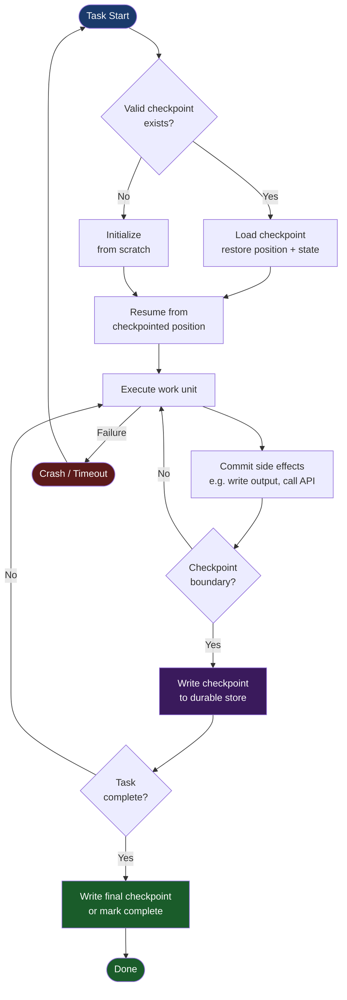

# Checkpoint State

**Family:** L — Memory & State
**Also known as:** Snapshot-and-Resume, Progress Checkpoint, Savepoint
**Related patterns:** [External Durable State](external-durable-state.md), [Artifact State](artifact-state.md), [State Machine](state-machine.md)

## Problem

A long-running agent task — processing thousands of items, executing a multi-step pipeline, or orchestrating multiple sub-agents — fails partway through due to a crash, timeout, quota exhaustion, or network error. Without a recovery mechanism, the entire task restarts from zero. Re-running completed work is expensive, slow, and sometimes impossible (e.g., if side effects were already applied or upstream data changed).

## Forces

- Long tasks have a higher probability of encountering at least one transient failure.
- Restarting from zero wastes time and money on already-completed work.
- Some steps have irreversible side effects; replaying them is harmful, not just wasteful.
- The agent must be able to determine what was done and what remains after a restart.
- Checkpoints add write overhead; too-frequent checkpointing can dominate task time.

## Solution

Identify safe points in the task — points where all work up to that point is complete and consistent — and write a snapshot of progress to durable storage at each one. On startup, the agent reads the latest valid checkpoint and resumes from there rather than from the beginning.

A checkpoint record contains:
- **Position:** which item, step, or phase was last completed.
- **Accumulated state:** partial results, counters, collected data needed for remaining steps.
- **Metadata:** timestamp, task ID, version of the task logic used.

Checkpoints are written *after* a unit of work completes and its side effects are committed — never before or during. This makes checkpoints consistent snapshots of real progress.

Key design choices:
- **Checkpoint granularity:** coarse (per phase) reduces write overhead; fine (per item) reduces re-work on restart. Choose based on step cost.
- **Checkpoint validity:** include a schema version; reject checkpoints written by incompatible task logic.
- **Cleanup:** delete superseded checkpoints to avoid unbounded storage growth.
- **Idempotency:** the work unit itself should be idempotent so that re-running a step after a missed checkpoint write is safe.

## Structure

<b>Checkpoint State — Execution and Recovery Flow</b>

## Implementation Notes

- **Write-after-commit, not before:** the checkpoint must be written only after all side effects for that unit are durably committed. A checkpoint that says "done" when the side effect hasn't landed is worse than no checkpoint.
- **Atomic checkpoint write:** use an atomic rename (write to temp file, rename) or a transactional store write to avoid a partially-written checkpoint being read on restart.
- **Checkpoint validation on load:** check schema version, task ID, and a checksum or hash before trusting a checkpoint.
- **Checkpoint granularity heuristic:** if a single work unit takes > 5 seconds or has expensive side effects, checkpoint after each one. If units are cheap, checkpoint every N units (e.g., every 100).
- **Failure mode — checkpoint lag:** if the agent checkpoints every 1000 items but fails at item 999, it re-does 999 items. Tune granularity to acceptable re-work cost.
- **Failure mode — corrupt checkpoint:** keep the previous checkpoint until the new one is verified. A two-checkpoint rolling window prevents a single bad write from blocking all recovery.
- **Cost tradeoff:** checkpoint writes add latency. Use asynchronous writes for low-cost checkpoints; use synchronous writes when correctness is critical.

## Examples

**1. Large-scale document processing.** An agent classifies 100,000 documents. It checkpoints every 500 documents: `{"last_processed_id": 12500, "counts": {"positive": 4100, "negative": 8400}}`. A crash at document 12,743 restarts from 12,500, not from 0.

**2. Multi-phase data pipeline.** A pipeline has phases: extract → transform → load. Each phase completion is a checkpoint. On failure during load, the agent resumes the load phase without re-running extract or transform.

**3. Agentic code refactor.** An agent refactors 200 files. After each file is written and the build passes, it appends the filename to a checkpoint log. On restart, it reads the log and skips already-refactored files.

## Consequences

### Benefits
- Drastically reduces re-work cost on failure for long tasks.
- Enables safe resumption across process restarts, timeouts, and quota resets.
- Prevents re-execution of irreversible side effects.
- Provides a natural audit trail of task progress.

### Liabilities
- Adds write overhead at checkpoint boundaries.
- Requires careful design to ensure checkpoints are consistent (written after, not during, a unit of work).
- Checkpoint storage must be managed (cleanup, versioning, validation).
- Idempotency of work units must be verified or enforced — not all operations are naturally idempotent.

## Related Families

- **E — Context Engineering:** On resume, only the state needed for the remaining steps is loaded into context; E patterns govern what to include from the checkpoint.
- **F — Harness:** The harness typically triggers checkpoint writes and manages checkpoint storage as part of the execution lifecycle.
- **I — Reliability:** Checkpoint State is the core mechanism for fault-tolerant resumption in I; I patterns add retry logic, failure classification, and escalation on top.
- **M — Observability:** Checkpoint timestamps and positions form a progress timeline visible in M dashboards.

## Sources

- Microsoft Azure Architecture Center — Microsoft's cloud architecture team; particularly strong on external persistent state and context compaction between agents. [AI Agent Design Patterns](https://learn.microsoft.com/en-us/azure/architecture/ai-ml/guide/ai-agent-design-patterns)
- OpenAI Engineering — AI research company; defines persistent execution state and thread lifecycle as part of harness. [Harness Engineering](https://openai.com/index/harness-engineering/) | [Unrolling the Codex Agent Loop](https://openai.com/index/unrolling-the-codex-agent-loop/)
- Anthropic Engineering — AI safety company; authors of Claude. [Building Effective Agents](https://www.anthropic.com/engineering/building-effective-agents)
