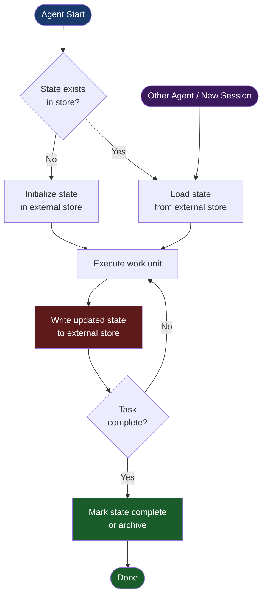

# External Durable State

**Family:** L — Memory & State
**Also known as:** Persistent State Store, External Memory, State Offloading
**Related patterns:** [Checkpoint State](checkpoint-state.md), [Shared-Memory Gateway](shared-memory-gateway.md), [Provenance-Tagged Memory](provenance-tagged-memory.md), [Artifact State](artifact-state.md)

## Problem

An agent running a long task accumulates state — partial results, tool outputs, decisions made, items processed — entirely inside the context window. When the session ends, the process restarts, or the context limit is approached, all of that state is lost or must be squeezed into an ever-growing prompt. The agent cannot resume where it left off, and other agents cannot access the state without receiving a full context dump.

## Forces

- Context windows are finite; long tasks produce more state than fits.
- Process restarts (crashes, timeouts, quota limits) destroy in-memory state.
- Multiple concurrent agents need to read and write shared state safely.
- Auditability requires that state changes be queryable after the fact.
- Passing full accumulated context to downstream agents is wasteful and often unnecessary.

## Solution

Write all meaningful agent state to an external store (relational database, key-value store, document store, or structured file) instead of — or in addition to — the context window. The agent reads from the store at startup to restore its position, writes updates after each significant step, and passes only a reference (an ID or pointer) rather than the full state to other agents or the next session.

The store is the source of truth. The context window is a working scratch space that is populated on demand from the store, not the reverse.

Key design choices:
- **Granularity:** Write after each logical unit of work, not after each token.
- **Schema:** Use a schema that matches the agent's task structure (rows for items processed, fields for decision outcomes).
- **Access pattern:** Agents query the store; they do not receive full dumps.
- **Cleanup:** Define a TTL or explicit deletion trigger; do not let state accumulate forever.

## Structure

<b>External Durable State — Data Flow</b>

## Implementation Notes

- **Idempotency:** Write operations should be upserts where possible. If the agent crashes mid-step and retries, re-writing the same state should be safe.
- **Serialization:** Use a schema that survives process restarts — avoid storing live object references or closures.
- **Read-before-write:** Always read current state before writing to avoid overwriting concurrent updates (use optimistic locking or versioned records).
- **Minimal context loading:** When resuming, load only the state fields needed for the next step, not the entire history.
- **Cost tradeoff:** External store reads/writes add latency (~1–10 ms for KV, ~5–50 ms for relational). Batch writes to amortize cost.
- **Failure mode — stale state:** If the store is not updated atomically with the work unit, a crash between work and write leaves a gap. Use transactional writes or idempotent retries.
- **Failure mode — schema drift:** As task logic evolves, old stored state may not match new schema. Version your state schema.

## Examples

**1. Multi-day research pipeline.** An agent processes 10,000 documents across multiple sessions. It stores `{doc_id, status: "pending|processed|failed", extracted_data}` in a database. Each session resumes by querying `status = pending LIMIT 100`.

**2. Multi-agent code review.** A coordinator agent writes per-file review tasks to a shared store. Reviewer sub-agents claim tasks (set `status = in_progress`), write findings, then set `status = done`. The coordinator reads all done records to synthesize the final report.

**3. Customer support workflow.** A support agent stores the full conversation history, tool results, and resolution state in a database keyed by ticket ID. Any agent instance that handles the ticket reads the same store and continues seamlessly after a timeout.

## Consequences

### Benefits
- State survives process restarts, crashes, and context resets.
- Multiple agents can share state without passing full context dumps.
- Historical state is queryable for auditing and debugging.
- Context window usage drops because only relevant fragments are loaded.

### Liabilities
- Adds infrastructure dependency (store must be available and consistent).
- Adds read/write latency to each work unit.
- Schema design is a new responsibility; poor schemas cause migration pain later.
- Requires careful access control to prevent agents from reading each other's state inappropriately (see [Session Isolation](session-isolation.md)).

## Related Families

- **E — Context Engineering:** External state reduces what must be injected into context; E patterns decide what to load from the store into the prompt.
- **F — Harness:** The harness typically owns the store connection and passes a handle to the agent; persistent task artifacts in F are a form of external state.
- **I — Reliability:** Checkpoint/resume patterns in I are the reliability-focused application of this pattern.
- **M — Observability:** State change events written to the store feed audit logs and traces in M.

## Sources

- Microsoft Azure Architecture Center — Microsoft's cloud architecture team; particularly strong on external persistent state and context compaction between agents. [AI Agent Design Patterns](https://learn.microsoft.com/en-us/azure/architecture/ai-ml/guide/ai-agent-design-patterns)
- Anthropic Engineering — AI safety company; authors of Claude. [Building Effective Agents](https://www.anthropic.com/engineering/building-effective-agents)
- AWS Prescriptive Guidance — Amazon Web Services architecture team; addresses shared memory and session isolation. [Agentic AI Patterns](https://docs.aws.amazon.com/prescriptive-guidance/latest/agentic-ai-patterns/agent-patterns.html)
