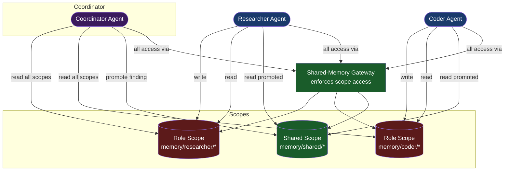

# Scoped Memory

**Family:** L — Memory & State
**Also known as:** Memory Partitioning, Role-Scoped Memory, Task-Scoped Memory
**Related patterns:** [Session Isolation](session-isolation.md), [Shared-Memory Gateway](shared-memory-gateway.md), [Summarized Memory](summarized-memory.md), [Provenance-Tagged Memory](provenance-tagged-memory.md)

## Problem

In a complex agent system, different agents, roles, or sub-tasks accumulate memory that is relevant only within their scope. When all memory is pooled globally, agents are exposed to information they should not have (security and privacy risk), confused by irrelevant context (accuracy degradation), or forced to carry the full memory burden of every sibling agent (context pressure). A general-purpose memory dump sent to every agent is both too much and too little: it overwhelms with noise while burying the signal each agent actually needs.

## Forces

- Agents operate most accurately when their context contains only information relevant to their role.
- Exposing all agents to all memory creates unnecessary security and privacy surface area.
- A bug in one agent should not corrupt memory used by unrelated agents.
- Different roles or tasks have different memory lifecycles: some are ephemeral, some long-lived.
- Over-partitioning creates coordination overhead when agents legitimately need shared state.

## Solution

Partition memory into scopes — bounded namespaces aligned to role, task, phase, or agent — and give each agent access only to the scopes it needs. Memory written by an agent lands in its scope; memory reads are filtered to that agent's authorized scopes. Cross-scope access is explicit and mediated.

Scope types commonly used:
- **Role scope:** `memory/researcher/*`, `memory/coder/*`, `memory/reviewer/*` — partitioned by agent role.
- **Task scope:** `memory/task/{task_id}/*` — partitioned by the unit of work.
- **Phase scope:** `memory/phase/{phase_name}/*` — partitioned by pipeline stage; earlier phases' memory is read-only to later phases.
- **Shared scope:** `memory/shared/*` — explicitly promoted, read-only for most agents.

Scope promotion is the controlled mechanism for moving information from a narrow scope to a broader one: a sub-agent writes a finding to its task scope, a coordinator promotes it to the shared scope after review.

## Structure

<b>Scoped Memory — Partition and Promotion Flow</b>

## Implementation Notes

- **Scope granularity tradeoff:** too-fine scopes create coordination overhead (every shared fact needs explicit promotion); too-coarse scopes recreate the global-memory problem. Start with role-level scopes and add task-level scopes only where isolation failures occur.
- **Scope lifecycle:** task scopes should be deleted when the task is complete. Role scopes persist for the agent's lifetime. Shared scopes persist for the session or longer.
- **Promotion gate:** the coordinator or an authorized agent must explicitly promote a finding from a narrow scope to a broader one. This is a natural human review point for high-stakes information.
- **Read vs. write access:** an agent may read from a broader scope (e.g., shared scope) without being able to write to it. Read-only access is a common and useful permission level.
- **Implementation via gateway:** enforce scope access in the [Shared-Memory Gateway](shared-memory-gateway.md) rather than by agent convention. The gateway validates the agent's identity against an access control list per scope.
- **Failure mode — scope creep:** agents request increasingly broad scope access over time to reduce the friction of cross-scope coordination. Audit scope access lists periodically; deny requests that don't have a documented justification.
- **Failure mode — stale promoted data:** a finding promoted to shared scope is not automatically updated when the source finding changes. Either re-promote on change or link to the source rather than copying.
- **Cost tradeoff:** scoping adds key-prefix overhead and access control checks. For high-throughput systems, batch access-control validation rather than checking per key.

## Examples

**1. Research-draft-review pipeline.** Three agents work sequentially. The researcher writes findings to `memory/researcher/findings/*`. The drafter reads the researcher scope (read-only) and writes drafts to `memory/drafter/sections/*`. The reviewer reads both scopes and writes comments to `memory/reviewer/comments/*`. A coordinator synthesizes by reading all three.

**2. Security-conscious multi-tenant analysis.** An agent analyzes financial data for multiple clients. Each client's data lives in `memory/client/{client_id}/*`. An analysis agent for client A is instantiated with access only to `memory/client/client-A/*`. The system cannot accidentally leak client B's data to client A's agent.

**3. Phased migration.** A migration pipeline has phases: plan, execute, verify. The plan phase writes to `memory/phase/plan/*`. The execute phase reads the plan scope (read-only) and writes execution logs to `memory/phase/execute/*`. The verify phase reads both but writes only to `memory/phase/verify/*`. Earlier phase data is immutable for later phases.

## Consequences

### Benefits
- Reduces context noise: agents receive only memory relevant to their role.
- Limits blast radius: a buggy or compromised agent damages only its own scope.
- Enforces information flow discipline: cross-scope sharing is explicit and auditable.
- Natural human review point: scope promotion is where a coordinator can inspect and approve information flow.

### Liabilities
- Requires upfront scope design; poor partitioning leads to either too-frequent promotions or too much pooling.
- Legitimate cross-scope coordination requires explicit promotion, adding latency and design work.
- Access control lists must be maintained and audited as agent roles evolve.
- Does not protect against a compromised gateway or a privileged coordinator agent.

## Related Families

- **E — Context Engineering:** Scoped memory reduces what must be loaded into context; E patterns then decide which scopes to include and how to compress them.
- **F — Harness:** The harness provisions scope namespaces at agent launch and tears them down at agent completion.
- **I — Reliability:** Scope boundaries limit failure propagation; a crashing agent's in-scope writes are isolated and do not corrupt sibling scopes.
- **M — Observability:** Scope access logs reveal unexpected cross-scope reads, which may indicate a security issue or a design flaw.

## Sources

- Microsoft Azure Architecture Center — Microsoft's cloud architecture team; particularly strong on external persistent state and context compaction between agents. [AI Agent Design Patterns](https://learn.microsoft.com/en-us/azure/architecture/ai-ml/guide/ai-agent-design-patterns)
- Anthropic Engineering — AI safety company; authors of Claude. [Effective Context Engineering for AI Agents](https://www.anthropic.com/engineering/effective-context-engineering-for-ai-agents) | [Building Effective Agents](https://www.anthropic.com/engineering/building-effective-agents)
- AWS Prescriptive Guidance — Amazon Web Services architecture team; addresses shared memory and session isolation. [Agentic AI Patterns](https://docs.aws.amazon.com/prescriptive-guidance/latest/agentic-ai-patterns/agent-patterns.html)
