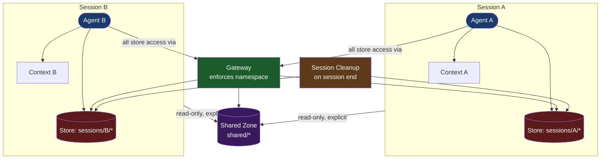

# Session Isolation

**Family:** L — Memory & State
**Also known as:** Tenant Isolation, Context Sandbox, Session Scope
**Related patterns:** [Scoped Memory](scoped-memory.md), [Shared-Memory Gateway](shared-memory-gateway.md), [External Durable State](external-durable-state.md)

## Problem

When multiple users, tenants, or concurrent sessions share the same agent infrastructure, one session's memory can leak into another. An agent initialized for user A reads context written by user B's previous session; a concurrent session's tool-call side effects appear in another session's state; a buggy agent writes to a global key that pollutes all future sessions. The result ranges from confusing wrong answers to serious privacy violations.

## Forces

- Agent infrastructure is expensive; multi-tenancy and session reuse are economically necessary.
- Users expect their sessions to be private — both in content and in behavioral influence.
- Shared state (caches, tool-call results, shared memory) is useful but dangerous without boundaries.
- Isolation mechanisms add overhead (namespacing, cleanup routines, storage per session).
- Incomplete cleanup of previous session state is a persistent source of subtle bugs.

## Solution

Assign every session a unique identifier and namespace all state under that identifier. No session reads or writes state outside its own namespace. Shared infrastructure (caches, tool-call results) is accessed through a gateway that enforces namespace boundaries. At session end, all session-scoped state is explicitly cleaned up or archived.

Isolation applies at every layer:
- **Context window:** the session's context is never shared with another session's agent process.
- **In-process memory:** any variables, caches, or buffers are scoped to the session object.
- **External store:** all keys are prefixed with `sessions/{session_id}/`; no agent accesses unprefixed keys.
- **Tool side effects:** tools that produce external side effects (file writes, API calls) are scoped to session-owned resources.

Cross-session sharing — where legitimately needed — goes through a controlled shared zone with explicit read-only access for sessions that need it.

## Structure

<b>Session Isolation — Namespace Boundaries</b>

## Implementation Notes

- **Session ID generation:** use a cryptographically random UUID. Never use user-supplied or predictable IDs as the sole namespace key.
- **Namespace enforcement:** enforce at the gateway or store layer, not just by agent convention. Convention-only enforcement fails when agents have bugs.
- **Shared zone governance:** the shared zone should be read-only for sessions. Only privileged processes (admin agents, post-session merges) write to the shared zone.
- **Session cleanup:** implement cleanup as a post-session hook, not as best-effort cleanup within the session. A session that crashes mid-task will not run cleanup inline. Use TTL-based expiry on the store as a fallback.
- **Cross-session contamination vectors to audit:**
  - In-process module-level state (singletons, global caches) shared across session threads.
  - Tool-call result caches keyed only on input content, not session ID.
  - Log aggregation that mixes session outputs without session ID tagging.
  - Model fine-tuning or context distillation that learns from one session's data and applies it globally.
- **Failure mode — orphaned state:** a session that crashes without cleanup leaves state in the store indefinitely. Apply store-level TTLs: `sessions/{id}/*` expires after N hours of inactivity.
- **Failure mode — namespace collision:** if session IDs are short or non-random, two sessions may share a prefix. Use full UUIDs and validate uniqueness at session creation.
- **Cost tradeoff:** per-session storage multiplies storage usage by the number of concurrent sessions. Use lazy initialization (create session namespace on first write) and aggressive TTLs.

## Examples

**1. Multi-tenant SaaS agent.** An agent platform serves hundreds of enterprise customers. Each customer's session is namespaced under their tenant ID and a session UUID. Tool calls write results to `sessions/{tenant}/{session}/tool_cache/`. A middleware layer validates that no cross-tenant key access occurs before committing any read or write.

**2. Parallel test execution.** An automated testing harness runs 20 agent sessions concurrently. Each session has its own namespace in the shared store. Test session A's writes to `sessions/test-run-7/` do not affect session B's reads from `sessions/test-run-8/`.

**3. Customer support agent.** A support agent handles one ticket per session. The session namespace holds the ticket's conversation history and tool results. When the ticket is resolved, session state is archived to the ticket record and the live namespace is deleted.

## Consequences

### Benefits
- Eliminates cross-session state contamination and privacy leakage.
- Makes session boundaries explicit and auditable.
- Enables safe multi-tenancy and concurrent session execution.
- Simplifies debugging: all state for a session lives in one namespace.

### Liabilities
- Adds namespacing overhead to every store operation.
- Requires a cleanup mechanism; cleanup failures leave orphaned state.
- Cross-session sharing — when legitimately needed — requires explicit design (shared zone), not ad-hoc global keys.
- Storage costs scale linearly with concurrent sessions unless TTLs and cleanup are well-tuned.

## Related Families

- **E — Context Engineering:** Session isolation ensures the context window is populated only from the correct session's state; E patterns then manage what within that scope to include.
- **F — Harness:** The harness creates and destroys sessions; it is responsible for generating session IDs and triggering cleanup hooks.
- **I — Reliability:** Session state that must survive agent crashes needs Checkpoint State (L) combined with isolation; isolation alone does not provide durability.
- **M — Observability:** Session IDs are the primary correlation key for traces, logs, and audit records in M.

## Sources

- AWS Prescriptive Guidance — Amazon Web Services architecture team; addresses shared memory and session isolation. [Agentic AI Patterns](https://docs.aws.amazon.com/prescriptive-guidance/latest/agentic-ai-patterns/agent-patterns.html)
- Microsoft Azure Architecture Center — Microsoft's cloud architecture team; particularly strong on external persistent state and context compaction between agents. [AI Agent Design Patterns](https://learn.microsoft.com/en-us/azure/architecture/ai-ml/guide/ai-agent-design-patterns)
- Anthropic Engineering — AI safety company; authors of Claude. [Effective Context Engineering for AI Agents](https://www.anthropic.com/engineering/effective-context-engineering-for-ai-agents)
