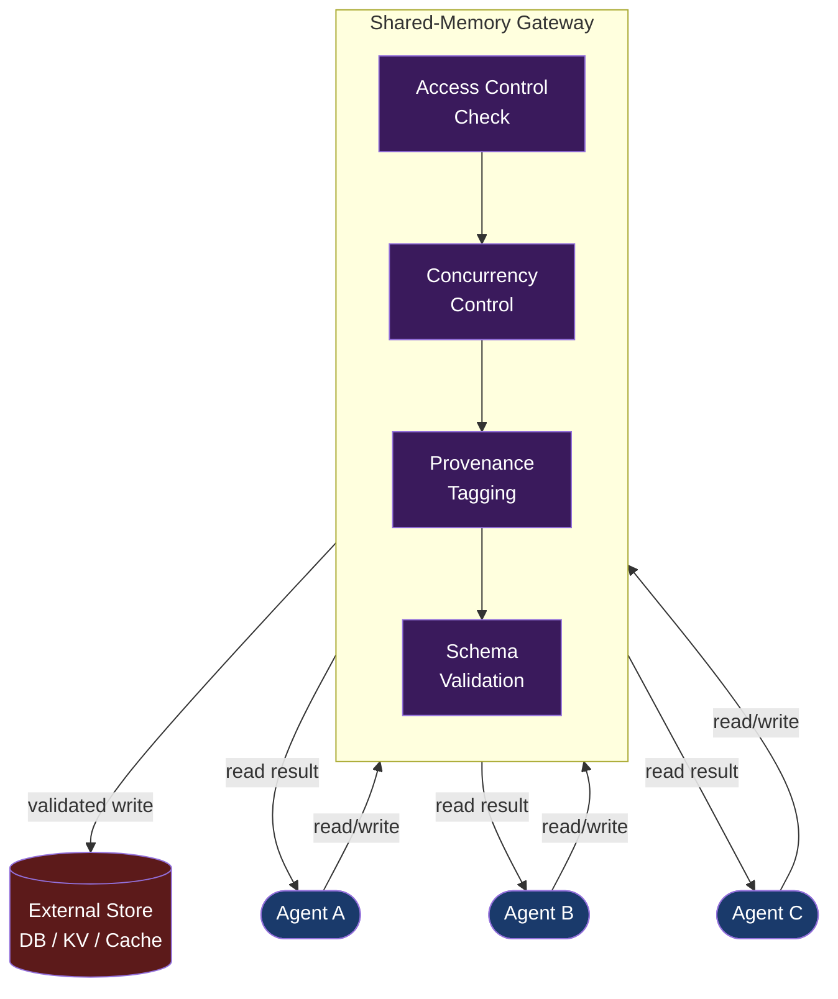

# Shared-Memory Gateway

**Family:** L — Memory & State
**Also known as:** Memory Bus, Shared State Interface, Centralized Memory Broker
**Related patterns:** [External Durable State](external-durable-state.md), [Session Isolation](session-isolation.md), [Scoped Memory](scoped-memory.md), [Provenance-Tagged Memory](provenance-tagged-memory.md)

## Problem

In a multi-agent system, several agents need to read from and write to shared state. Without a controlled access layer, agents read stale data, overwrite each other's work, produce inconsistent views of state, and make it impossible to audit who changed what. Direct database access by every agent creates an uncontrolled shared mutable state problem — the distributed systems equivalent of a global variable.

## Forces

- Multiple agents running concurrently need a consistent view of shared state.
- Concurrent writes without coordination produce lost updates, dirty reads, or race conditions.
- Each agent should access only the state it is authorized to read or write.
- State changes must be auditable: who changed what, when, and why.
- The access interface should be stable so agents do not need to know the underlying storage technology.

## Solution

Introduce a single gateway service (or module) that all agents use to read and write shared memory. No agent accesses the underlying store directly. The gateway enforces:

- **Access control:** each agent has a declared scope of readable and writable keys.
- **Concurrency control:** reads are consistent; writes use optimistic locking, CAS (compare-and-swap), or serialized queues.
- **Provenance:** every write is tagged with the writing agent's identity and a timestamp.
- **Schema enforcement:** the gateway validates writes against a declared schema before committing.

The gateway exposes a narrow interface: `read(key, agent_id)`, `write(key, value, agent_id)`, `list(prefix, agent_id)`, `watch(key, agent_id)` (optional, for reactive agents). The underlying store — Redis, a relational DB, a document store — is an implementation detail hidden behind the gateway.

## Structure

<b>Shared-Memory Gateway — Multi-Agent Access Pattern</b>

## Implementation Notes

- **Gateway granularity:** the gateway can be a standalone microservice, a shared library module, or a thin wrapper around a database connection. A library module is lowest latency; a service adds network cost but enables centralized enforcement.
- **Concurrency control strategy:**
  - *Optimistic locking:* read returns a version token; write includes the token and fails if the record changed since the read. Good for low-contention keys.
  - *Pessimistic locking:* gateway holds a lock for the duration of a read-modify-write. Good for high-contention keys but risks deadlock.
  - *CAS (compare-and-swap):* atomic operation in the store (Redis `SET NX`, database `UPDATE WHERE version = N`).
- **Access control granularity:** key-level is more precise but harder to manage; prefix-level (agent A owns `tasks/*`, agent B owns `results/*`) is practical for most systems.
- **Watch / reactive pattern:** some gateways support `watch(key)` so agents are notified when a key changes, enabling event-driven coordination without polling.
- **Failure mode — gateway bottleneck:** all agents serialize through the gateway. Use read replicas for read-heavy workloads; partition the keyspace to allow parallel writes.
- **Failure mode — partial write visibility:** an agent reads state after another agent's write is partially committed. Use write-ahead logging or transactions to ensure atomicity before the gateway makes a write visible.
- **Cost tradeoff:** every memory access incurs a network round-trip to the gateway. Batch reads where possible; cache frequently-read stable keys locally with a short TTL.

## Examples

**1. Orchestrator + worker agents.** An orchestrator assigns tasks to worker agents via the gateway (`tasks/{id}/status = "assigned"`). Workers write results back (`tasks/{id}/result = ...`). The orchestrator watches for all tasks reaching `status = done`. No agent talks to another directly.

**2. Collaborative document editing.** Three agents (outline, drafter, reviewer) work on the same document. The gateway owns `doc/outline`, `doc/sections/{n}`, `doc/review_notes`. Each agent writes only to its declared prefix. The gateway rejects a reviewer write to `doc/sections/*`.

**3. Shared tool-call cache.** Multiple parallel agents may invoke the same expensive tool. The gateway holds a cache of `tool_results/{hash}`. Before calling the tool, agents read from the gateway; on cache miss they call the tool and write the result back for others to reuse.

## Consequences

### Benefits
- Eliminates race conditions and lost updates in multi-agent state.
- Enforces access boundaries between agents without requiring inter-agent trust.
- Centralizes provenance tracking — one place to audit all state changes.
- Decouples agents from the underlying storage technology.

### Liabilities
- Gateway is a single point of failure; its availability determines the whole system's availability.
- Adds latency to every memory access.
- Gateway becomes a bottleneck under high concurrency without careful partitioning.
- Access control configuration is a new operational burden.

## Related Families

- **E — Context Engineering:** Agents load state from the gateway into their context window; E patterns determine what to include and how to compress it.
- **F — Harness:** The harness often hosts or provisions the gateway; it may inject gateway credentials into agents at launch.
- **I — Reliability:** The gateway itself needs redundancy (I patterns); a gateway failure must not permanently lose in-flight state.
- **M — Observability:** The gateway's write log is a primary source for M audit traces and state-change timelines.

## Sources

- Microsoft Azure Architecture Center — Microsoft's cloud architecture team; particularly strong on external persistent state and context compaction between agents. [AI Agent Design Patterns](https://learn.microsoft.com/en-us/azure/architecture/ai-ml/guide/ai-agent-design-patterns)
- AWS Prescriptive Guidance — Amazon Web Services architecture team; addresses shared memory and session isolation. [Agentic AI Patterns](https://docs.aws.amazon.com/prescriptive-guidance/latest/agentic-ai-patterns/agent-patterns.html)
- Google Cloud Architecture Center — Google's cloud architecture team. [Choose a Design Pattern for Agentic AI](https://docs.cloud.google.com/architecture/choose-design-pattern-agentic-ai-system)
