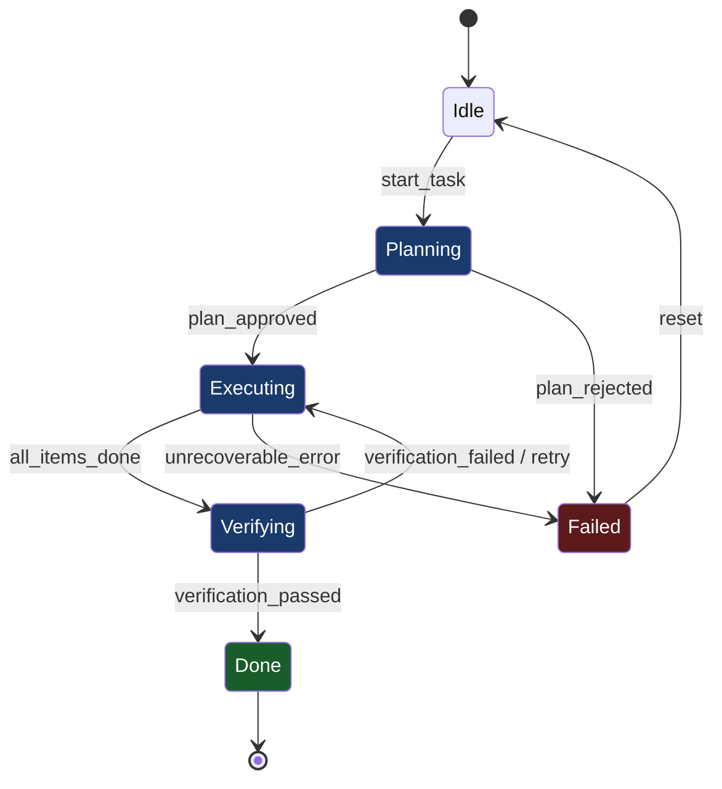

# State Machine

**Family:** L — Memory & State
**Also known as:** Explicit Agent State, Finite State Agent, Workflow State
**Related patterns:** [External Durable State](external-durable-state.md), [Checkpoint State](checkpoint-state.md), [Provenance-Tagged Memory](provenance-tagged-memory.md)

## Problem

An agent executing a multi-step task implicitly tracks where it is by what it most recently did — relying on conversational context or informal conventions to know whether it is in the "planning" stage, the "executing" stage, or the "verifying" stage. This implicit state is fragile: it cannot be inspected from outside, it does not survive a restart, it allows invalid transitions (e.g., jumping from planning directly to verification), and it makes it impossible to enforce invariants about what actions are legal at each stage. The result is agents that get stuck in loops, skip steps, or take actions that are only valid in a different stage.

## Forces

- Agent tasks with multiple stages need to know which stage is current without relying on conversational memory.
- Invalid stage transitions (e.g., executing before planning completes) cause hard-to-debug failures.
- Human oversight is easier when agent state is explicit and queryable.
- State must survive process restarts; conversational implicit state does not.
- Over-formalized state machines become rigid and require engineering effort to extend.

## Solution

Model the agent's progress as an explicit finite state machine: a finite set of named states and a defined set of legal transitions between them. The current state is stored in durable storage (or at minimum in a named variable that is checkpointed). Every action the agent can take is associated with one or more valid source states; the agent checks its current state before acting and updates the state after each transition.

State machine components:
- **States:** named stages of the task (e.g., `idle`, `planning`, `executing`, `verifying`, `done`, `failed`).
- **Transitions:** defined pairs `(from_state, event) → to_state`. Only defined transitions are legal.
- **Actions:** work performed within a state before transitioning.
- **Guards:** conditions that must hold for a transition to fire (e.g., "all items processed before transitioning to `verifying`").
- **State store:** the current state is persisted so it survives restarts (see [External Durable State](external-durable-state.md)).

The state machine does not replace the agent's reasoning — it structures which reasoning is invoked and when.

## Structure

<details>
<summary><b>State Machine — Agent Lifecycle States and Transitions</b></summary>



</details>

## Implementation Notes

**Pseudocode — state machine wiring:**

```
# State definitions
STATES = {idle, planning, executing, verifying, done, failed}
TRANSITIONS = {
  (idle, start_task)         -> planning,
  (planning, plan_approved)  -> executing,
  (planning, plan_rejected)  -> failed,
  (executing, all_done)      -> verifying,
  (executing, fatal_error)   -> failed,
  (verifying, passed)        -> done,
  (verifying, failed)        -> executing,  # retry
  (failed, reset)            -> idle
}

function transition(current_state, event):
  key = (current_state, event)
  if key not in TRANSITIONS:
    raise InvalidTransitionError(current_state, event)
  next_state = TRANSITIONS[key]
  persist_state(next_state)          # write to durable store
  emit_event(current_state, event, next_state)  # for observability
  return next_state

function agent_loop():
  state = load_state() or idle       # resume from durable store
  while state not in {done, failed}:
    action = select_action_for(state)
    event = execute_action(action)
    state = transition(state, event)
```

- **Persist state atomically:** write the new state to the store before returning from `transition`. A crash between action completion and state write is safe only if actions are idempotent.
- **Guard conditions:** implement guards in `select_action_for()` — the agent checks preconditions before executing an action, not inside the state machine itself.
- **State store:** store state in [External Durable State](external-durable-state.md) for cross-session durability. For short-lived tasks, an in-memory store with checkpoint-on-transition is sufficient.
- **Failure mode — invalid transition:** log the attempted transition and the event that triggered it. Transition errors reveal logic bugs in the action layer (an action fired the wrong event).
- **Failure mode — stuck state:** an agent reaches a state and no event fires to advance it. Add a timeout transition to `failed` for every non-terminal state; a stuck agent should fail explicitly rather than hang silently.
- **Extension:** when the state machine needs new states, add them as new transition entries. Do not modify existing transition logic — treat transitions as append-only.
- **Cost tradeoff:** state machine overhead is a single dictionary lookup and a store write per transition — negligible compared to agent inference cost.

## Examples

**1. Code review agent.** States: `queued → fetching_diff → analyzing → commenting → done`. The agent cannot transition to `commenting` without completing `analyzing`. If `fetching_diff` fails, it transitions to `failed` rather than silently proceeding with no diff.

**2. Data ingestion pipeline.** States: `idle → validating_schema → transforming → loading → verifying_load → done`. A verification failure transitions back to `transforming` (with a retry counter guard). After 3 retries, it transitions to `failed`.

**3. Customer escalation workflow.** States: `new → triaging → awaiting_customer → escalated → resolved`. Each state has a defined timeout transition to `escalated` if no action is taken. The state machine is stored in the CRM; any agent picking up the ticket reads the current state and knows exactly what actions are valid.

## Consequences

### Benefits
- Makes agent progress inspectable and queryable from outside the agent.
- Prevents invalid stage transitions and the bugs they cause.
- Survives process restarts when state is persisted durably.
- Provides natural human oversight points at state transitions.
- Simplifies testing: each state and transition can be tested independently.

### Liabilities
- Requires upfront design of states and transitions; over-engineering produces rigid machines that are hard to extend.
- Does not replace the agent's reasoning about *how* to act within a state — only *when* and *whether* to act.
- Stuck-state detection requires explicit timeout transitions, adding design surface area.
- State machine logic and agent prompt logic can drift out of sync if not co-maintained.

## Related Families

- **E — Context Engineering:** The current state is injected into context at each step, telling the agent which role and constraints apply; E patterns govern how to include it efficiently.
- **F — Harness:** The harness can host the state machine, invoking the appropriate agent prompt and tools for each state and managing transition logic externally.
- **I — Reliability:** The state machine's `failed` state and its reset/retry transitions are the reliability mechanism; I patterns add exponential backoff, dead-letter queues, and alerting on top.
- **M — Observability:** Every state transition emits an event that feeds M dashboards and audit logs, producing a complete timeline of agent progress.

## Sources

- Microsoft Azure Architecture Center — Microsoft's cloud architecture team; particularly strong on external persistent state and context compaction between agents. [AI Agent Design Patterns](https://learn.microsoft.com/en-us/azure/architecture/ai-ml/guide/ai-agent-design-patterns)
- OpenAI Engineering — AI research company; defines persistent execution state and thread lifecycle as part of harness. [Harness Engineering](https://openai.com/index/harness-engineering/)
- Google Cloud Architecture Center — Google's cloud architecture team. [Choose a Design Pattern for Agentic AI](https://docs.cloud.google.com/architecture/choose-design-pattern-agentic-ai-system)
