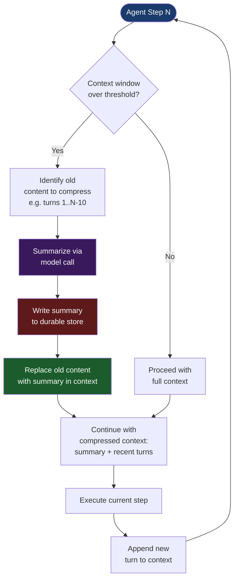

# Summarized Memory

**Family:** L — Memory & State
**Also known as:** Context Compression, Rolling Summary, Memory Distillation
**Related patterns:** [Scoped Memory](scoped-memory.md), [External Durable State](external-durable-state.md), [Provenance-Tagged Memory](provenance-tagged-memory.md)

## Problem

A long-running agent task accumulates conversation history, tool outputs, and intermediate results that together grow larger than what can usefully fit in a context window. Naively appending all history causes the context window to fill up, forcing either truncation (losing the oldest — often most important — context) or model errors. The agent needs to remember what happened across many steps, but cannot afford to carry the full verbatim record forward.

## Forces

- Context windows are finite; verbatim history grows without bound.
- Truncating old context destroys information that may still be relevant.
- Passing the full accumulated context to downstream agents is wasteful when most of it is not needed.
- Summaries lose fidelity; over-compressed summaries cause agents to forget critical details.
- The cost of inference grows with context length; large contexts increase latency and token cost.

## Solution

Periodically compress older portions of context into a shorter summary, replacing the verbatim content with the summary while preserving the key facts, decisions, and findings. The summary is written to a persistent store and injected at the top of the context window on each new step, while only the most recent verbatim history is appended below it.

The summarization trigger can be:
- **Size-based:** when context exceeds N tokens, summarize everything older than the last M turns.
- **Phase-based:** at the end of each phase, summarize the phase's work before starting the next.
- **Time-based:** after N steps, regardless of token count.

The summarization itself is performed by a model call (a secondary, cheaper model is often sufficient). The summary is stored in [External Durable State](external-durable-state.md) alongside the raw history for auditability.

Key design choices:
- **What to preserve verbatim:** the most recent turns (where reasoning is ongoing), tool call results that will be re-referenced, and any artifact contents the agent is actively editing.
- **What to summarize:** resolved questions, completed sub-tasks, context that provided background but is no longer active.
- **Summary format:** structured summaries (bulleted lists of decisions, findings, open items) are more reliable than prose for agent consumption.

## Structure

<b>Summarized Memory — Rolling Compression Flow</b>

## Implementation Notes

- **Summary quality:** instruct the summarizer to preserve: decisions made and their rationale, open questions and blockers, key findings with their source, and the current task state. Omit: conversational pleasantries, repeated attempts at the same action, and intermediate reasoning that was discarded.
- **Summarizer model:** a smaller, cheaper model (e.g., a faster distilled model) is usually sufficient for summarization. Reserve the full-capability model for the main task.
- **Preserve raw history:** always write the verbatim content to durable storage before replacing it with a summary. The summary is a lossy compression; raw history enables auditability and re-summarization at higher fidelity if needed.
- **Incremental vs. full resummary:** incremental summarization (summarize only the new batch of turns) is cheaper; full resummary (re-summarize everything from raw history) produces a more coherent summary. Full resummary is worth the cost at major phase transitions.
- **Failure mode — over-compression:** a summary that omits a critical fact causes the agent to lose track of a constraint or decision. Mitigate with structured summary formats that explicitly list open items and constraints.
- **Failure mode — summary hallucination:** the summarizing model invents facts not present in the original. Mitigate by using lower temperature for the summarizer and by keeping summaries shorter with explicit grounding instructions.
- **Cross-agent use:** when passing context to a sub-agent, do not pass the full raw history. Pass only the current summary plus the most recent verbatim turns. This is the key insight from Microsoft: do not pass accumulated context if the next agent does not need it.
- **Cost tradeoff:** summarization adds a model call per compression event, but saves tokens on all subsequent steps. Break-even is typically within 3–5 steps after summarization.

## Examples

**1. Long research conversation.** An agent has conducted 40 turns of a deep research task. The context is approaching the window limit. The system triggers a summarization: turns 1–30 are compressed into a 500-token structured summary listing key findings, sources consulted, and open questions. Turns 31–40 remain verbatim. The agent continues with ~1000 tokens of context instead of 8000.

**2. Multi-phase pipeline handoff.** A planning agent completes its work and hands off to an execution agent. Rather than passing the full planning conversation, the system summarizes the planning phase into a structured brief: decisions, constraints, and the resulting plan. The execution agent receives only the brief plus the plan artifact.

**3. Customer support session.** A support session spans multiple agent interactions over several hours. After each resolved sub-issue, the system summarizes the resolution and appends it to a running session summary. The active context window always contains the full summary plus the current interaction, never the full session history.

## Consequences

### Benefits
- Extends the effective memory of an agent beyond the context window limit.
- Reduces token cost and latency on each step after compression.
- Produces clean, structured handoff documents for downstream agents or human review.
- Raw history is preserved for auditability even as context is compressed.

### Liabilities
- Summaries are lossy; facts not in the summary are effectively forgotten by the agent.
- Summarization adds a model call and latency at compression events.
- Summary hallucination is a real risk that requires mitigation.
- The choice of what to summarize vs. preserve verbatim requires careful calibration per task type.

## Related Families

- **E — Context Engineering:** Summarized Memory is a dynamic form of context management; E patterns address static context construction, while this pattern handles growing context mid-task.
- **F — Harness:** The harness can trigger summarization automatically at context thresholds, abstracting the mechanism from the agent itself.
- **I — Reliability:** If a summarization model call fails, the agent must have a fallback (truncate with warning, retry with simpler prompt). I patterns govern this failure path.
- **M — Observability:** Storing raw history alongside summaries enables M-layer auditing that compares what the agent "remembers" (summary) against what actually happened (raw).

## Sources

- Anthropic Engineering — AI safety company; authors of Claude. [Effective Context Engineering for AI Agents](https://www.anthropic.com/engineering/effective-context-engineering-for-ai-agents) | [Building Effective Agents](https://www.anthropic.com/engineering/building-effective-agents)
- Microsoft Azure Architecture Center — Microsoft's cloud architecture team; particularly strong on external persistent state and context compaction between agents. [AI Agent Design Patterns](https://learn.microsoft.com/en-us/azure/architecture/ai-ml/guide/ai-agent-design-patterns)
- OpenAI Engineering — AI research company; defines persistent execution state and thread lifecycle as part of harness. [Unrolling the Codex Agent Loop](https://openai.com/index/unrolling-the-codex-agent-loop/)
