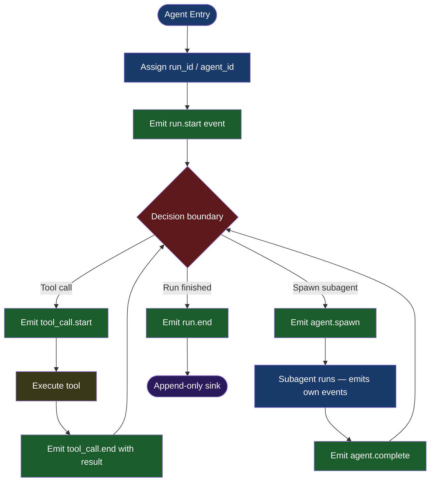

# M01 — Structured Trace

## Intent
Emit a structured, machine-readable event at every decision boundary so a run can be fully reconstructed from its log.

## Context
An agent system is in operation. It makes decisions, calls tools, spawns subagents, and produces artifacts. Without instrumentation, the only record of a run is the final output — or an unstructured wall of text logs.

## Problem
When a run fails, developers open the logs and find either silence or an undifferentiated stream of print statements. There is no way to answer: "What decision did the agent make at step 7, and what inputs drove it?" Without structured events at decision boundaries, every failure investigation starts from zero.

**Without this pattern:** A multi-step agent fails on step 12 of 20. The log shows the final error. Steps 1–11 are either invisible or mixed into stdout noise. Developers cannot determine which prior decision caused the failure, nor reproduce the state at failure time.

## Solution
At every decision boundary — agent invocation, tool call, branch selection, subagent spawn, artifact write — emit a structured event object. The event must include at minimum:

```
event:
  run_id:       string       # stable ID for the full run (see M04)
  agent_id:     string       # ID of the emitting agent node
  event_type:   string       # e.g. "decision", "tool_call", "spawn", "complete"
  step:         integer      # monotonic counter within the agent's own scope
  timestamp:    ISO-8601
  payload:      object       # event-type-specific fields
  status:       "ok" | "error" | "skipped"
```

Emit to an append-only sink (file, queue, or structured logger). Never mutate emitted events.

## Structure

<details>
<summary><b>Structured Trace — Event Flow</b></summary>



</details>

| Event Type | When Emitted | Key Payload Fields |
|---|---|---|
| `run.start` | Harness entry | `prompt`, `model`, `tool_definitions` |
| `decision` | Agent selects next action | `reasoning_summary`, `chosen_action` |
| `tool_call.start` | Before tool invocation | `tool_name`, `arguments` |
| `tool_call.end` | After tool returns | `result_summary`, `latency_ms`, `error` |
| `agent.spawn` | Parent spawns subagent | `child_agent_id`, `prompt` |
| `agent.complete` | Agent finishes | `output_summary`, `step_count` |
| `run.end` | Harness exit | `final_status`, `wall_time_ms` |

## Implementation Notes
- **Sync vs async emission:** Emit synchronously for critical events (`run.start`, `run.end`, errors); async buffered writes are acceptable for high-frequency events like `tool_call.start/end`.
- **Storage backend:** Append-only file (JSONL) is the minimal viable option. Add a structured log aggregator (e.g., OpenTelemetry collector) for multi-agent or distributed systems.
- **Sampling:** Do not sample at the trace level — drop only high-volume metadata fields (e.g., full tool response bodies). Keep the event skeleton intact for every event.
- **Secrets:** Scrub secrets from `arguments` and `result_summary` fields before emission. Never log API keys, tokens, or PII.
- **Minimal viable implementation:** `run_id` + `event_type` + `timestamp` + `status` on every event. Everything else is additive.

## Consequences
### Benefits
- Any failure can be reconstructed from the log without re-running.
- Decision points are identifiable and auditable.
- Downstream patterns (M02–M09) all build on this structured foundation.
- Enables cross-run comparison and trend analysis.

### Liabilities
- Adds latency at every decision boundary if emission is synchronous.
- Log volume grows with agent complexity; storage cost is non-trivial at scale.
- Schema must be kept stable — schema changes break log parsers and dashboards.
- Developers must discipline themselves to add new event types consistently.

## Related Patterns
- [M02 — Tool-Call Event Log](M02-tool-call-event-log.md) — specializes `tool_call.*` events from this pattern
- [M03 — Execution Tree](M03-execution-tree.md) — builds the agent hierarchy from `agent.spawn` / `agent.complete` events
- [M04 — Instrumented Handoff](M04-instrumented-handoff.md) — propagates `run_id` across agent boundaries
- [M08 — Trace-Linked Eval](M08-trace-linked-eval.md) — attaches eval results to events emitted here
- [Family F — Harness](../../F-harness-environment/README.md) — the harness is where `run_id` is assigned and `run.start` / `run.end` are emitted

## Example

```
// Minimal JSONL trace for a two-step run

{"run_id":"r-4f2a","agent_id":"root","event_type":"run.start","step":0,"timestamp":"2026-08-24T10:00:00Z","status":"ok","payload":{"model":"claude-sonnet","tool_count":5}}
{"run_id":"r-4f2a","agent_id":"root","event_type":"tool_call.start","step":1,"timestamp":"2026-08-24T10:00:01Z","status":"ok","payload":{"tool_name":"read_file","arguments":{"path":"/src/main.py"}}}
{"run_id":"r-4f2a","agent_id":"root","event_type":"tool_call.end","step":1,"timestamp":"2026-08-24T10:00:01Z","status":"ok","payload":{"latency_ms":42,"result_summary":"2048 bytes read"}}
{"run_id":"r-4f2a","agent_id":"root","event_type":"agent.spawn","step":2,"timestamp":"2026-08-24T10:00:02Z","status":"ok","payload":{"child_agent_id":"sub-7b1c","prompt":"Analyze the file for issues"}}
{"run_id":"r-4f2a","agent_id":"sub-7b1c","event_type":"agent.complete","step":3,"timestamp":"2026-08-24T10:00:08Z","status":"ok","payload":{"output_summary":"Found 2 issues","step_count":4}}
{"run_id":"r-4f2a","agent_id":"root","event_type":"run.end","step":4,"timestamp":"2026-08-24T10:00:09Z","status":"ok","payload":{"final_status":"success","wall_time_ms":9000}}
```

## Sources
- **Hamel Husain & Shreya Shankar** — independent ML practitioners and leading voices on LLM evaluation and trace-driven debugging. [Why Error Analysis Matters](https://hamel.dev/blog/posts/evals-faq/why-is-error-analysis-so-important-in-llm-evals-and-how-is-it-performed.html)
- **Microsoft Azure Architecture Center** — Microsoft's cloud architecture team, which stresses instrumenting every agent operation and handoff. [AI Agent Design Patterns](https://learn.microsoft.com/en-us/azure/architecture/ai-ml/guide/ai-agent-design-patterns)
- **OpenAI Engineering** — AI research company; observability is a core component of their harness engineering. [Harness Engineering](https://openai.com/index/harness-engineering/)
