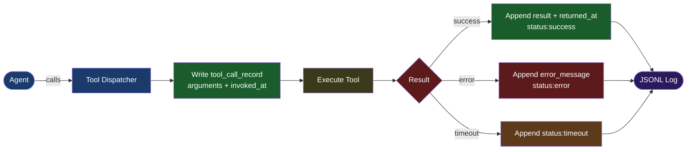

# M02 — Tool-Call Event Log

## Intent
Record every tool invocation and its result verbatim so the exact sequence of actions an agent took can be audited without re-running.

## Context
An agent is executing a task using a set of tools (file reads, web fetches, code execution, API calls, etc.). The agent may call dozens of tools in a single run. Structured traces (M01) are in place, but tool calls need their own dedicated log with full fidelity — arguments and responses captured verbatim.

## Problem
Structured traces record that a tool was called and whether it succeeded. But when debugging, the trace summary is not enough: developers need to know exactly what arguments were passed and exactly what the tool returned. Without verbatim capture, questions like "Did the agent read the right file?" or "What did the search API actually return?" cannot be answered from logs alone.

**Without this pattern:** An agent produces a wrong answer. The trace shows `tool_call.end status:ok`. Without the verbatim response, developers cannot tell whether the tool returned correct data that the agent misinterpreted, or whether the tool returned subtly wrong data that caused the error downstream.

## Solution
Maintain a dedicated, append-only tool-call log that records each invocation as a complete record:

```
tool_call_record:
  run_id:           string
  agent_id:         string
  call_id:          string       # unique per invocation
  step:             integer
  tool_name:        string
  arguments:        object       # full args, secrets redacted
  invoked_at:       ISO-8601
  returned_at:      ISO-8601
  latency_ms:       integer
  status:           "success" | "error" | "timeout"
  result:           object       # verbatim response (or truncated with truncated:true flag)
  error_message:    string|null
  truncated:        boolean
```

Store as append-only JSONL. Never modify a record after it is written.

## Structure

<details>
<summary><b>Tool-Call Event Log — Capture Flow</b></summary>



</details>

| Field | Fidelity Level | Notes |
|---|---|---|
| `tool_name` | Always exact | Never alias |
| `arguments` | Verbatim, secrets redacted | Flag redacted fields |
| `result` | Verbatim up to size limit | Set `truncated:true` if cut |
| `latency_ms` | Measured wall time | Dispatcher-side, not agent-side |
| `error_message` | Verbatim from tool | Include stack trace if available |

## Implementation Notes
- **Verbatim vs summary:** Capture the full result by default. Apply a size cap (e.g. 64 KB per record) and set `truncated:true` when exceeded. Never silently truncate.
- **Two-phase write:** Write the record with arguments before the tool executes, then update it with the result. This ensures a record exists even if the process crashes mid-call.
- **Secrets:** Identify secret-bearing argument keys (API keys, tokens, passwords) and replace values with `"[REDACTED]"` before writing. Maintain a redaction manifest so reviewers know what was scrubbed.
- **Idempotency:** Assign `call_id` before dispatch so the record can be correlated even if the tool call is retried.
- **Minimal viable implementation:** `tool_name` + `arguments` + `status` + `result` (truncated at 4 KB) per call. Latency and two-phase writes are additive.

## Consequences
### Benefits
- Answers "what did the agent actually do?" — the first question in any debug session.
- Enables detection of tool misuse: wrong arguments, unexpected response shapes, repeated identical calls.
- Provides ground truth for tool-level latency profiling.
- Feeds M07 Replayable Run: frozen tool responses come from this log.

### Liabilities
- Log volume is high; verbatim responses from large tools (file reads, search results) consume significant storage.
- Truncated results lose information exactly when it is most needed (large responses are often the interesting ones).
- Secret redaction must be maintained as new tools are added; gaps expose credentials.

## Related Patterns
- [M01 — Structured Trace](M01-structured-trace.md) — M02 specializes the `tool_call.*` events defined there
- [M03 — Execution Tree](M03-execution-tree.md) — the tree uses tool-call counts per node for anomaly detection
- [M07 — Replayable Run](M07-replayable-run.md) — frozen tool responses for replay come from this log
- [M09 — Failure Categorization](M09-failure-categorization.md) — tool errors are the primary input to failure classification
- [Family F — Harness](../F-harness/README.md) — the harness owns the tool dispatcher where interception occurs

## Example

```
// Two tool calls: one success, one error

{
  "run_id": "r-4f2a",
  "agent_id": "root",
  "call_id": "tc-001",
  "step": 1,
  "tool_name": "read_file",
  "arguments": {"path": "/workspace/main.py"},
  "invoked_at": "2026-08-24T10:00:01.000Z",
  "returned_at": "2026-08-24T10:00:01.042Z",
  "latency_ms": 42,
  "status": "success",
  "result": {"content": "def main():\n    pass\n", "size_bytes": 512},
  "error_message": null,
  "truncated": false
}

{
  "run_id": "r-4f2a",
  "agent_id": "root",
  "call_id": "tc-002",
  "step": 3,
  "tool_name": "bash",
  "arguments": {"command": "pytest tests/"},
  "invoked_at": "2026-08-24T10:00:05.000Z",
  "returned_at": "2026-08-24T10:00:35.021Z",
  "latency_ms": 30021,
  "status": "error",
  "result": null,
  "error_message": "Process exited with code 1: ModuleNotFoundError: No module named 'src'",
  "truncated": false
}
```

## Sources
- **OpenAI Engineering** — AI research company; tool-call logging is a core component of their agent harness. [Unrolling the Codex Agent Loop](https://openai.com/index/unrolling-the-codex-agent-loop/) | [Harness Engineering](https://openai.com/index/harness-engineering/)
- **Hamel Husain & Shreya Shankar** — independent ML practitioners and leading voices on LLM evaluation and trace-driven debugging. [Evals Skills for Coding Agents](https://hamel.dev/blog/posts/evals-skills/)
- **Anthropic Engineering** — AI safety company; agent evals depend on reconstructing the exact sequence of tool calls. [Demystifying Evals for AI Agents](https://www.anthropic.com/engineering/demystifying-evals-for-ai-agents)
