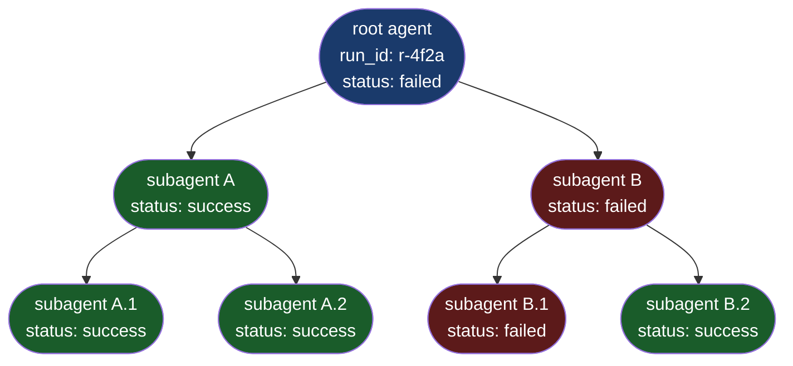

# M03 — Agent/Subagent Execution Tree

## Intent
Build a hierarchical tree of every agent spawn and completion so a failed run can be isolated to a single branch without replaying the whole system.

## Context
A multi-agent system spawns subagents to handle parallel or specialized tasks. Each subagent may itself spawn further subagents. The system has structured traces (M01) and a tool-call log (M02) in place. Without a tree view, the flat event log is hard to navigate when the system has more than two or three agents.

## Problem
Flat logs from a multi-agent run are a jumble of interleaved events from different agents. When one subagent fails at depth 3 of a 5-level hierarchy, finding the relevant events in a flat log requires knowing which `agent_id` values belong to the failing branch — information that is not obvious without a tree structure.

**Without this pattern:** A run with 12 subagents fails. The log contains 3,000 events across all agents. Developers must manually trace `agent.spawn` events to reconstruct which agents are children of which parents, then filter the log by the relevant `agent_id` values. This takes 30+ minutes for a run that took 2 minutes.

## Solution
Record every `agent.spawn` and `agent.complete` event with explicit parent linkage. Build a tree data structure from these events, either at collection time or as a query-time view.

Each tree node:

```
agent_node:
  agent_id:          string
  parent_agent_id:   string | null    # null for root
  run_id:            string
  spawned_at:        ISO-8601
  completed_at:      ISO-8601 | null  # null if still running or crashed
  status:            "running" | "success" | "failed" | "timeout"
  prompt_summary:    string           # first 256 chars of the prompt
  output_summary:    string | null    # first 256 chars of final output
  tool_call_count:   integer
  child_agent_ids:   string[]
  depth:             integer          # 0 = root
```

## Structure

<details>
<summary><b>Execution Tree — Hierarchy and Failure Isolation</b></summary>



</details>

The tree immediately isolates the failing branch (B → B.1) without scanning all events from A, A.1, or A.2.

| Node Field | Diagnostic Use |
|---|---|
| `status: failed` | Identifies the failing branch |
| `completed_at: null` | Agent was interrupted (crash / timeout) |
| `tool_call_count` | Anomaly detection — loops produce inflated counts |
| `depth` | Deep trees (depth > 5) are a smell for runaway spawning |
| `prompt_summary` | Identifies what the agent was asked to do |

## Implementation Notes
- **Construction:** Build the tree by joining `agent.spawn` (parent emits child ID) and `agent.complete` (child emits its own ID and final status) events from M01.
- **Missing `agent.complete`:** If a node has no `completed_at`, the agent crashed or was killed. Mark it `status: timeout` if elapsed time exceeds the run timeout; otherwise `status: failed`.
- **Storage:** Store the tree as a nested JSON document per run, updated incrementally as events arrive. For large runs, store as an adjacency list and reconstruct on query.
- **Depth limit:** Enforce a maximum depth (e.g. 10) in the harness and emit an `agent.spawn.rejected` event when exceeded. Runaway recursive spawning is a common failure mode.
- **Minimal viable implementation:** Parent/child linkage + status + timestamps. Summaries and tool counts are additive.

## Consequences
### Benefits
- Reduces mean time to isolate a failing branch from O(log volume) to O(tree depth).
- Makes runaway spawning (infinite loops) immediately visible as anomalous depth or breadth.
- Provides the structural skeleton that artifact lineage (M05) and token metrics (M06) attach to.
- Enables per-branch cost attribution without scanning the full event log.

### Liabilities
- Tree construction requires reliable parent linkage; agents that fail to propagate `parent_agent_id` produce disconnected nodes.
- Very wide trees (many siblings) are visually unwieldy in tooling.
- Incremental tree maintenance adds bookkeeping overhead to the orchestrator.

## Related Patterns
- [M01 — Structured Trace](M01-structured-trace.md) — `agent.spawn` and `agent.complete` events are the raw input
- [M04 — Instrumented Handoff](M04-instrumented-handoff.md) — handoffs are what populate `parent_agent_id`
- [M05 — Artifact Lineage](M05-artifact-lineage.md) — artifacts are annotated with the tree node that produced them
- [M06 — Token/Cost Metrics](M06-token-cost-metrics.md) — token counts roll up the tree
- [Family F — Harness](../../F-harness-environment/README.md) — the orchestrator manages spawning and must enforce depth limits

## Example

```
// Adjacency list for a 3-node tree

{
  "run_id": "r-4f2a",
  "nodes": [
    {
      "agent_id": "root",
      "parent_agent_id": null,
      "depth": 0,
      "spawned_at": "2026-08-24T10:00:00Z",
      "completed_at": "2026-08-24T10:00:45Z",
      "status": "failed",
      "prompt_summary": "Refactor the authentication module",
      "output_summary": null,
      "tool_call_count": 3,
      "child_agent_ids": ["sub-7b1c", "sub-9d3e"]
    },
    {
      "agent_id": "sub-7b1c",
      "parent_agent_id": "root",
      "depth": 1,
      "spawned_at": "2026-08-24T10:00:02Z",
      "completed_at": "2026-08-24T10:00:20Z",
      "status": "success",
      "prompt_summary": "Identify all auth-related files",
      "output_summary": "Found 7 files: auth.py, session.py ...",
      "tool_call_count": 8,
      "child_agent_ids": []
    },
    {
      "agent_id": "sub-9d3e",
      "parent_agent_id": "root",
      "depth": 1,
      "spawned_at": "2026-08-24T10:00:21Z",
      "completed_at": null,
      "status": "timeout",
      "prompt_summary": "Rewrite auth module with new interface",
      "output_summary": null,
      "tool_call_count": 41,
      "child_agent_ids": []
    }
  ]
}
```

## Sources
- **Microsoft Azure Architecture Center** — Microsoft's cloud architecture team, which stresses instrumenting every agent operation and handoff. [AI Agent Design Patterns](https://learn.microsoft.com/en-us/azure/architecture/ai-ml/guide/ai-agent-design-patterns)
- **OpenAI Engineering** — AI research company; the Codex agent loop is a concrete example of a multi-level execution tree. [Unrolling the Codex Agent Loop](https://openai.com/index/unrolling-the-codex-agent-loop/)
- **AWS Prescriptive Guidance** — Amazon Web Services architecture team covering agentic AI patterns. [Agentic AI Patterns](https://docs.aws.amazon.com/prescriptive-guidance/latest/agentic-ai-patterns/agent-patterns.html)
