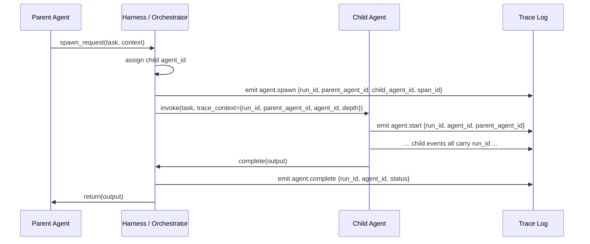

# M04 — Instrumented Handoff

## Intent
Attach trace context when crossing agent boundaries so events from parent and child agents can always be joined into a single coherent picture.

## Context
A parent agent spawns one or more subagents. Each subagent runs in its own process or context. Structured traces (M01) are in place, and the execution tree (M03) depends on linking child events back to their parent. Without explicit context propagation at the handoff point, child events are orphaned — they exist in the log but cannot be joined to the run they belong to.

## Problem
A subagent is spawned and runs successfully, but its events are logged under a `run_id` it generated itself rather than the parent's `run_id`. The execution tree has a gap. The tool-call log for the subagent cannot be attributed to the triggering run. Cross-agent debugging is impossible because the events live in disconnected silos.

**Without this pattern:** An orchestrator spawns 10 subagents. Each subagent generates its own `run_id`. The harness has 11 separate trace silos with no join key. Reconstructing the full run requires manually correlating timestamps, which is error-prone and fails entirely when subagents run in parallel.

## Solution
At every spawn point, the parent serializes its trace context into the subagent's invocation payload. The subagent reads this context on startup and adopts it.

Handoff context block (injected into subagent prompt or config):

```
trace_context:
  run_id:             string    # inherited from parent — never overridden
  parent_agent_id:    string    # the spawning agent's ID
  agent_id:           string    # freshly assigned for this child
  depth:              integer   # parent.depth + 1
  span_id:            string    # unique for this handoff event
  spawned_at:         ISO-8601
```

The parent emits an `agent.spawn` event with the handoff context before the child starts. The child emits its first event (`agent.start`) using the inherited `run_id` and `parent_agent_id`.

## Structure

<details>
<summary><b>Instrumented Handoff — Context Propagation</b></summary>



</details>

| Propagated Field | Who Sets It | Who Must Never Override It |
|---|---|---|
| `run_id` | Root harness at run start | Every agent in the tree |
| `parent_agent_id` | Spawning agent | Child agent |
| `agent_id` | Harness at spawn time | Child agent |
| `depth` | Harness (parent.depth + 1) | Child agent |

## Implementation Notes
- **Injection method:** Pass the trace context as a structured config block separate from the task prompt. Do not embed it in the natural language prompt — parseable fields must be machine-readable.
- **Adoption on startup:** The subagent harness entrypoint must read `trace_context` before emitting any event. First event emitted is always `agent.start` carrying the inherited `run_id`.
- **Async spawning:** When subagents are spawned asynchronously, the parent must emit `agent.spawn` before dispatching, not after. This guarantees the log has the spawn event even if the child never starts.
- **Cross-process propagation:** For subagents running in separate processes, serialize `trace_context` as JSON in the invocation payload (env var, config file, or prompt header).
- **Validation:** The harness should validate that each child's first event carries the expected `run_id`. Mismatches indicate a context-propagation bug.

## Consequences
### Benefits
- All events across a multi-agent run share a single `run_id` join key.
- The execution tree (M03) can be constructed reliably from `parent_agent_id` links.
- Orphaned events (no parent link) are immediately detectable as instrumentation gaps.
- Enables cross-agent latency attribution: wall time from `agent.spawn` to `agent.complete`.

### Liabilities
- Every spawning path must be instrumented; missing a spawn point creates silent gaps.
- Context must not be mutated by intermediate layers (serializers, prompt formatters) that pass it through.
- In dynamic or LLM-driven orchestrators, the model must be constrained not to invent a new `run_id`.

## Related Patterns
- [M01 — Structured Trace](M01-structured-trace.md) — defines the events (`agent.spawn`, `agent.start`, `agent.complete`) that handoffs produce
- [M03 — Execution Tree](M03-execution-tree.md) — depends entirely on the `parent_agent_id` linkage this pattern establishes
- [M07 — Replayable Run](M07-replayable-run.md) — replay must propagate the same trace context to produce matching events
- [Family F — Harness](../F-harness/README.md) — the harness is the authoritative assigner of `agent_id` and the injector of trace context

## Example

```
// Parent spawns a subagent — harness injects trace context

// 1. Parent requests spawn
parent_requests_spawn({
  task: "Identify all authentication-related files",
  context: {
    run_id: "r-4f2a",
    parent_agent_id: "root",
    depth: 0
  }
})

// 2. Harness assigns child ID and emits spawn event
harness_assigns_child_id("sub-7b1c")
emit_event({
  run_id: "r-4f2a",
  agent_id: "root",
  event_type: "agent.spawn",
  payload: {
    child_agent_id: "sub-7b1c",
    span_id: "sp-abc123",
    depth: 1
  }
})

// 3. Harness invokes child with trace context
invoke_child_agent({
  task: "Identify all authentication-related files",
  trace_context: {
    run_id: "r-4f2a",          // inherited — never changed
    parent_agent_id: "root",   // inherited
    agent_id: "sub-7b1c",      // freshly assigned
    depth: 1
  }
})

// 4. Child's first emitted event
emit_event({
  run_id: "r-4f2a",            // matches parent's run_id
  agent_id: "sub-7b1c",
  event_type: "agent.start",
  payload: { parent_agent_id: "root", depth: 1 }
})
```

## Sources
- **Microsoft Azure Architecture Center** — Microsoft's cloud architecture team, which specifically stresses instrumenting every agent handoff with trace context. [AI Agent Design Patterns](https://learn.microsoft.com/en-us/azure/architecture/ai-ml/guide/ai-agent-design-patterns)
- **OpenAI Engineering** — AI research company; context propagation across agent boundaries is documented in their harness engineering work. [Harness Engineering](https://openai.com/index/harness-engineering/)
- **AWS Prescriptive Guidance** — Amazon Web Services architecture team covering coordination and handoff patterns in agentic AI. [Agentic AI Patterns](https://docs.aws.amazon.com/prescriptive-guidance/latest/agentic-ai-patterns/agent-patterns.html)
