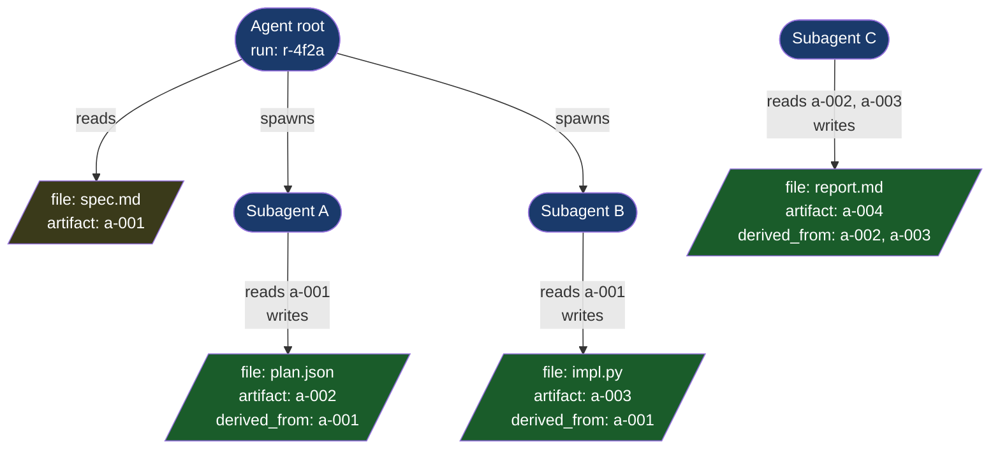

# M05 — Artifact Lineage

## Intent
Track the provenance of every artifact produced by an agent so that when a downstream step fails, the origin of its input can be traced exactly.

## Context
An agent system produces artifacts — files, structured outputs, memory entries, database writes — as it works. These artifacts flow between agents: subagent A produces a file that subagent B consumes. The execution tree (M03) is in place and every agent has an identity. Without lineage tracking, artifacts are anonymous: you know a file exists but not which agent wrote it, in which run, at which step.

## Problem
A downstream agent fails because its input artifact is malformed. The artifact exists on disk. But there is no record of which agent produced it, from which run, or at what step. Was it produced in this run or a prior run? Did a different subagent overwrite it? Without provenance metadata, the investigation cannot begin.

**Without this pattern:** Two parallel subagents both write to the same output path. One overwrites the other. The final artifact is wrong. The trace log shows both agents completed successfully. There is no way to determine which agent wrote the file that caused the downstream failure.

## Solution
Every artifact write operation attaches a lineage record stored alongside the artifact (as a sidecar metadata file or in a lineage store):

```
lineage_record:
  artifact_id:      string       # stable hash or UUID for this artifact version
  artifact_path:    string       # logical path (not filesystem-absolute)
  artifact_type:    string       # "file" | "memory" | "structured_output" | "db_write"
  run_id:           string
  agent_id:         string
  step:             integer
  produced_at:      ISO-8601
  content_hash:     string       # SHA-256 of artifact content at write time
  derived_from:     string[]     # artifact_ids of inputs consumed to produce this artifact
  overwrite:        boolean      # true if a prior artifact at this path was replaced
  prior_artifact_id: string|null # previous artifact_id at this path, if overwrite:true
```

## Structure

<details>
<summary><b>Artifact Lineage — Provenance Graph</b></summary>



</details>

When `report.md` is wrong, the lineage graph shows it was derived from `a-002` and `a-003`. Each of those traces back to its producing agent and step.

| Lineage Field | Diagnostic Use |
|---|---|
| `agent_id` + `step` | Locates the exact event in the tool-call log |
| `derived_from` | Traverses the dependency chain |
| `content_hash` | Detects unexpected mutations between writes |
| `overwrite: true` | Flags concurrent-write races |
| `prior_artifact_id` | Recovers the overwritten version |

## Implementation Notes
- **Sidecar storage:** Write lineage records to a parallel path (e.g. `.lineage/plan.json.lineage.json`) rather than inside the artifact. This keeps artifact content clean and lineage queryable without parsing artifacts.
- **Content hash:** Compute hash after the write completes. Store alongside the record. Re-hash on read to detect out-of-band mutations.
- **Derived_from tracking:** Require agents to declare their input artifact IDs before writing an output. This is the only reliable way to track derivation — inferring it from file-access logs is fragile.
- **Memory and structured outputs:** Apply the same lineage record schema to in-memory stores and database writes, using a logical path (e.g. `memory://session/plan`) as `artifact_path`.
- **Minimal viable implementation:** `artifact_path` + `run_id` + `agent_id` + `produced_at`. Hashing and `derived_from` are additive.

## Consequences
### Benefits
- Answers "where did this artifact come from?" without replaying the run.
- Detects concurrent-write races immediately via `overwrite: true` events.
- Enables artifact-level diffing between runs: same path, different `content_hash`.
- Feeds M08 Trace-Linked Eval: evals on artifacts can be attributed to the producing agent.

### Liabilities
- Agents must declare inputs before writing outputs — this is a discipline requirement, not a technical enforcement.
- Lineage store grows with every write; large runs with many small artifact updates produce high metadata volume.
- Content hashing adds compute overhead, especially for large binary artifacts.

## Related Patterns
- [M03 — Execution Tree](M03-execution-tree.md) — `agent_id` in the lineage record maps to a node in the tree
- [M04 — Instrumented Handoff](M04-instrumented-handoff.md) — `run_id` in lineage records comes from handoff context propagation
- [M08 — Trace-Linked Eval](M08-trace-linked-eval.md) — evals on artifacts reference the lineage record to attribute results
- [Family L — Memory](../../L-memory-state/README.md) — provenance-tagged memory entries are an instance of artifact lineage applied to the memory store

## Example

```
// Lineage record for a generated plan file

{
  "artifact_id": "a-002",
  "artifact_path": "workspace/plan.json",
  "artifact_type": "file",
  "run_id": "r-4f2a",
  "agent_id": "sub-7b1c",
  "step": 5,
  "produced_at": "2026-08-24T10:00:18Z",
  "content_hash": "sha256:e3b0c44298fc1c149afbf4c8996fb92427ae41e4649b934ca495991b7852b855",
  "derived_from": ["a-001"],
  "overwrite": false,
  "prior_artifact_id": null
}

// Sidecar file written to: workspace/.lineage/plan.json.lineage.json
```

## Sources
- **Microsoft Azure Architecture Center** — Microsoft's cloud architecture team; artifact provenance is a key component of their agent observability guidance. [AI Agent Design Patterns](https://learn.microsoft.com/en-us/azure/architecture/ai-ml/guide/ai-agent-design-patterns)
- **Anthropic Engineering** — AI safety company; artifact attribution is needed to connect eval failures back to the agent step that produced the evaluated output. [Demystifying Evals for AI Agents](https://www.anthropic.com/engineering/demystifying-evals-for-ai-agents)
- **Hamel Husain & Shreya Shankar** — independent ML practitioners; trace-driven debugging depends on knowing which step produced each artifact under analysis. [Why Error Analysis Matters](https://hamel.dev/blog/posts/evals-faq/why-is-error-analysis-so-important-in-llm-evals-and-how-is-it-performed.html)
