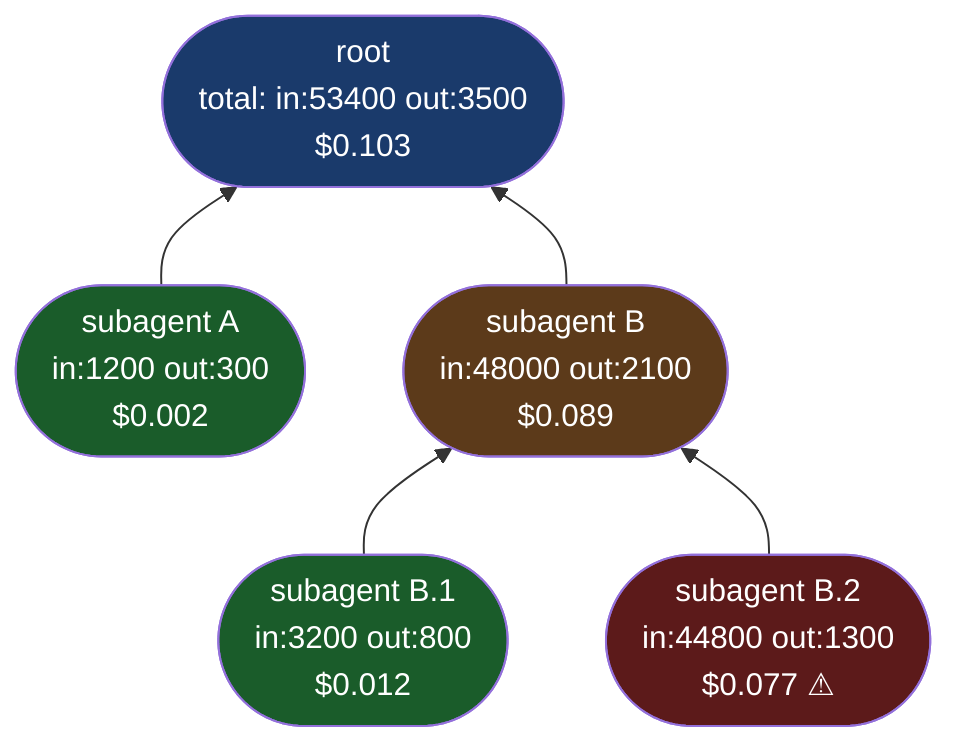

# M06 — Token/Cost Metrics

## Intent
Capture token usage and cost per agent node in the execution tree so budget overruns and runaway loops are detectable before they cascade.

## Context
An agent system is in production or under active development. The execution tree (M03) is in place. Each agent node invokes a language model one or more times. Without cost telemetry, the only way to discover that a run consumed 10× the expected tokens is to receive the invoice at the end of the month — or to hit a hard API limit mid-run.

## Problem
A run that normally costs $0.10 suddenly costs $8.00. Without per-node token metrics, the investigation shows only the total. It is unclear whether a single agent entered a loop, whether a subagent was given an unexpectedly large context, or whether all agents contributed equally. No targeted fix is possible without knowing which node drove the cost.

**Without this pattern:** A multi-agent run fails with a context-length error. The log shows the error but not which agent's prompt crossed the limit. Developers must re-run with added logging, increasing cost further, to locate the problem.

## Solution
At each model invocation, capture the token counts returned by the API response and associate them with the invoking agent node:

```
token_record:
  run_id:           string
  agent_id:         string
  call_id:          string         # matches tool_call_record.call_id if via tool
  model_id:         string
  invoked_at:       ISO-8601
  input_tokens:     integer
  output_tokens:    integer
  cache_read_tokens: integer       # 0 if not using prompt caching
  cache_write_tokens: integer
  cost_usd:         number         # computed from model pricing at log time
  context_limit:    integer        # model's max context window
  context_utilization: number      # input_tokens / context_limit (0.0–1.0)
```

Roll up per-node totals into the execution tree node, and roll up to run level for budget tracking.

## Structure

<details>
<summary><b>Token/Cost Metrics — Rollup Through Tree</b></summary>



</details>

The tree immediately shows that subagent B.2 consumed 87% of the run's total input tokens — a clear anomaly worth investigating.

| Metric | Diagnostic Use |
|---|---|
| `context_utilization > 0.9` | Context overflow risk; likely root cause of truncation errors |
| `output_tokens >> baseline` | Runaway generation or verbose tool response |
| `cost_usd` per node | Identifies cost hotspots without reading event logs |
| `cache_read_tokens` | Shows whether prompt caching is working as expected |
| Per-node vs run total | Identifies whether cost is distributed or concentrated |

## Implementation Notes
- **Collection point:** Read token counts from the model API response object (e.g. `usage.input_tokens`, `usage.output_tokens`). Do not estimate — always use API-reported values.
- **Cost computation:** Apply model-specific pricing at log time and store the result. Pricing changes over time; store the model ID so historical records can be recomputed.
- **Prompt caching:** Track `cache_read_tokens` and `cache_write_tokens` separately. Cache hits dramatically reduce effective cost; conflating them with uncached tokens obscures true savings.
- **Rollup:** Compute node-level rollups lazily (at query time) rather than incrementally, to avoid double-counting when a node makes multiple model calls.
- **Budget alerts:** Set run-level thresholds (e.g. $1.00 or 500K tokens). Emit a `budget.warning` event at 80% and a `budget.exceeded` event at 100%. The harness can halt the run on `budget.exceeded`.
- **Minimal viable implementation:** `input_tokens` + `output_tokens` + `model_id` per invocation. Cost computation and context utilization are additive.

## Consequences
### Benefits
- Budget overruns are diagnosed in minutes rather than discovered via invoices.
- Context overflow errors have an obvious leading indicator (`context_utilization` approaching 1.0).
- Prompt caching effectiveness is measurable and improvable.
- Per-node attribution enables targeted optimization rather than guessing.

### Liabilities
- Pricing tables must be maintained as models and pricing change.
- Token counts are available only after the model responds; pre-invocation cost estimation requires approximation.
- Rollup queries can be expensive for runs with thousands of model calls.

## Related Patterns
- [M03 — Execution Tree](M03-execution-tree.md) — token metrics attach to tree nodes and roll up through the tree
- [M01 — Structured Trace](M01-structured-trace.md) — model invocation events carry the token counts
- [M09 — Failure Categorization](M09-failure-categorization.md) — context overflow is a failure category detected via `context_utilization`
- [Family F — Harness](../F-harness/README.md) — the harness implements budget thresholds and `budget.exceeded` halting

## Example

```
// Token record for a single model invocation

{
  "run_id": "r-4f2a",
  "agent_id": "sub-9d3e",
  "call_id": "mc-017",
  "model_id": "claude-sonnet-4-5",
  "invoked_at": "2026-08-24T10:00:22Z",
  "input_tokens": 44800,
  "output_tokens": 1300,
  "cache_read_tokens": 0,
  "cache_write_tokens": 0,
  "cost_usd": 0.077,
  "context_limit": 200000,
  "context_utilization": 0.224
}

// Node rollup (computed at query time for agent sub-9d3e across all its model calls)
{
  "agent_id": "sub-9d3e",
  "total_input_tokens": 44800,
  "total_output_tokens": 1300,
  "total_cost_usd": 0.077,
  "model_call_count": 1,
  "max_context_utilization": 0.224
}
```

## Sources
- **Anthropic Engineering** — AI safety company; token budgeting and cost visibility are discussed in the context of agent eval harnesses. [Demystifying Evals for AI Agents](https://www.anthropic.com/engineering/demystifying-evals-for-ai-agents)
- **OpenAI Engineering** — AI research company; per-node cost telemetry is part of their harness engineering practice. [Harness Engineering](https://openai.com/index/harness-engineering/)
- **AWS Prescriptive Guidance** — Amazon Web Services architecture team; cost observability is a requirement in their agentic AI patterns. [Agentic AI Patterns](https://docs.aws.amazon.com/prescriptive-guidance/latest/agentic-ai-patterns/agent-patterns.html)
