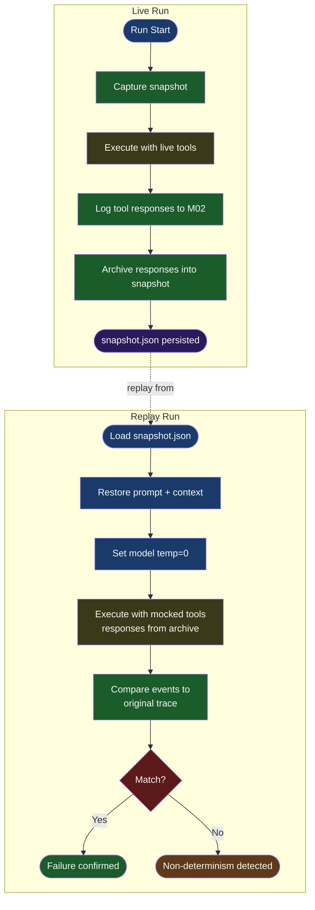

# M07 — Replayable Run

## Intent
Snapshot the full input state at run start so a failed or flaky run can be replayed deterministically to confirm a root cause before deploying a fix.

## Context
A multi-agent system has structured traces (M01), a tool-call log (M02), and an execution tree (M03) in place. When a failure is identified, the next step is to reproduce it reliably. But agent runs are non-deterministic by default: model responses vary, external tools return live data, and timestamps differ. Without a snapshot, "replaying" a run means running it again from scratch with no guarantee of hitting the same failure.

## Problem
An intermittent failure is reported. The trace shows a tool returned an unexpected response at step 9. Developers fix what they believe is the cause and re-run. The run passes — but it is impossible to know whether the fix worked or whether the non-determinism simply did not trigger this time. Confidence in the fix is zero.

**Without this pattern:** A complex agent run fails once in every twenty attempts. Developers cannot reproduce the failure on demand. They ship a speculative fix and hope the failure rate drops. It does not.

## Solution
At `run.start`, snapshot everything needed to replay the run from the same initial state:

```
run_snapshot:
  run_id:               string
  snapshot_version:     integer       # increment on schema changes
  captured_at:          ISO-8601
  prompt:               string        # full prompt text, not a summary
  model_id:             string
  model_parameters:     object        # temperature, top_p, max_tokens, etc.
  tool_definitions:     object[]      # full tool schemas
  injected_context:     object        # any injected memory, artifacts, config
  trace_context:        object        # run_id, agent_id, depth (from M04)
  tool_response_archive: object       # keyed by call_id: frozen tool responses for mock replay
```

The `tool_response_archive` is populated from the tool-call log (M02) after the run completes. Replay mode substitutes archived responses instead of calling live tools.

## Structure

<details>
<summary><b>Replayable Run — Snapshot and Replay Modes</b></summary>



</details>

## Implementation Notes
- **Snapshot storage:** Store as a single JSON file per run, named by `run_id`. Keep for the retention period of your debug policy (minimum: until the issue is closed).
- **Temperature zeroing:** Set `temperature=0` (or equivalent) in replay mode to maximize model determinism. Full determinism is not guaranteed by any model, but low temperature reduces variance significantly.
- **Live vs mocked replay:** Two modes exist. *Mocked replay* (substitutes archived tool responses) is fully deterministic and cheap. *Live replay* (calls tools for real) tests whether the failure was caused by tool-side state change. Choose based on the failure hypothesis.
- **Partial replay:** For large trees, replay only the failing branch by loading the snapshot for that node's `agent_id`, not the root. This requires that M04 handoffs propagate a replayable context to each node.
- **Snapshot size:** Prompts, tool definitions, and archived responses can be large. Compress snapshots (gzip) and store externally if they exceed a few MB.
- **Minimal viable implementation:** Snapshot `prompt` + `model_id` + `model_parameters` only. Tool response archiving is additive but required for true determinism.

## Consequences
### Benefits
- Turns intermittent failures into reproducible test cases.
- Confirms fixes before deployment: if replay passes, the fix is valid for this failure mode.
- Enables before/after comparison: run the same snapshot against the old and new code.
- Supports regression testing: a library of snapshots covering known failure modes.

### Liabilities
- Tool response archives grow large for runs with many tool calls or large responses.
- Model non-determinism means replay is high-probability, not guaranteed, even with `temperature=0`.
- State-dependent tools (e.g. database writes that happened during the original run) may not replay correctly without additional state snapshotting.
- Snapshot schema must evolve with the harness; old snapshots may not replay on new code.

## Related Patterns
- [M02 — Tool-Call Event Log](M02-tool-call-event-log.md) — tool response archive is populated from this log
- [M03 — Execution Tree](M03-execution-tree.md) — partial replay uses the tree to select the failing branch
- [M04 — Instrumented Handoff](M04-instrumented-handoff.md) — each node's trace context is part of its replayable snapshot
- [M08 — Trace-Linked Eval](M08-trace-linked-eval.md) — replay confirms the failure mode; the eval then codifies it as a regression test

## Example

```
// Snapshot file: snapshots/r-4f2a.json (abbreviated)

{
  "run_id": "r-4f2a",
  "snapshot_version": 1,
  "captured_at": "2026-08-24T10:00:00Z",
  "prompt": "Refactor the authentication module to use the new session interface.",
  "model_id": "claude-sonnet-4-5",
  "model_parameters": {
    "temperature": 1.0,
    "max_tokens": 8192
  },
  "tool_definitions": [
    { "name": "read_file", "description": "...", "input_schema": { ... } },
    { "name": "write_file", "description": "...", "input_schema": { ... } }
  ],
  "injected_context": {
    "memory": {},
    "working_directory": "/workspace"
  },
  "trace_context": {
    "run_id": "r-4f2a",
    "agent_id": "root",
    "depth": 0
  },
  "tool_response_archive": {
    "tc-001": { "content": "def main():\n    pass\n", "size_bytes": 512 },
    "tc-002": { "exit_code": 1, "stderr": "ModuleNotFoundError: No module named 'src'" }
  }
}

// Replay invocation (pseudocode)
replay_run({
  snapshot_path: "snapshots/r-4f2a.json",
  mode: "mocked",            // substitute archived tool responses
  override_temperature: 0    // maximize determinism
})
```

## Sources
- **OpenAI Engineering** — AI research company; deterministic replay is a core technique in their agent harness engineering. [Harness Engineering](https://openai.com/index/harness-engineering/) | [Unrolling the Codex Agent Loop](https://openai.com/index/unrolling-the-codex-agent-loop/)
- **Hamel Husain & Shreya Shankar** — independent ML practitioners; reproducible runs are a prerequisite for meaningful eval design. [LLM Evals FAQ](https://hamel.dev/blog/posts/evals-faq/)
- **Anthropic Engineering** — AI safety company; reproducibility is foundational to their agent eval methodology. [Demystifying Evals for AI Agents](https://www.anthropic.com/engineering/demystifying-evals-for-ai-agents)
