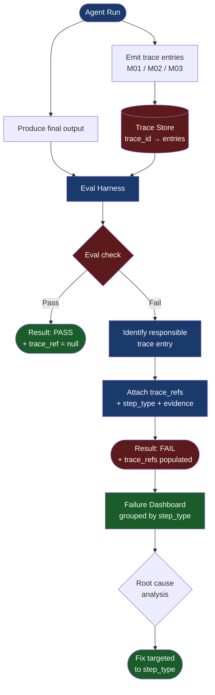

# M08 — Trace-Linked Eval

## Intent
Anchor evaluation results to the specific trace entries that caused them — tool calls, model responses, handoff events — so a failing eval points to the step that failed, not just the final output.

## Context
A multi-agent system has structured traces (M01), a tool-call event log (M02), and an execution tree (M03) in place. Evals run against run outputs, but output-level pass/fail tells you nothing about *where* the failure originated. In a run with thirty steps, a wrong final answer could stem from step 3 (wrong tool call), step 17 (bad model inference), or step 29 (dropped context in a handoff). Without trace linkage, debugging starts with a guess.

## Problem
An eval suite reports that 12% of runs produce incorrect final answers. The team spends hours manually reading traces to identify which step failed. Different runs fail at different steps, making patterns invisible. Fixing the most visible symptom (the output format) does not reduce the failure rate because the root cause is upstream.

**Without this pattern:** Eval failures accumulate a label — "wrong answer" — but no location. Teams fix the easiest thing to see, not the thing that caused the failure. Regressions are undetected until they appear in the output metric again.

## Solution
When an eval check fails, record the trace entry ID (or IDs) that are causally responsible alongside the pass/fail result. Every eval result carries:

- **eval_id:** which check failed
- **run_id:** which run it belongs to
- **verdict:** pass / fail / skip
- **trace_refs:** one or more trace entry IDs from the structured trace (M01) that caused or best explain the failure
- **step_type:** the kind of trace entry (tool_call, model_response, handoff, memory_read, etc.)
- **evidence:** a short excerpt from the referenced trace entry — the specific field or value that triggered the failure

Trace refs are assigned either by the eval harness (for deterministic checks against logged data) or by a judge model (for semantic checks, which cites the trace entry it found most relevant).

## Structure

<details>
<summary><b>Trace-Linked Eval — Linkage Flow</b></summary>



</details>

## When to Use

- Eval failure rate is above a noise floor and you cannot identify which step causes failures by reading outputs alone.
- Multiple failure modes co-exist in the same metric (e.g. "wrong answer" covers tool errors, context loss, and hallucination).
- You need to prioritize fixes across a large step space: trace linkage shows which step types account for the most failures.
- You are building regression tests: a trace-linked failing eval becomes a pinned test case tied to the exact step.

## When Not to Use

- Single-step agents with no intermediate trace: there is only one place to look, so linkage adds overhead without value.
- Output-only evals where the process is irrelevant (e.g. pure quality scoring of a generated document).
- Early prototyping before a trace schema is established: implement M01 first.

## Trade-offs

| Dimension | Benefit | Cost |
|---|---|---|
| Debuggability | Failures point to a step, not just the output | Eval harness must read and parse the trace store |
| Prioritization | Step-type grouping reveals systemic failure modes | Trace ref assignment adds logic to every eval check |
| Regression coverage | Linked failures become pinned step-level test cases | Test library grows; maintenance burden increases |
| Judge-model evals | Semantic checks can still cite a specific trace entry | Judge model citations may be imprecise; require validation |
| Overhead | Marginal per-eval cost after trace is in place | Requires M01 (structured trace) as a prerequisite |

## Implementation Sketch

```
# Eval result schema
EvalResult:
  eval_id:     string          # e.g. "check-final-answer-correctness"
  run_id:      string
  verdict:     "pass" | "fail" | "skip"
  trace_refs:  TraceRef[]      # empty on pass
  evidence:    string          # excerpt from the referenced entry

TraceRef:
  entry_id:    string          # ID of the trace entry in M01
  step_type:   "tool_call" | "model_response" | "handoff" | "memory_read" | ...
  field:       string          # which field in the entry triggered the failure


# Deterministic eval (tool error check)
function eval_tool_errors(run_id):
  entries = trace_store.get_by_run(run_id, type="tool_call")
  for entry in entries:
    if entry.result.is_error:
      yield EvalResult(
        eval_id   = "tool-call-error",
        run_id    = run_id,
        verdict   = "fail",
        trace_refs = [TraceRef(entry.id, "tool_call", "result.error")],
        evidence  = entry.result.error[:200]
      )


# Semantic eval (judge model cites trace)
function eval_answer_correctness(run_id, expected):
  output    = trace_store.get_final_output(run_id)
  entries   = trace_store.get_by_run(run_id)
  verdict, cited_id, evidence = judge_model(
    output   = output,
    expected = expected,
    entries  = entries,
    prompt   = "If the answer is wrong, cite the trace entry ID most responsible."
  )
  yield EvalResult(
    eval_id    = "answer-correctness",
    run_id     = run_id,
    verdict    = verdict,
    trace_refs = [TraceRef(cited_id, "model_response", "content")] if verdict == "fail" else [],
    evidence   = evidence
  )


# Aggregate: group failures by step_type
function failure_report(results):
  by_step = group_by(results.filter(verdict="fail"), key=lambda r: r.trace_refs[0].step_type)
  for step_type, failures in by_step:
    print(f"{step_type}: {len(failures)} failures")
```

## Related Patterns

- [M01 — Structured Trace](M01-structured-trace.md) — prerequisite; provides the trace entries that evals link to
- [M02 — Tool-Call Event Log](M02-tool-call-event-log.md) — primary source of tool_call trace entries
- [M03 — Execution Tree](M03-execution-tree.md) — provides step position context for multi-agent failures
- [M07 — Replayable Run](M07-replayable-run.md) — replay confirms the failure mode; this pattern codifies it as a regression test
- [M09 — Failure Categorization](M09-failure-categorization.md) — step_type grouping from this pattern feeds the failure taxonomy

## Anti-Patterns Addressed

- **Output-only debugging:** teams fix the output format without touching the step that produced the wrong value. Trace linkage redirects attention to the causal step.
- **Metric stagnation:** a single "accuracy" metric hides the mix of failure modes. Step-type grouping surfaces the dominant failure class so the team works on what matters most.
- **Speculative fixing:** engineers guess which step is at fault and patch it. Trace refs replace guessing with evidence.

## Sources

- Hamel Husain & Shreya Shankar — independent ML practitioners; leading voices on LLM evaluation and trace-driven debugging. [Evals Skills for Coding Agents](https://hamel.dev/blog/posts/evals-skills/) | [How to Evaluate Agentic Workflows](https://hamel.dev/blog/posts/evals-faq/how-do-i-evaluate-agentic-workflows.html)
- Anthropic Engineering — AI safety company; authors of Claude. [Demystifying Evals for AI Agents](https://www.anthropic.com/engineering/demystifying-evals-for-ai-agents)
- OpenAI Engineering — AI research company. [Harness Engineering](https://openai.com/index/harness-engineering/)
