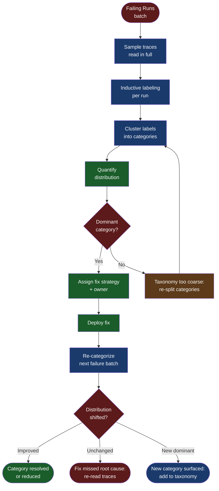

# M09 — Failure Categorization

## Intent
Before attempting any fix, classify each agent failure into a structured taxonomy derived from real traces — so that effort is directed at the correct failure class and fixes are measurable against a known baseline.

## Context
A system has structured traces (M01), trace-linked evals (M08), and some accumulation of failing runs. The team has a backlog of failures and limited engineering time. Without a shared taxonomy, different engineers describe the same failure class differently, fixes are applied to the wrong layer, and it is impossible to tell whether the overall failure rate is improving or just shifting between categories.

## Problem
A batch of 50 failing runs is handed to the team. Some fail because the model hallucinates a file path. Some fail because a tool times out. Some fail because the agent loops without making progress. Some fail because the prompt does not include context the model needed. All are recorded as "eval failed." The team patches the most visible symptom — usually the last output before failure — while the dominant failure class (often context gap or prompt ambiguity) goes untouched. Two sprints later, the failure rate is unchanged.

**Without this pattern:** Every failure is treated as unique. Fixes are one-off. No one can answer: "What is our most common failure class this week, and is it trending up or down?"

## Solution
After a batch of failures is collected (from evals, user reports, or automated monitors), perform an error analysis pass before writing any fix:

1. **Sample and read traces.** Pull a representative sample of failing runs. Read the full trace for each, not just the final output.
2. **Label inductively.** Assign a short free-text label to each failure based on what the trace shows caused it. Do not impose a taxonomy upfront — let categories emerge from the data.
3. **Cluster and name.** Group similar labels into named categories. Merge until each category is actionable (i.e. a distinct fix strategy exists).
4. **Quantify.** Count the proportion of failures in each category. This is the baseline.
5. **Assign owners.** Each category maps to a fix strategy and an owner.
6. **Re-measure.** After fixes are deployed, re-run the same categorization on the next failure batch. Compare distributions.

A minimal taxonomy for most agent systems covers five classes:

| Category | Description | Typical trace signal |
|---|---|---|
| **Hallucination** | Model asserts a fact not present in context or tool output | Model response contradicts prior tool result |
| **Tool Error** | A tool call fails, returns an error, or returns malformed data | `result.is_error = true` in tool-call log |
| **Context Gap** | The model lacked information it needed; the information existed but was not injected | Model asks for something available in memory/artifacts |
| **Loop Exhaustion** | The agent repeated the same action without progress until it hit a step limit | Repeated identical tool calls in execution tree |
| **Prompt Ambiguity** | The task specification was underspecified; model chose a valid but wrong interpretation | Correct reasoning toward the wrong goal |

The taxonomy is a living artifact: add categories when a new class accounts for >5% of failures; merge categories that share a fix strategy.

## Structure

<details>
<summary><b>Failure Categorization — Analysis Loop</b></summary>



</details>

## When to Use

- A failure backlog exists and the team does not know which class to fix first.
- The same metric has been flat or worsening across multiple fix attempts.
- Multiple engineers are working on failures independently and using inconsistent terminology.
- A new agent system is being evaluated for the first time: categorization before fixing prevents wasted effort.

## When Not to Use

- Fewer than ~10 failing runs: the sample is too small for meaningful categorization; read each trace directly.
- A single deterministic failure type is known with certainty (e.g. every run fails due to a missing API key): fix it directly.
- The taxonomy already exists and is stable: skip re-derivation, apply existing labels.

## Trade-offs

| Dimension | Benefit | Cost |
|---|---|---|
| Fix targeting | Effort goes to the dominant failure class | Categorization pass takes time before any fix ships |
| Measurement | Distribution baseline makes improvement measurable | Requires consistent re-categorization after each fix cycle |
| Communication | Shared taxonomy aligns teams on failure descriptions | Taxonomy maintenance: categories split, merge, and rename over time |
| Inductive approach | Categories reflect actual failure modes, not assumed ones | Requires reading full traces, not just output labels |
| Taxonomy drift | Living taxonomy stays accurate as the system evolves | Old categories may persist past their relevance |

## Implementation Sketch

```
# Taxonomy entry
Category:
  name:           string         # e.g. "context-gap"
  description:    string
  trace_signal:   string         # how to detect in a trace
  fix_strategy:   string
  owner:          string
  count:          integer        # in current batch
  proportion:     float          # count / total_failures


# Step 1: sample failing runs
function sample_failures(run_ids, sample_size=30):
  return random.sample(run_ids, min(sample_size, len(run_ids)))


# Step 2: inductive labeling (human or judge-model)
function label_run(run_id, trace_store):
  trace = trace_store.get_full_trace(run_id)
  # Read trace entries in order; assign a short free-text label
  # describing what went wrong and at which step
  label = judge_or_human_label(trace)
  return {"run_id": run_id, "label": label}


# Step 3: cluster labels into categories
function derive_taxonomy(labels):
  # Group similar labels (embedding similarity or manual review)
  # Merge until each group has a distinct fix strategy
  clusters = cluster_by_similarity(labels, threshold=0.75)
  taxonomy = []
  for cluster in clusters:
    taxonomy.append(Category(
      name        = canonical_name(cluster),
      description = summarize(cluster.labels),
      count       = len(cluster)
    ))
  return taxonomy


# Step 4: quantify and rank
function failure_report(taxonomy, total_failures):
  for cat in sorted(taxonomy, key=lambda c: c.count, reverse=True):
    cat.proportion = cat.count / total_failures
    print(f"{cat.name}: {cat.count} ({cat.proportion:.0%})")


# Step 5: re-measure after fix
function measure_shift(before: taxonomy, after: taxonomy):
  for cat in before:
    before_pct = cat.proportion
    after_pct  = after.find(cat.name).proportion if after.find(cat.name) else 0
    delta      = after_pct - before_pct
    print(f"{cat.name}: {before_pct:.0%} → {after_pct:.0%}  ({delta:+.0%})")
```

## Related Patterns

- [M01 — Structured Trace](M01-structured-trace.md) — provides the trace data that categorization reads
- [M08 — Trace-Linked Eval](M08-trace-linked-eval.md) — step_type grouping from evals seeds the initial taxonomy
- [M07 — Replayable Run](M07-replayable-run.md) — replayable snapshots let the team confirm a category assignment by reproducing the failure

## Anti-Patterns Addressed

- **Symptom fixing:** patching the final output without understanding the upstream cause. Categorization forces reading the full trace before writing any code.
- **Assumed taxonomy:** teams impose a failure taxonomy based on intuition ("it must be hallucination") rather than evidence. Inductive derivation from real traces produces a taxonomy that matches actual failure modes.
- **Unmeasured fixes:** changes are deployed without a baseline, so it is impossible to know if they helped. The distribution baseline makes improvement (or regression) visible.
- **Terminology fragmentation:** five engineers call the same failure class five different things. A shared named taxonomy aligns communication and prevents duplicate effort.

## Sources

- Hamel Husain & Shreya Shankar — independent ML practitioners; leading voices on LLM evaluation and trace-driven debugging. [Why Error Analysis Matters](https://hamel.dev/blog/posts/evals-faq/why-is-error-analysis-so-important-in-llm-evals-and-how-is-it-performed.html) | [LLM Evals FAQ](https://hamel.dev/blog/posts/evals-faq/)
- Anthropic Engineering — AI safety company. [Demystifying Evals for AI Agents](https://www.anthropic.com/engineering/demystifying-evals-for-ai-agents)
- AWS Prescriptive Guidance — Amazon Web Services architecture team. [Agentic AI Patterns](https://docs.aws.amazon.com/prescriptive-guidance/latest/agentic-ai-patterns/agent-patterns.html)
