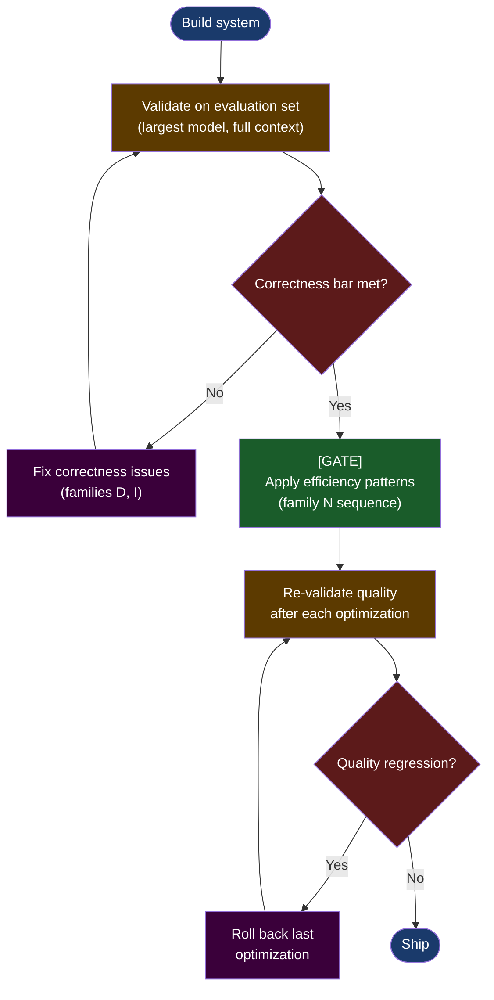

# Premature Optimization

**Family:** N — Efficiency & Model Routing
**Type:** Anti-Pattern

## Problem

Teams apply efficiency patterns — model routing, context trimming, early stopping, caching — before the underlying system produces correct output. The optimizations reduce cost and latency, but the system they accelerate is wrong. Cheap wrong answers arrive faster, and the cost savings make the degraded system feel production-ready before correctness has been established. Debugging is harder because the efficiency layers obscure what the model would have said with full context and the right model tier.

## Solution

Establish correctness first. Run the system in its most capable, least-restricted configuration — largest model, full context, no early stopping, no caching of model outputs — and validate it against a representative evaluation set. Only after the system passes its correctness bar should efficiency patterns from family N be applied, in the sequence defined in the README's cost optimization table: reuse → trim → parallelize → route → budget → stop.

## Structure

The sequence of work is a gate, not a dial:

```
Phase 1: Correctness (families D, I)
  Run on largest model, full context, no caching.
  Validate on evaluation set.
  Pass correctness bar?
      NO  → fix correctness issues first. DO NOT optimize yet.
      YES → proceed to Phase 2.

[GATE: correctness validated]

Phase 2: Efficiency (family N)
  Apply patterns in sequence: reuse → trim → parallelize
                              → route → budget → stop.
  Validate quality at each step: no regression before proceeding.
```

<details>
<summary><b>Structure Diagram</b></summary>



</details>

## When This Anti-Pattern Appears

- Routing to a small model is added early in development "to save costs during testing."
- Context is trimmed before the team understands what information the model actually needs.
- Caching is added before outputs have been validated for correctness.
- Early stopping fires on a loop that has not yet been shown to converge to correct answers.
- Cost becomes the primary design driver before quality metrics are defined.

## When Not to Use (i.e., when efficiency-first is acceptable)

- The task is well-understood and the small model's correctness on it is already validated from a prior system.
- A prototype is being built purely to explore cost structure, with explicit acknowledgment that output quality is not yet evaluated.
- An existing correct system is being re-optimized and the evaluation set is already in place.

## Trade-offs

| Symptom | Root Cause |
|---------|------------|
| System is fast and cheap but answers are wrong | Efficiency applied before correctness established |
| Debugging is difficult | Routing / trimming hides what the full-context large model would have said |
| Cost metrics look good; quality metrics are absent | No evaluation set defined before optimization |
| Small-model routing "looks fine" on demos | Demo inputs are easy; evaluation set is missing hard cases |

## Example

A team builds a multi-step reasoning pipeline and immediately routes 80% of inputs to a small model to manage costs. The small model handles easy inputs correctly but silently fails on moderately complex ones — a class that was never represented in the informal demo set used for validation. The routing "works" for weeks until a customer reports a systematic error. The root cause: correctness was never validated before routing was applied.

## Related Patterns (what to do instead)

- [Family D — Verification & Evaluation](../../D-verification-evaluation/README.md) — establish correctness before optimizing
- [Family I — Reliability & Recovery](../../I-reliability-recovery/README.md) — ensure reliability before optimizing
- [Complexity-Based Model Routing](../patterns/complexity-based-model-routing.md) — apply routing only after correctness is validated
- [Silent Quality Degradation](silent-quality-degradation.md) — the most common consequence of premature optimization

## Sources

- **Anthropic Engineering** — AI safety company; authors of Claude. [Building Effective Agents](https://www.anthropic.com/engineering/building-effective-agents)
- **Google Cloud Architecture Center** — Google's cloud architecture team; frames pattern choice around latency, cost, and task characteristics. [Choose a Design Pattern for Agentic AI](https://docs.cloud.google.com/architecture/choose-design-pattern-agentic-ai-system)
- **Microsoft Azure Architecture Center** — Microsoft's cloud architecture team. [AI Agent Design Patterns](https://learn.microsoft.com/en-us/azure/architecture/ai-ml/guide/ai-agent-design-patterns)
