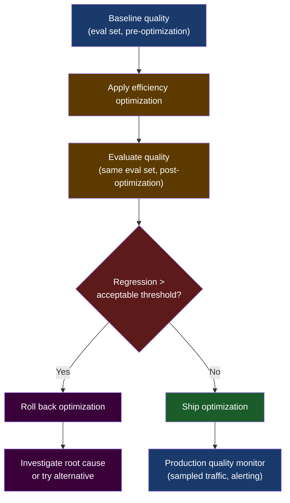

# Silent Quality Degradation

**Family:** N — Efficiency & Model Routing
**Type:** Anti-Pattern

## Problem

Efficiency patterns reduce cost and latency, but each one makes a trade-off: a smaller model may miss edge cases, trimmed context may remove information the model silently needed, a confidence threshold may be miscalibrated, a cached output may be stale. When these optimizations ship without quality monitoring, accuracy drops invisibly. Users encounter wrong answers; the team has no signal because cost and latency metrics look healthy while quality metrics were never wired up.

## Solution

Every efficiency optimization must be accompanied by a quality measurement before and after. Define a held-out evaluation set before applying any N-family pattern. After each optimization, re-run the evaluation set and compare the quality metric (accuracy, task completion rate, error rate) to the pre-optimization baseline. Set an acceptable regression threshold. If quality drops beyond the threshold, roll back the optimization. Maintain the monitoring in production: log quality signals on sampled live traffic, alert on degradation.

## Structure

The guard is applied around every efficiency change:

```
Before optimization:
  baseline_quality = evaluate(eval_set, system_v0)

Apply optimization:
  system_v1 = apply(optimization, system_v0)

After optimization:
  new_quality = evaluate(eval_set, system_v1)
  regression  = baseline_quality - new_quality

  if regression > ACCEPTABLE_THRESHOLD:
      ROLL BACK optimization
  else:
      ship + add production quality monitor
```

<details>
<summary><b>Structure Diagram</b></summary>



</details>

## When This Anti-Pattern Appears

- A routing threshold is set by intuition rather than calibration against a labeled evaluation set.
- Context is trimmed without checking whether the trimmed information was load-bearing for any task type.
- Caching is added and the TTL is set without analyzing how quickly ground truth changes.
- A confidence threshold is deployed without monitoring the distribution of confidence scores in production.
- Cost and latency dashboards exist but no quality dashboard is wired up alongside them.

## When Not to Use (i.e., when quality monitoring can be lighter)

- The efficiency change is demonstrably lossless (e.g., reordering independent tool calls in parallel — output is identical).
- The change is on a non-critical path with human review of all outputs before use.
- A very small change is made to an already heavily monitored system with dense production quality signals.

## Trade-offs

| Symptom | Root Cause |
|---------|------------|
| Cost is down, but customer complaints are up | Optimization shipped without quality re-evaluation |
| Confidence threshold "seemed fine" but misroutes edge cases | Threshold set without a calibration dataset |
| Cached output is subtly wrong | TTL is too long; ground truth changed after caching |
| Small model handles most cases but silently fails on a class | No evaluation set covering the failure class |
| Quality degradation discovered weeks after shipping | No production quality monitoring on sampled traffic |

## Example

A team adds confidence-based routing, setting the escalation threshold at 0.8 "because it looks reasonable on demos." Six weeks later, analysis of customer-flagged errors shows that the small model returns confidence scores above 0.8 on a specific class of queries it consistently answers incorrectly — the model is confidently wrong. The threshold was never calibrated on a labeled evaluation set, and no production quality monitor was in place to catch the accumulating errors.

## Related Patterns (what to do instead)

- [Confidence-Based Routing](../patterns/confidence-based-routing.md) — calibrate the threshold on a labeled evaluation set before deploying
- [Complexity-Based Model Routing](../patterns/complexity-based-model-routing.md) — validate classifier accuracy before routing production traffic
- [Caching](../patterns/caching.md) — set TTL based on measured staleness rate, not intuition
- [Premature Optimization](premature-optimization.md) — the precursor; optimization before correctness makes silent degradation inevitable
- [Family D — Verification & Evaluation](../D-verification-evaluation/README.md) — evaluation infrastructure that must be in place before N patterns ship

## Sources

- **Anthropic Engineering** — AI safety company; authors of Claude. [Building Effective Agents](https://www.anthropic.com/engineering/building-effective-agents)
- **AWS Prescriptive Guidance** — Amazon Web Services architecture team; defines Confidence-Based Routing. [Agentic AI Patterns](https://docs.aws.amazon.com/prescriptive-guidance/latest/agentic-ai-patterns/agent-patterns.html)
- **Google Cloud Architecture Center** — Google's cloud architecture team; frames pattern choice around latency, cost, and task characteristics. [Choose a Design Pattern for Agentic AI](https://docs.cloud.google.com/architecture/choose-design-pattern-agentic-ai-system)
