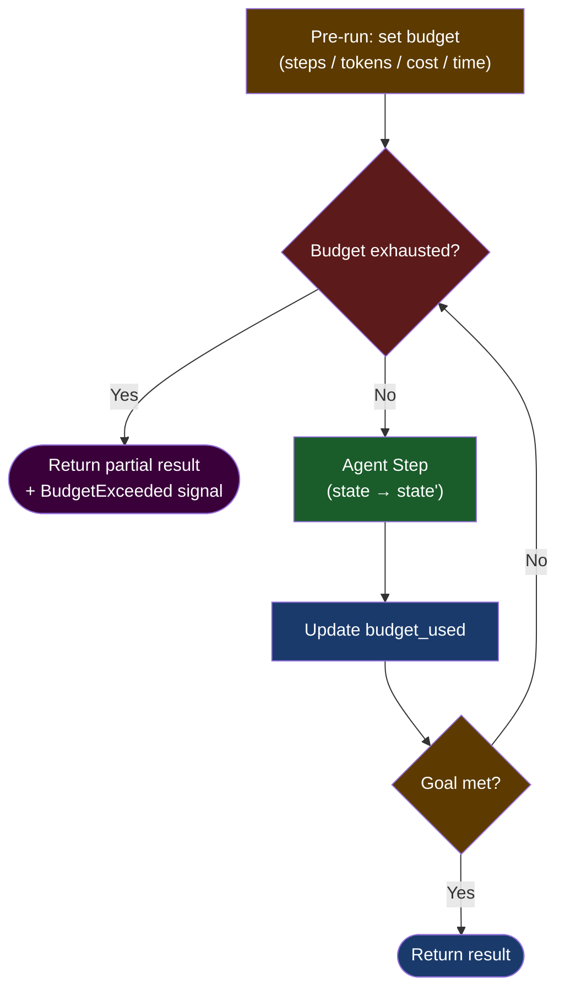

# Budgeted Agent Loop

**Family:** N — Efficiency & Model Routing
**Type:** Pattern

## Problem

Agent loops that run until a goal is met or a stopping condition is reached have unbounded cost by default. A loop that stalls, recurses unexpectedly, or misjudges its own progress can consume orders of magnitude more tokens and wall-clock time than intended. Without a pre-set ceiling, a single runaway run can exhaust a daily budget or trigger rate-limit penalties before anyone notices.

## Solution

Before entering the loop, define a hard budget: a maximum number of steps, a token ceiling, a wall-clock timeout, or a monetary cost cap — whichever is most meaningful for the use case. Check the budget at each iteration boundary. When the budget is exhausted, stop the loop, return whatever partial result is available, and surface the budget-exceeded condition to the caller. The budget is set before the run starts, not adjusted reactively during it.

## Solution Structure

```
Pre-run: define budget = {max_steps, max_tokens, max_cost, timeout}

Loop:
  check budget  ──── EXCEEDED ──────────────────► return partial_result + BudgetExceeded
  │ within budget
  ▼
  agent_step(state)  ──► state'  ──► update budget_used
  │
  ├── goal_met? ──────────────────────────────► return result
  │
  └── continue ──────────────────────────────► (next iteration)
```

<details>
<summary><b>Solution Structure Diagram</b></summary>



</details>

## Implementation Sketch

```
function run_agent(task, budget: Budget):
    state = initial_state(task)
    used  = Budget.zero()

    while not goal_met(state):
        if used.exceeds(budget):
            return PartialResult(state, reason=BUDGET_EXCEEDED)

        step_result = agent_step(state)
        state = step_result.next_state
        used  = used + step_result.cost

    return Result(state)

// Budget dimensions — use one or more:
// Budget(max_steps=20, max_tokens=50_000, max_usd=0.50, timeout_sec=120)
```

## When to Use

- The agent loop has no deterministic termination guarantee.
- Runaway loops are a realistic failure mode (stalling, circular tool calls, goal misspecification).
- Inference cost is significant and per-run cost must be predictable for billing or multi-tenant systems.
- The loop runs autonomously without human oversight at each step.

## When Not to Use

- The loop has a provably bounded number of steps by design — adding a budget check is redundant overhead.
- A partial result is worse than no result and surfacing BudgetExceeded would mislead the caller — prefer a hard failure with a clear error.
- Budget dimensions are impossible to estimate for the task and any cap would either never bind or fire too aggressively.

## Trade-offs

| Pro | Con |
|-----|-----|
| Hard ceiling on runaway cost and latency | Budget must be calibrated; too tight cuts off correct runs |
| Surfaces budget exhaustion as an explicit, handleable signal | Partial results may be unusable for some tasks |
| Enables predictable per-run billing in multi-tenant systems | Adds bookkeeping overhead to every loop iteration |
| Composable with all other N patterns — applies after routing and minimization | Budget exhaustion masks underlying loop correctness issues |

## Example

A data analysis agent is given an open-ended "explore and summarize" task. Without a budget, it calls 47 tool invocations over 80 steps before producing output. With a budget of 20 steps and $0.30, it completes in 18 steps on routine tasks and returns a partial summary with a BudgetExceeded signal on complex ones — giving the caller the option to extend the budget or escalate to a human.

## Related Patterns

- [Cost-Aware Stopping](cost-aware-stopping.md) — stop early when marginal improvement no longer justifies cost, complementing the hard ceiling
- [Complexity-Based Model Routing](complexity-based-model-routing.md) — routing to cheaper models reduces per-step spend, making budget go further
- [Context Minimization](context-minimization.md) — trimming context reduces per-step token count against the token budget
- [Family I — Reliability & Recovery](../../I-reliability-recovery/README.md) — Bounded Retry caps retries for correctness; Budgeted Loop caps total run cost

## Related Anti-Patterns

- [Premature Optimization](../anti-patterns/premature-optimization.md) — setting a budget too tight before correctness is established forces early termination of runs that are working correctly
- [Silent Quality Degradation](../anti-patterns/silent-quality-degradation.md) — not monitoring which runs hit the budget cap hides systemic goal-misspecification issues

## Sources

- **Anthropic Engineering** — AI safety company; authors of Claude. [Building Effective Agents](https://www.anthropic.com/engineering/building-effective-agents)
- **Google Cloud Architecture Center** — Google's cloud architecture team; frames pattern choice around latency, cost, and task characteristics. [Choose a Design Pattern for Agentic AI](https://docs.cloud.google.com/architecture/choose-design-pattern-agentic-ai-system)
- **OpenAI Engineering** — AI research company. [A Practical Guide to Building AI Agents](https://openai.com/business/guides-and-resources/a-practical-guide-to-building-ai-agents/)
