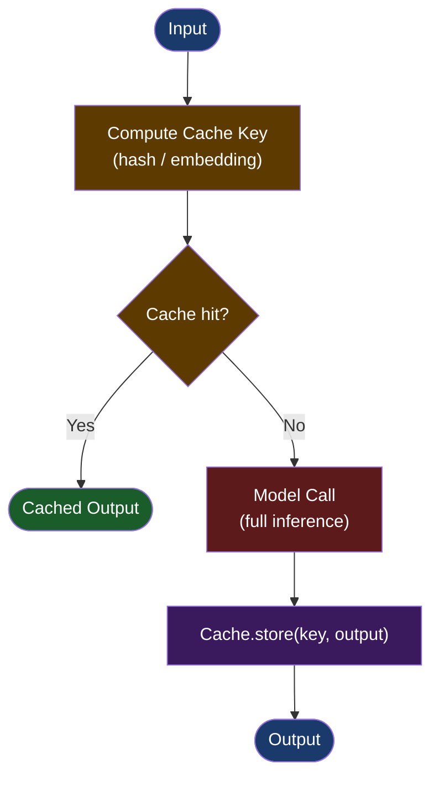

# Caching

**Family:** N — Efficiency & Model Routing
**Type:** Pattern

## Problem

Agent pipelines and user-facing applications frequently re-process identical or near-identical inputs: the same document is summarized multiple times, the same query triggers the same tool call, or the same system prompt prefix is re-encoded on every request. Each repeat call pays full inference cost and full latency even though the output would be identical to a prior call.

## Solution

Store the output of each inference call (or expensive sub-step) keyed by a hash or semantic embedding of its input. Before dispatching a call, check the cache. On a hit, return the stored result immediately at zero inference cost. On a miss, execute normally and populate the cache. For prompts with stable prefixes, use provider-level prompt caching to avoid re-encoding the shared prefix on repeated calls.

## Solution Structure

```
Input
  │
  ▼
Cache Lookup (hash or semantic key)
  │
  ├── HIT ──────────────────────────────────────► Cached Output
  │
  └── MISS
          │
          ▼
       Model Call  ──► Output  ──► Cache.store(key, output)
                                          │
                                          └──────────────────► Output
```

<details>
<summary><b>Solution Structure Diagram</b></summary>



</details>

## Implementation Sketch

```
CACHE = {}   // in-memory, Redis, or vector store depending on match type

function cached_invoke(input, model):
    key = hash(input)                    // exact match
    // OR: key = nearest_neighbor(embed(input), threshold)  // semantic match

    if key in CACHE and not expired(CACHE[key]):
        return CACHE[key].output

    output = model.invoke(input)
    CACHE[key] = {output: output, timestamp: now(), ttl: TTL}
    return output

// Provider-level prompt caching (e.g. Anthropic cache_control):
// Mark the stable prefix of the prompt with cache_control = {"type": "ephemeral"}
// The provider avoids re-encoding the cached prefix on repeated calls.
```

## When to Use

- The same or near-identical inputs recur across requests (identical prompts, repeated documents, common queries).
- Inference cost per call is significant and hit rates are measurable.
- Output staleness is acceptable for the use case (cache TTL can be set appropriately).
- The system prompt has a large, stable prefix shared across many requests — provider-level caching applies directly.

## When Not to Use

- Inputs are highly unique and hit rates would be near zero — caching overhead (key computation, storage, lookup) adds cost with no savings.
- Outputs must always reflect the latest state (e.g., live data lookups, real-time queries) — stale cache hits would be incorrect.
- The task is creative or stochastic and identical inputs should yield varied outputs by design.
- Cache invalidation is complex and unreliable — stale outputs would silently degrade quality (see [Silent Quality Degradation](../anti-patterns/silent-quality-degradation.md)).

## Trade-offs

| Pro | Con |
|-----|-----|
| Zero inference cost and zero latency on a cache hit | Requires cache infrastructure (storage, TTL management) |
| Savings compound with traffic — high hit rates are very impactful | Stale outputs if TTL is too long or invalidation is missed |
| Compatible with provider-level prompt caching for further savings | Semantic caching requires embedding overhead and a similarity threshold |
| Reduces load on downstream models and tools | Cache key design is non-trivial for semantic or partial matches |

## Example

A document Q&A system receives thousands of queries against the same 50 reference documents. By caching each (document, question-cluster) pair with a 24-hour TTL, 68% of requests are served from cache at zero inference cost. The remaining 32% populate the cache for subsequent callers, reducing daily inference spend by over half.

## Related Patterns

- [Tool/Result Reuse](tool-result-reuse.md) — cache tool call results (external APIs, search, DB) rather than model outputs
- [Context Minimization](context-minimization.md) — trimmed context reduces the surface area that must be cached
- [Complexity-Based Model Routing](complexity-based-model-routing.md) — route after confirming the cache misses
- [Budgeted Agent Loop](budgeted-agent-loop.md) — caching reduces per-iteration cost, extending what a fixed budget can achieve

## Related Anti-Patterns

- [Premature Optimization](../anti-patterns/premature-optimization.md) — caching incorrect outputs propagates errors at scale
- [Silent Quality Degradation](../anti-patterns/silent-quality-degradation.md) — stale or incorrect cache entries degrade quality invisibly

## Sources

- **Anthropic Engineering** — AI safety company; authors of Claude. [Building Effective Agents](https://www.anthropic.com/engineering/building-effective-agents)
- **AWS Prescriptive Guidance** — Amazon Web Services architecture team; defines Confidence-Based Routing. [Agentic AI Patterns](https://docs.aws.amazon.com/prescriptive-guidance/latest/agentic-ai-patterns/agent-patterns.html)
- **Microsoft Azure Architecture Center** — Microsoft's cloud architecture team. [AI Agent Design Patterns](https://learn.microsoft.com/en-us/azure/architecture/ai-ml/guide/ai-agent-design-patterns)
