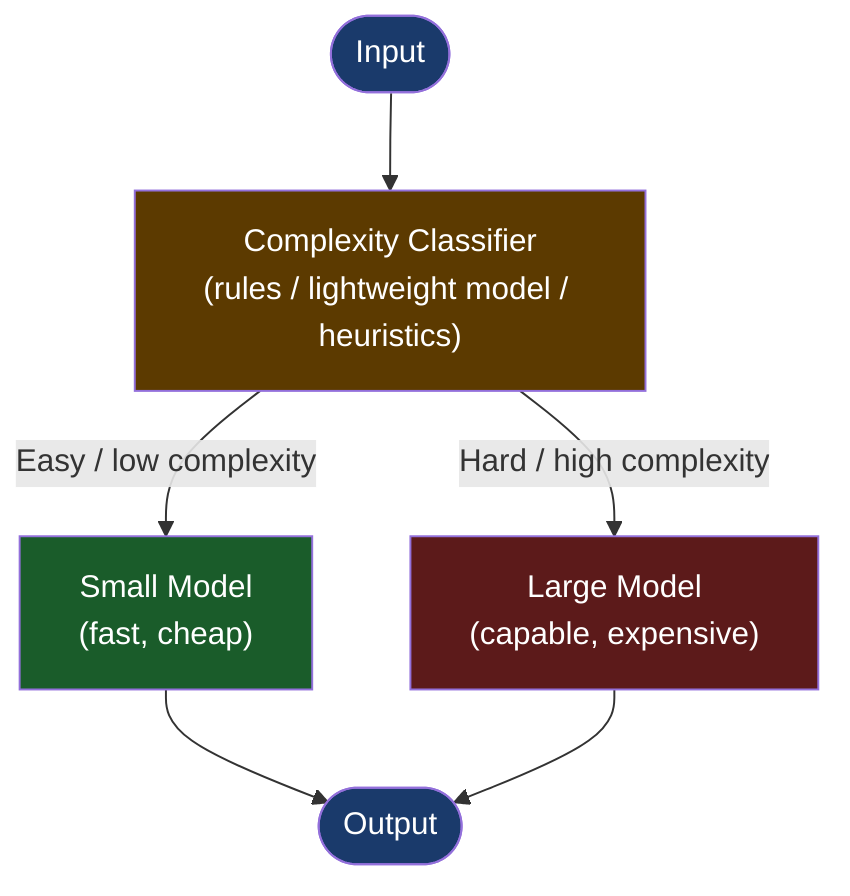

# Complexity-Based Model Routing

**Family:** N — Efficiency & Model Routing
**Type:** Pattern

## Problem

When every request is sent to the largest, most capable model, inference costs and latency scale with traffic regardless of task difficulty. Most production workloads contain a mix of trivial, moderate, and genuinely hard inputs; paying large-model prices for simple lookups or short classifications wastes budget and slows throughput without improving output quality on those easy cases.

## Solution

Before calling any model, classify the input by predicted complexity using cheap signals — input length, token count, keyword presence, a lightweight classifier, or rule-based heuristics. Route easy inputs to a small, fast model and reserve the large model only for inputs that exceed a complexity threshold. Classification happens at intake so no inference cost is paid on the wrong tier.

## Solution Structure

```
Input
  │
  ▼
┌─────────────────────┐
│  Complexity         │
│  Classifier         │  ← rules, lightweight model, or heuristic
│  (cheap, fast)      │
└─────────────────────┘
  │ score / label
  ├─────── EASY ──────────────────────────────────►  Small Model  ──► Output
  │
  └─────── HARD ──────────────────────────────────►  Large Model  ──► Output
```

<details>
<summary><b>Solution Structure Diagram</b></summary>



</details>

## Implementation Sketch

```
function route(input):
    complexity = classify(input)           // cheap: rules or tiny model
    if complexity == EASY:
        return small_model.invoke(input)
    else:
        return large_model.invoke(input)

function classify(input):
    // Tier 1: length heuristic
    if token_count(input) < EASY_THRESHOLD:
        return EASY
    // Tier 2: keyword / topic rules
    if matches_simple_pattern(input):
        return EASY
    // Tier 3: lightweight classifier
    score = classifier_model.predict(input)
    return EASY if score < COMPLEXITY_CUTOFF else HARD
```

## When to Use

- The workload contains a measurable mix of easy and hard inputs and you can characterize the difference before calling a model.
- A lightweight classifier or rule set reliably separates easy from hard inputs (validated on a labeled sample).
- The cost differential between small and large model is significant (e.g., 10× or more per token).
- Latency matters and simple inputs outnumber complex ones.

## When Not to Use

- Input complexity cannot be predicted before calling a model (use [Confidence-Based Routing](confidence-based-routing.md) instead).
- The workload is uniformly hard — routing overhead adds cost with no savings.
- The system is not yet producing correct output; routing to a cheaper model will produce cheap wrong answers (see [Premature Optimization](../anti-patterns/premature-optimization.md)).
- Classification accuracy is too low — misrouting hard inputs to the small model degrades quality silently (see [Silent Quality Degradation](../anti-patterns/silent-quality-degradation.md)).

## Trade-offs

| Pro | Con |
|-----|-----|
| Significant cost reduction when easy inputs dominate | Classifier must be trained and maintained |
| Lower latency for easy inputs | Misclassified hard inputs produce degraded output |
| Scales well: savings grow with traffic | Adds an extra step to the hot path |
| Threshold is tunable for quality vs. cost balance | Threshold tuning requires labeled evaluation data |

## Example

A customer support system receives 10,000 requests per day. After labeling a sample, 70% are simple FAQ lookups (short, keyword-matchable). Routing those to a small model at 1/15th the cost cuts the daily inference bill by ~65% while the large model handles the remaining 30% of nuanced complaints and escalations without quality loss.

## Related Patterns

- [Confidence-Based Routing](confidence-based-routing.md) — route after the model scores its own confidence rather than before calling any model
- [Small-Model-First Escalation](small-model-first-escalation.md) — start cheap and escalate on failure; complementary when pre-classification is unreliable
- [Budgeted Agent Loop](budgeted-agent-loop.md) — cap total cost after routing decisions are made
- [Family C — Orchestration](../../C-orchestration/README.md) — routing between specialized agents rather than model tiers

## Related Anti-Patterns

- [Premature Optimization](../anti-patterns/premature-optimization.md) — applying routing before correctness is established
- [Silent Quality Degradation](../anti-patterns/silent-quality-degradation.md) — routing without quality monitoring causes accuracy to drop undetected

## Sources

- **Anthropic Engineering** — AI safety company; authors of Claude. [Building Effective Agents](https://www.anthropic.com/engineering/building-effective-agents)
- **Google Cloud Architecture Center** — Google's cloud architecture team; frames pattern choice around latency, cost, and task characteristics. [Choose a Design Pattern for Agentic AI](https://docs.cloud.google.com/architecture/choose-design-pattern-agentic-ai-system)
- **Microsoft Azure Architecture Center** — Microsoft's cloud architecture team. [AI Agent Design Patterns](https://learn.microsoft.com/en-us/azure/architecture/ai-ml/guide/ai-agent-design-patterns)
