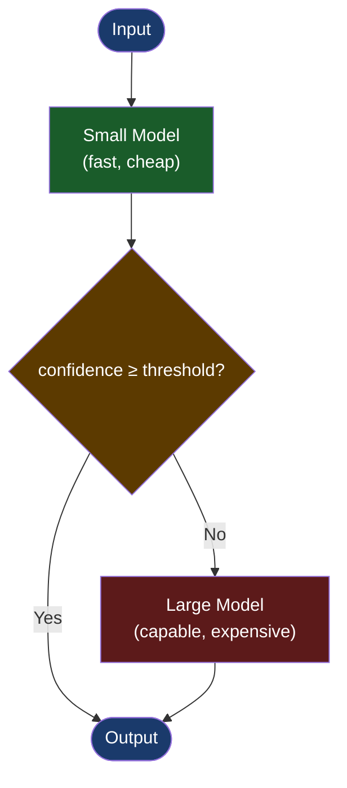

# Confidence-Based Routing

**Family:** N — Efficiency & Model Routing
**Type:** Pattern

## Problem

Some inputs look simple but are genuinely ambiguous; others look complex but are handled easily by a small model. Pre-classifying inputs by surface features (length, keywords) misroutes both classes. The result is either unnecessary large-model spend on easy inputs or degraded quality when hard inputs are sent to a small model that cannot handle them.

## Solution

Let the small model attempt the task first and emit a confidence score alongside its answer. If the score meets the threshold, return the answer. If not, escalate the same input — optionally including the small model's draft — to the large model. Routing is driven by the model's own posterior estimate of answer quality rather than input features predicted before any inference.

## Solution Structure

```
Input
  │
  ▼
Small Model  ──► (answer, confidence_score)
  │
  ├── confidence ≥ threshold ──────────────────────► Output
  │
  └── confidence < threshold
          │
          ▼
       Large Model  ──────────────────────────────► Output
```

<details>
<summary><b>Solution Structure Diagram</b></summary>



</details>

## Implementation Sketch

```
function route(input):
    answer, confidence = small_model.invoke_with_confidence(input)

    if confidence >= CONFIDENCE_THRESHOLD:
        return answer                          // fast, cheap path

    // Escalate; optionally forward the draft for context
    return large_model.invoke(input, hint=answer)

// Calibrate threshold on a held-out labeled set:
// find the score above which small-model accuracy meets the quality bar
CONFIDENCE_THRESHOLD = calibrate(validation_set, quality_bar)
```

## When to Use

- The small model produces a reliable, calibrated confidence or probability score.
- The failure mode is "occasionally wrong" rather than "systematically wrong" — the small model gets most inputs right.
- Input complexity is hard to predict before calling any model (surface features are not reliable classifiers).
- You have a labeled validation set to calibrate the confidence threshold against a quality bar.

## When Not to Use

- The small model's confidence scores are poorly calibrated (overconfident or underconfident) — use [Complexity-Based Model Routing](complexity-based-model-routing.md) with a pre-classifier instead.
- The task has no natural confidence signal (e.g., open-ended generation with no ground truth).
- Latency for the small-model attempt is unacceptable even when it would be escalated anyway.
- The system is not yet correct; routing on confidence will just escalate incorrect answers cheaply (see [Premature Optimization](../anti-patterns/premature-optimization.md)).

## Trade-offs

| Pro | Con |
|-----|-----|
| Routing is driven by actual task difficulty, not proxy features | Requires a small model that emits calibrated confidence |
| Fine-grained escalation; adapts to ambiguous inputs | Threshold calibration requires a labeled evaluation set |
| Naturally detects quality degradation at inference time | Low-confidence inputs always pay for two model calls |
| Compatible with monitoring: log confidence distributions | Poorly calibrated scores produce silent misroutes |

## Example

A legal document classifier routes most routine filings through a small model with >0.92 confidence and escalates ~15% of ambiguous filings to the large model. The overall cost drops by 60% versus always using the large model, and monitored accuracy on the escalated subset is indistinguishable from full large-model use.

## Related Patterns

- [Complexity-Based Model Routing](complexity-based-model-routing.md) — classify before calling any model when input features are reliable predictors
- [Small-Model-First Escalation](small-model-first-escalation.md) — escalate on failure rather than on confidence score; simpler when no confidence signal is available
- [Cost-Aware Stopping](cost-aware-stopping.md) — stop an agent loop when marginal improvement falls below a threshold, analogous to confidence-gated escalation
- [Family D — Verification & Evaluation](../D-verification-evaluation/README.md) — confidence scoring is a lightweight form of self-evaluation

## Related Anti-Patterns

- [Premature Optimization](../anti-patterns/premature-optimization.md) — routing before correctness is established
- [Silent Quality Degradation](../anti-patterns/silent-quality-degradation.md) — not monitoring confidence distributions means quality drops go undetected

## Sources

- **AWS Prescriptive Guidance** — Amazon Web Services architecture team; defines Confidence-Based Routing. [Agentic AI Patterns](https://docs.aws.amazon.com/prescriptive-guidance/latest/agentic-ai-patterns/agent-patterns.html)
- **Anthropic Engineering** — AI safety company; authors of Claude. [Building Effective Agents](https://www.anthropic.com/engineering/building-effective-agents)
- **Google Cloud Architecture Center** — Google's cloud architecture team; frames pattern choice around latency, cost, and task characteristics. [Choose a Design Pattern for Agentic AI](https://docs.cloud.google.com/architecture/choose-design-pattern-agentic-ai-system)
