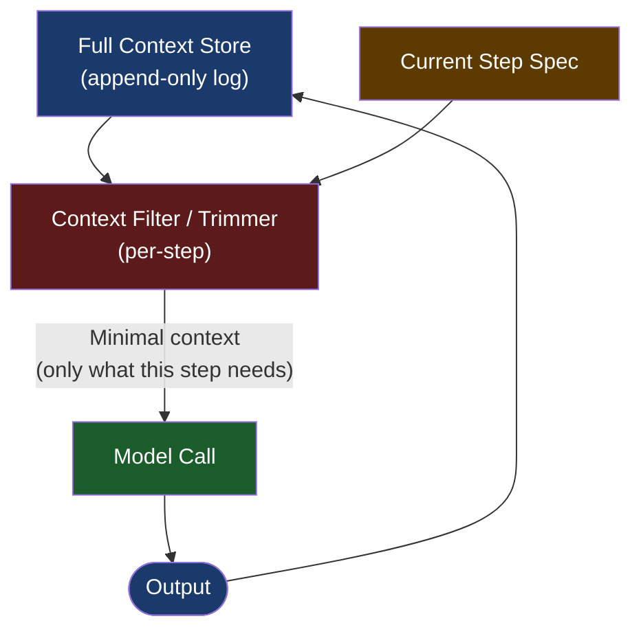

# Context Minimization

**Family:** N — Efficiency & Model Routing
**Type:** Pattern

## Problem

Agent loops and multi-step pipelines accumulate context: full conversation history, raw tool outputs, intermediate reasoning traces, and supporting documents. Sending the entire accumulated context on every inference call inflates prompt token counts, increases cost proportionally, and often exceeds context window limits on long runs — forcing expensive workarounds like truncation or summarization mid-flight.

## Solution

Before each model call, filter the context to only what is necessary for the current step. Remove completed reasoning traces, raw tool outputs that have been summarized, earlier turns that are no longer relevant, and duplicate information. Apply this trim at the step boundary, not retroactively, so the model always receives a lean, task-relevant prompt. The trimmed content is stored externally and retrieved only if needed.

## Solution Structure

```
Full Context Store
  │
  ▼
Context Filter / Trimmer  ←── current step specification
  │ minimal context
  ▼
Model Call
  │
  ▼
Output  ──► store result  ──► Full Context Store (append only)
```

<details>
<summary><b>Solution Structure Diagram</b></summary>



</details>

## Implementation Sketch

```
function call_model(step, full_context):
    minimal = trim(full_context, step)
    return model.invoke(minimal)

function trim(context, step):
    keep = []
    for item in context:
        if is_relevant(item, step):
            keep.append(item)
        elif is_raw_tool_output(item) and has_summary(item):
            keep.append(summary_of(item))   // replace raw with summary
        // else: drop entirely
    return keep

function is_relevant(item, step):
    // Examples:
    // - item is the current task definition → always keep
    // - item is a tool result used by this step → keep
    // - item is a prior step's full trace → drop (keep only its conclusion)
    // - item is a document already incorporated → drop
    return step.depends_on(item)
```

## When to Use

- The agent loop or pipeline runs for many turns and context accumulates significantly.
- Tool outputs are verbose and most of their content is not needed after the immediate step.
- Prompt token costs are a meaningful fraction of total system cost.
- Context window limits are approached on long runs.

## When Not to Use

- The current step genuinely requires the full prior context (e.g., a final summarization step that synthesizes everything).
- Context is already short and trimming adds complexity without meaningful savings.
- The filter logic is expensive to run (e.g., an LLM-based relevance scorer) — the filter cost must be less than the token savings.
- Trimming is lossy for the task and cannot be validated — prefer [Caching](caching.md) or [Tool/Result Reuse](tool-result-reuse.md) to avoid re-generating content.

## Trade-offs

| Pro | Con |
|-----|-----|
| Reduces token cost on every call where trimming applies | Filter logic must be designed per task or step type |
| Prevents context window overflow on long runs | Aggressive trimming risks losing information the model silently needs |
| Faster inference (fewer input tokens to process) | Requires an external store for trimmed content |
| Composable with routing — trim first, then route | Summarization of tool outputs may introduce inaccuracy |

## Example

A 20-step research agent accumulates raw web search results (avg. 2,000 tokens each) after each tool call. By replacing each raw result with a 100-token summary after the step that uses it, the average prompt size drops from 40,000 tokens to 6,000 tokens at step 20, cutting per-call cost by 85% without changing the final report quality.

## Related Patterns

- [Caching](caching.md) — avoid re-generating content that trimming would discard
- [Tool/Result Reuse](tool-result-reuse.md) — store tool results externally so they can be trimmed from context but retrieved on demand
- [Budgeted Agent Loop](budgeted-agent-loop.md) — context minimization reduces per-step cost; budgeting caps the total
- [Family E — Context Engineering](../../E-context-engineering/README.md) — context minimization is also a context pattern; N treats it as a cost intervention

## Related Anti-Patterns

- [Premature Optimization](../anti-patterns/premature-optimization.md) — trimming context on an incorrect system hides the very information needed to debug it
- [Silent Quality Degradation](../anti-patterns/silent-quality-degradation.md) — aggressive trimming without quality monitoring causes subtle accuracy loss

## Sources

- **Anthropic Engineering** — AI safety company; authors of Claude. [Building Effective Agents](https://www.anthropic.com/engineering/building-effective-agents)
- **Google Cloud Architecture Center** — Google's cloud architecture team; frames pattern choice around latency, cost, and task characteristics. [Choose a Design Pattern for Agentic AI](https://docs.cloud.google.com/architecture/choose-design-pattern-agentic-ai-system)
- **Microsoft Azure Architecture Center** — Microsoft's cloud architecture team. [AI Agent Design Patterns](https://learn.microsoft.com/en-us/azure/architecture/ai-ml/guide/ai-agent-design-patterns)
