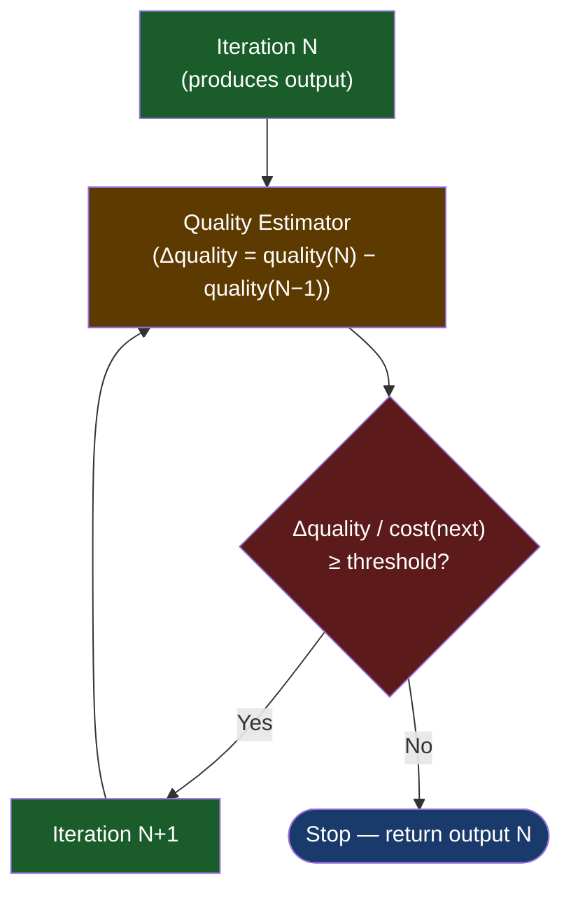

# Cost-Aware Stopping

**Family:** N — Efficiency & Model Routing
**Type:** Pattern

## Problem

Agent loops and iterative refinement pipelines often continue long past the point of diminishing returns. Each additional iteration improves output quality by a smaller margin than the last while paying the same per-step cost. Without a stopping criterion tied to value, the loop runs to its hard budget limit (or indefinitely), spending tokens on marginal gains that do not justify the cost.

## Solution

After each iteration, estimate the marginal value of continuing — via a quality delta metric, a confidence score, a self-assessment, or a comparison of successive outputs. If the estimated marginal improvement falls below a defined threshold relative to the cost of the next step, stop and return the current result. The stopping criterion is defined before the run starts, not discovered reactively.

## Solution Structure

```
Iteration N output
  │
  ▼
Quality Estimator  ──► Δquality = quality(N) - quality(N-1)
  │
  ├── Δquality / cost(next_step) ≥ threshold ──► continue to iteration N+1
  │
  └── Δquality / cost(next_step) < threshold ──► STOP → return output(N)
```

<details>
<summary><b>Solution Structure Diagram</b></summary>



</details>

## Implementation Sketch

```
function iterative_run(task, stop_config: StopConfig):
    output = initial_output(task)
    prev_quality = 0.0

    for step in range(stop_config.max_steps):
        output = refine(output, task)
        quality = estimate_quality(output)
        delta   = quality - prev_quality

        if delta / stop_config.step_cost < stop_config.value_threshold:
            break    // marginal value below threshold — stop early

        prev_quality = quality

    return output

// estimate_quality examples:
// - LLM self-score: "rate the completeness of this answer 0-10"
// - validation set pass rate on a held-out sample
// - semantic similarity between output(N) and output(N-1): small delta → converged
// - task-specific rubric score
```

## When to Use

- The loop is iterative-refinement by nature (rewrites, retry-with-feedback, plan-then-revise).
- A meaningful quality signal can be computed cheaply after each iteration.
- Successive outputs converge and the delta between iterations is a reliable stopping signal.
- The task has a "good enough" threshold rather than requiring perfect output.

## When Not to Use

- Quality cannot be estimated cheaply between iterations — the estimator cost negates the savings.
- The task requires a specific number of iterations by definition (e.g., a fixed k-round review protocol).
- Quality is non-monotonic (output can get worse before getting better) — early stopping would fire prematurely.
- The [Budgeted Agent Loop](budgeted-agent-loop.md) hard cap is already binding; additional stopping logic adds complexity without benefit.

## Trade-offs

| Pro | Con |
|-----|-----|
| Stops exactly when marginal value falls below the cost threshold | Quality estimator must be reliable; a poor estimator stops too early or too late |
| Savings are largest on runs that converge quickly | Adds per-iteration overhead for quality estimation |
| Complements hard budget cap — stops earlier in the common case | Threshold calibration requires representative workload data |
| Surfaces convergence signal, useful for monitoring and tuning | Non-monotonic quality curves make the stopping criterion unreliable |

## Example

A report-writing agent runs up to 10 refinement rounds. With cost-aware stopping, the quality delta drops below the value threshold at round 4 on 80% of tasks. Average iterations per run drop from 10 to 4.3, saving 57% of per-run token cost while final output quality measured on a held-out evaluation set is statistically indistinguishable from running all 10 rounds.

## Related Patterns

- [Budgeted Agent Loop](budgeted-agent-loop.md) — hard ceiling on total cost; cost-aware stopping fires first in the common case of converging runs
- [Confidence-Based Routing](confidence-based-routing.md) — analogous: stop escalating when confidence is sufficient; stop iterating when improvement is sufficient
- [Complexity-Based Model Routing](complexity-based-model-routing.md) — route each iteration to the cheapest model that can make meaningful progress
- [Family D — Verification & Evaluation](../D-verification-evaluation/README.md) — the quality estimator used for stopping is a lightweight evaluator

## Related Anti-Patterns

- [Premature Optimization](../anti-patterns/premature-optimization.md) — stopping early on an incorrect system returns cheap wrong answers
- [Silent Quality Degradation](../anti-patterns/silent-quality-degradation.md) — a poorly calibrated quality estimator stops too early and the quality drop is not monitored

## Sources

- **Anthropic Engineering** — AI safety company; authors of Claude. [Building Effective Agents](https://www.anthropic.com/engineering/building-effective-agents)
- **Google Cloud Architecture Center** — Google's cloud architecture team; frames pattern choice around latency, cost, and task characteristics. [Choose a Design Pattern for Agentic AI](https://docs.cloud.google.com/architecture/choose-design-pattern-agentic-ai-system)
- **AWS Prescriptive Guidance** — Amazon Web Services architecture team; defines Confidence-Based Routing. [Agentic AI Patterns](https://docs.aws.amazon.com/prescriptive-guidance/latest/agentic-ai-patterns/agent-patterns.html)
