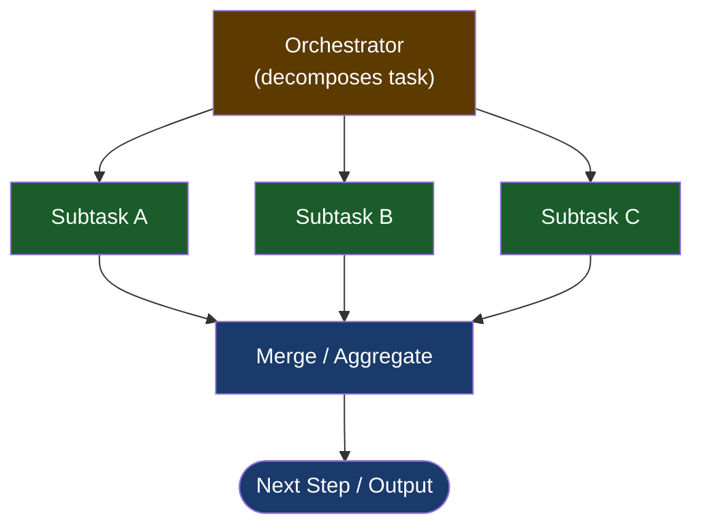

# Parallel Execution

**Family:** N — Efficiency & Model Routing
**Type:** Pattern

## Problem

Sequential execution of independent subtasks accumulates their latencies — the total wall-clock time equals the sum of each step. In agent workflows that fan out to multiple tools, sub-agents, or model calls, this makes throughput proportional to the longest chain of dependencies rather than the workload's inherent complexity. Users wait for results that could have been computed simultaneously.

## Solution

Identify subtasks that have no data dependency on each other and dispatch them concurrently. A coordinating layer collects results as they complete and merges them before passing to the next dependent step. The wall-clock time for the parallel batch is bounded by the slowest subtask, not the sum of all.

## Solution Structure

```
Orchestrator
  │
  ├──── Subtask A (no dependency on B, C) ──► result_A
  ├──── Subtask B (no dependency on A, C) ──► result_B
  └──── Subtask C (no dependency on A, B) ──► result_C
  │
  ▼  (all results collected)
Merge / Aggregate  ──► Next Step
```

<details>
<summary><b>Solution Structure Diagram</b></summary>



</details>

## Implementation Sketch

```
function run_parallel(task):
    subtasks = decompose(task)               // identify independent subtasks
    assert no_circular_dependencies(subtasks)

    futures = [dispatch_async(s) for s in subtasks]
    results = await_all(futures)             // collect as each completes

    return merge(results)

function merge(results):
    // Task-specific aggregation:
    // - concatenate sections of a report
    // - union tool results
    // - vote / pick best for speculative execution
    return aggregate(results)
```

## When to Use

- The task decomposes into subtasks that share no data dependencies.
- Each subtask's latency is non-trivial (parallel overhead is justified).
- The execution environment supports concurrent dispatch (async runtime, thread pool, or multi-agent framework).
- Wall-clock latency matters more than total token spend.

## When Not to Use

- Subtasks are data-dependent and must execute in sequence; forced parallelism introduces race conditions or stale inputs.
- Each subtask is so fast that dispatch and coordination overhead dominates.
- Concurrency limits (rate limits, context window size, budget) make parallel dispatch unsafe — use [Budgeted Agent Loop](budgeted-agent-loop.md) to cap concurrent spend.
- The merge step is ill-defined; conflicting results from parallel subtasks cannot be reliably reconciled.

## Trade-offs

| Pro | Con |
|-----|-----|
| Wall-clock time bounded by slowest subtask, not sum | Requires a dependency analysis step upfront |
| No quality loss — outputs are identical to sequential | Coordination and merge logic adds implementation complexity |
| Scales naturally with independent workloads | Rate limits and budgets can throttle effective parallelism |
| Enables speculative execution (run N variants, pick best) | Errors in one subtask may require partial re-execution |

## Example

A research agent needs to gather information from five independent data sources before writing a report. Running them sequentially takes 25 seconds (5 × 5s). Dispatching all five concurrently reduces wall-clock time to ~6 seconds (the slowest source), a 4× latency improvement with no change in output quality.

## Related Patterns

- [Budgeted Agent Loop](budgeted-agent-loop.md) — cap total parallel spend to prevent concurrent cost spikes
- [Tool/Result Reuse](tool-result-reuse.md) — avoid re-dispatching subtasks whose results are already cached
- [Complexity-Based Model Routing](complexity-based-model-routing.md) — route each parallel subtask to the appropriate model tier
- [Family A — Workflow Topology](../A-workflow-topology/README.md) — parallel execution is also a topology pattern; N treats it as a latency optimization

## Related Anti-Patterns

- [Premature Optimization](../anti-patterns/premature-optimization.md) — parallelizing an incorrect pipeline produces multiple wrong answers simultaneously

## Sources

- **Anthropic Engineering** — AI safety company; authors of Claude. [Building Effective Agents](https://www.anthropic.com/engineering/building-effective-agents)
- **Google Cloud Architecture Center** — Google's cloud architecture team; frames pattern choice around latency, cost, and task characteristics. [Choose a Design Pattern for Agentic AI](https://docs.cloud.google.com/architecture/choose-design-pattern-agentic-ai-system)
- **OpenAI Engineering** — AI research company. [A Practical Guide to Building AI Agents](https://openai.com/business/guides-and-resources/a-practical-guide-to-building-ai-agents/)
