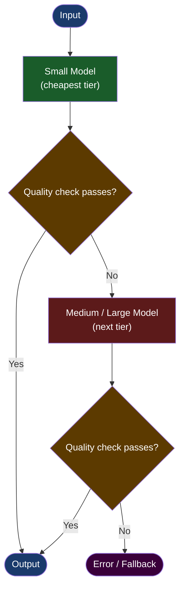

# Small-Model-First Escalation

**Family:** N — Efficiency & Model Routing
**Type:** Pattern

## Problem

Routing decisions made before any inference rely on proxy features that may not accurately reflect task difficulty. Pre-classifiers can be expensive to build and maintain, and their errors silently degrade quality. Without a classifier, all inputs pay the large-model price even though most workloads contain many inputs a small model handles correctly.

## Solution

Always attempt the task with the cheapest available model first. Escalate to the next tier only when the attempt fails a defined quality check — such as a format validation, a contradiction check, a retry signal, or a downstream assertion. No pre-classifier is needed; the small model's own output determines whether escalation is required. Tiers can be chained (small → medium → large).

## Solution Structure

```
Input
  │
  ▼
Small Model  ──► output
  │
  ├── passes quality check ──────────────────────► Output
  │
  └── fails quality check
          │
          ▼
       Medium/Large Model  ──► output
          │
          ├── passes quality check ─────────────► Output
          │
          └── fails ──────────────────────────► Error / fallback
```

<details>
<summary><b>Solution Structure Diagram</b></summary>



</details>

## Implementation Sketch

```
TIERS = [small_model, medium_model, large_model]

function escalate(input):
    for model in TIERS:
        output = model.invoke(input)
        if quality_check(output):
            return output
    raise MaxEscalationReached(input)

function quality_check(output):
    // Examples of checks (pick what fits the task):
    // - schema / format validation
    // - self-consistency: model re-reads and confirms
    // - downstream assertion: tool result is not an error
    // - length / completeness heuristic
    return is_valid(output) and not is_incomplete(output)
```

## When to Use

- Most inputs are simple enough for a small model; hard inputs are the minority.
- A reliable quality check exists for the output (format, schema, tool feedback, assertion).
- No pre-classifier is available or affordable to build.
- The failure mode is "occasionally wrong" — a retry at a higher tier fixes it.

## When Not to Use

- The small model's quality check is not reliable — escalation fires on correct outputs or misses incorrect ones.
- The majority of inputs fail the small model — most calls pay for two tiers, which is more expensive than routing directly.
- Latency is critical and the small-model attempt adds unacceptable overhead on the escalation path.
- Input complexity can be predicted cheaply upfront — [Complexity-Based Model Routing](complexity-based-model-routing.md) is more efficient.

## Trade-offs

| Pro | Con |
|-----|-----|
| No pre-classifier needed | Failed attempts pay for two (or more) inference calls |
| Naturally adapts to actual difficulty at runtime | Quality check design is task-specific and requires care |
| Easy to chain into multiple tiers | Escalation latency adds up when failure rate is high |
| Reduces cost when small-model success rate is high | Risk of quality check false negatives hiding bad output |

## Example

A code generation assistant tries every request on a small model first. It validates the output by running the generated code in a sandbox; if the code fails, it escalates to the large model with the original prompt plus the error message as context. The small model handles 72% of requests successfully, cutting average inference cost by 58%.

## Related Patterns

- [Confidence-Based Routing](confidence-based-routing.md) — escalate on confidence score rather than on a post-hoc quality check
- [Complexity-Based Model Routing](complexity-based-model-routing.md) — skip the small-model attempt entirely when input is clearly complex
- [Budgeted Agent Loop](budgeted-agent-loop.md) — cap total escalation attempts to prevent runaway cost
- [Family I — Reliability & Recovery](../I-reliability-recovery/README.md) — escalation shares structure with retry patterns

## Related Anti-Patterns

- [Premature Optimization](../anti-patterns/premature-optimization.md) — escalation on an incorrect system produces cheap wrong answers
- [Silent Quality Degradation](../anti-patterns/silent-quality-degradation.md) — a weak quality check lets degraded output through undetected

## Sources

- **Anthropic Engineering** — AI safety company; authors of Claude. [Building Effective Agents](https://www.anthropic.com/engineering/building-effective-agents)
- **Google Cloud Architecture Center** — Google's cloud architecture team; frames pattern choice around latency, cost, and task characteristics. [Choose a Design Pattern for Agentic AI](https://docs.cloud.google.com/architecture/choose-design-pattern-agentic-ai-system)
- **OpenAI Engineering** — AI research company. [A Practical Guide to Building AI Agents](https://openai.com/business/guides-and-resources/a-practical-guide-to-building-ai-agents/)
