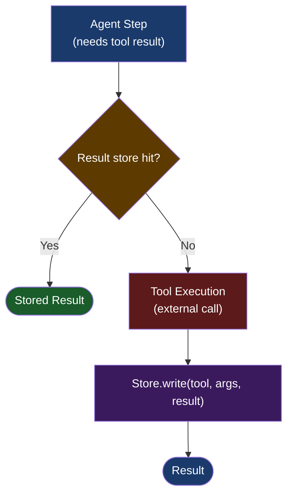

# Tool/Result Reuse

**Family:** N — Efficiency & Model Routing
**Type:** Pattern

## Problem

Within a single agent run, the same tool may be invoked multiple times with the same arguments across different steps or sub-agents. A web search, database query, or external API call is re-executed even though the result is already available in the run's history. This wastes time, money, and external API quota — and can violate rate limits or introduce inconsistency if the external source returns different results on repeated calls.

## Solution

Maintain a result store scoped to the current run (or session). Before dispatching any tool call, look up the tool name and arguments in the store. On a hit, return the stored result. On a miss, execute the tool and write the result to the store. The store is ephemeral — it lives for the duration of the run and is not shared across independent runs unless results are known to be stable.

## Solution Structure

```
Agent Step
  │ wants: tool(args)
  ▼
Run-Scoped Result Store
  │
  ├── HIT  ──────────────────────────────────────► Stored Result
  │
  └── MISS
          │
          ▼
       Tool Execution  ──► result  ──► Store.write(tool, args, result)
                                               │
                                               └──────────────────► Result
```

<details>
<summary><b>Solution Structure Diagram</b></summary>



</details>

## Implementation Sketch

```
RUN_STORE = {}   // scoped to current run; keyed by (tool_name, canonical_args)

function invoke_tool(tool_name, args):
    key = (tool_name, canonicalize(args))

    if key in RUN_STORE:
        return RUN_STORE[key]

    result = tools[tool_name].call(args)
    RUN_STORE[key] = result
    return result

function canonicalize(args):
    // Sort dict keys, normalize whitespace, lowercase where appropriate
    // so semantically identical calls share the same key
    return stable_serialize(args)
```

## When to Use

- The agent loop or multi-agent system may call the same tool with the same arguments more than once within a run.
- Tool calls are expensive (external API fees, latency, rate limits).
- Results are deterministic or stable within the run window (e.g., a database record is unlikely to change mid-run).
- Multiple parallel sub-agents may independently request the same tool result.

## When Not to Use

- Tool results are intentionally non-deterministic or must reflect real-time state (e.g., stock prices, live sensor data) — reuse would return stale data.
- Tool calls have side effects (write operations, order placement) — reuse would suppress the intended side effect.
- The run is short and no tool is ever called more than once — the store adds overhead with no benefit.

## Trade-offs

| Pro | Con |
|-----|-----|
| Eliminates redundant external calls within a run | Requires a result store and canonicalization logic |
| Consistent results: all steps see the same data within a run | Stale results if external state changes mid-run |
| Reduces external API quota consumption and rate-limit risk | Write-side-effect tools must be explicitly excluded |
| Composable with [Caching](caching.md) for cross-run reuse | Canonicalization bugs cause cache misses or false hits |

## Example

A research agent with five parallel sub-agents all need the same web search result. Without reuse, five identical HTTP requests are made in parallel; with the run-scoped store, the first sub-agent executes the search and the remaining four read from the store. Total external calls drop from 5 to 1, and all sub-agents see identical, consistent data.

## Related Patterns

- [Caching](caching.md) — persist results beyond the current run for cross-session reuse
- [Parallel Execution](parallel-execution.md) — result reuse is especially valuable when parallel sub-agents would otherwise make identical calls
- [Context Minimization](context-minimization.md) — stored results can be trimmed from context after use, then retrieved on demand
- [Budgeted Agent Loop](budgeted-agent-loop.md) — reuse reduces per-step tool cost, extending what a fixed budget achieves

## Related Anti-Patterns

- [Premature Optimization](../anti-patterns/premature-optimization.md) — reusing results from an incorrect prior step propagates the error to all subsequent steps
- [Silent Quality Degradation](../anti-patterns/silent-quality-degradation.md) — stale stored results degrade quality invisibly when external state changes mid-run

## Sources

- **Anthropic Engineering** — AI safety company; authors of Claude. [Building Effective Agents](https://www.anthropic.com/engineering/building-effective-agents)
- **OpenAI Engineering** — AI research company. [A Practical Guide to Building AI Agents](https://openai.com/business/guides-and-resources/a-practical-guide-to-building-ai-agents/)
- **AWS Prescriptive Guidance** — Amazon Web Services architecture team; defines Confidence-Based Routing. [Agentic AI Patterns](https://docs.aws.amazon.com/prescriptive-guidance/latest/agentic-ai-patterns/agent-patterns.html)
