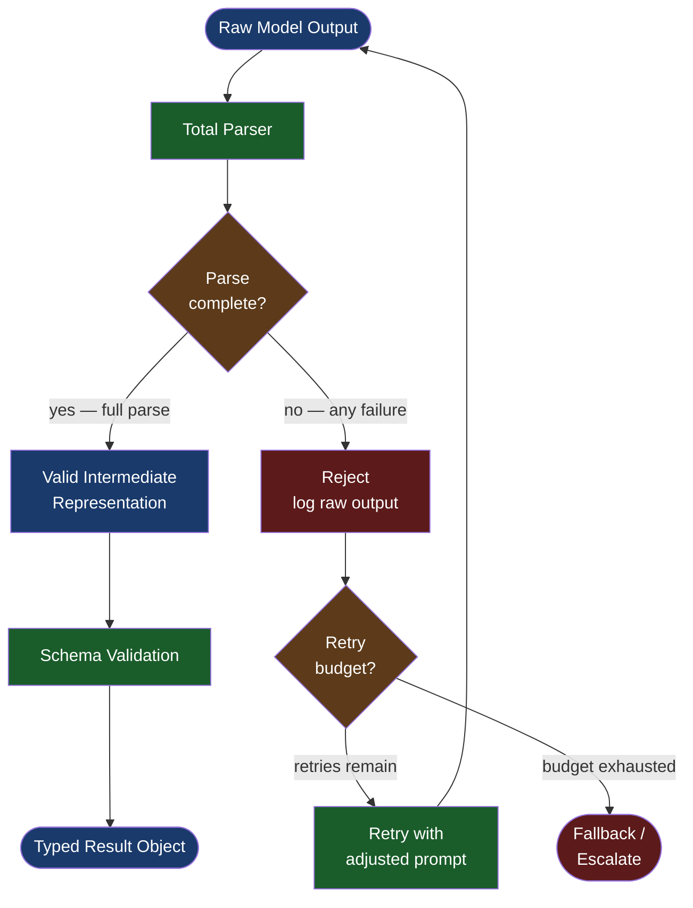

# Parse-and-Reject

**Family:** O — Output & Integration Boundaries
**Intent:** Parse model output completely and atomically; reject the entire output and invoke a defined fallback if parsing fails at any point — never partially process malformed output.
**Also known as:** All-or-Nothing Parsing, Total Parse, Reject-on-Failure

## Problem

Lenient parsing is a common defense against model output variation, but it introduces subtle correctness hazards:

- A parser that extracts a substring and succeeds silently discards the remainder. If the discarded portion contained required data, the result is a corrupt partial record with no error signal.
- Parsers that coerce or guess at field values (e.g., treating `"N/A"` as `null`) mask model errors and make output degradation invisible.
- Partial processing of malformed output can commit side effects (database writes, API calls) before the failure is detected. Rolling back partial side effects is often impossible.
- Without a defined rejection path, callers have no consistent way to handle parse failures — each call site invents its own behavior.

The core force: parsing is an assertion that the input meets a structural contract. Partial assertion is not meaningful — either the contract is met or it is not.

## Solution

Parse model output in a single atomic operation. If the parse succeeds, the result is a fully valid intermediate representation. If the parse fails at any point — missing field, wrong type, truncated structure — the entire operation fails, no partial result is returned, and a defined error path is invoked. The caller then executes a pre-defined fallback: retry the model call, use a default value, or escalate to a human.

Critically: the fallback behavior must be defined before execution, not improvised at the call site when a failure occurs.

## Structure

<details>
<summary><b>Solution Structure</b></summary>



</details>

## Participants

| Participant | Role |
|---|---|
| **Raw Model Output** | The unvalidated text response from the model |
| **Total Parser** | Parses the entire output atomically; produces a complete result or a structured error |
| **Valid Intermediate Representation** | A fully parsed dict/map — every required field present and structurally correct |
| **Reject** | Terminates parsing on any failure; logs raw output for debugging |
| **Retry Logic** | Tracks retry budget; re-invokes the model with an adjusted prompt on rejection |
| **Fallback / Escalate** | Final handler when retry budget is exhausted — default value, human escalation, or hard error |

## Implementation Notes

**Pseudocode — total parse with retry loop:**

```
MAX_RETRIES = 3
attempt = 0
last_error = null

while attempt < MAX_RETRIES:
  raw_output = model_api.complete(messages + retry_hint(last_error))

  // check finish reason first — truncated output should be rejected
  if raw_output.finish_reason != "stop":
    last_error = FinishReasonError(raw_output.finish_reason)
    attempt += 1
    continue

  try:
    parsed = total_parse(raw_output.content)    // raises on any structural failure
    return parsed                                // success: exit retry loop
  catch ParseError as e:
    log.warn("parse_rejected", {
      attempt:    attempt,
      error:      e.message,
      raw_output: raw_output.content            // preserve raw for debugging
    })
    last_error = e
    attempt += 1

// retry budget exhausted
raise OutputBoundaryError("parse failed after " + MAX_RETRIES + " attempts", last_error)

// ---- total_parse implementation ----
function total_parse(text: String) -> Dict:
  parsed = json_parse(text)                    // raises on invalid JSON
  required_fields = ["action", "target", "confidence"]
  for field in required_fields:
    if field not in parsed:
      raise ParseError("missing required field: " + field)
  return parsed                                // all fields present — total parse succeeded
```

**Key guidance:**

- Never extract a substring and treat it as the complete parse. If the model output contains JSON wrapped in prose, either use Structured Output Boundary to prevent the wrapping, or reject the entire output.
- On retry, include the parse error in the retry prompt: `"Your previous response could not be parsed because: {error}. Please respond only with valid JSON matching this schema: {schema}."` This gives the model signal to correct itself.
- Log the raw model response on every rejection — not just the error message. The raw response is required for diagnosing whether the failure is a model error, a prompt error, or an infrastructure error.
- Define the retry budget and fallback behavior before the first call. A caller that has no fallback will improvise at runtime, often by silently continuing with partial data.
- Distinguish recoverable parse failures (malformed JSON, missing field — retry may help) from unrecoverable ones (the model fundamentally cannot produce the required format — fallback or prompt redesign required).

## Consequences

**Gains:**
- Partial processing of malformed output is structurally impossible.
- Failure behavior is explicit and testable — inject malformed responses in tests to verify the rejection path.
- Raw output is preserved at the point of failure, enabling root-cause analysis.
- Retry logic is centralized rather than scattered across call sites.

**Trade-offs:**
- Retry loops add latency and cost. Budget retry attempts based on the cost profile of the use case.
- Hard rejection may be too strict for outputs where partial information is genuinely useful (e.g., a list where some items are valid and some are not). In such cases, define a schema where valid-subset outputs are themselves valid.
- Retry prompts that include error details may inadvertently leak prompt internals if the model echoes them in its response.

## Related Patterns

- [Structured Output Boundary](structured-output-boundary.md) — reduces parse failure rate at the source; Parse-and-Reject handles residual failures
- [Schema Validation](schema-validation.md) — runs after a successful total parse; catches semantic schema violations
- [Typed Result Object](typed-result-object.md) — receives the fully parsed result after rejection gate
- [Programmatic Postcondition](programmatic-postcondition.md) — asserts semantic invariants after parse succeeds
- [Family H — Deterministic Control](../H-deterministic-control/README.md) — the rejection gate is a hard deterministic control point in the agentic pipeline

## When to Use / When Not to Use

**Use when:**
- Partial processing of model output could cause incorrect side effects (database writes, external API calls).
- The output structure has required fields — a missing field must be a hard error, not a `null`.
- You need testable, auditable rejection behavior at the output boundary.
- The system can tolerate retry latency in exchange for correctness guarantees.

**Do not use when:**
- Output is advisory or informational — a parse failure does not affect correctness (e.g., a UI hint that can be omitted if missing).
- The valid partial subset of output is genuinely useful and well-defined. In this case, redesign the schema so the partial subset is a complete valid output.

## Sources

- **Anthropic Engineering** — AI safety company; authors of Claude. [Building Effective Agents](https://www.anthropic.com/engineering/building-effective-agents)
- **OpenAI Engineering** — AI research company; advocates schema-constrained structured output. [A Practical Guide to Building AI Agents](https://openai.com/business/guides-and-resources/a-practical-guide-to-building-ai-agents/)
- **AWS Prescriptive Guidance** — Amazon Web Services architecture team. [Agentic AI Patterns](https://docs.aws.amazon.com/prescriptive-guidance/latest/agentic-ai-patterns/agent-patterns.html)
- **OWASP GenAI Security Project** — Open Web Application Security Project; sanitized output prevents injection into downstream systems. [OWASP Top 10 for Agentic Applications 2026](https://genai.owasp.org/resource/owasp-top-10-for-agentic-applications-for-2026/)
