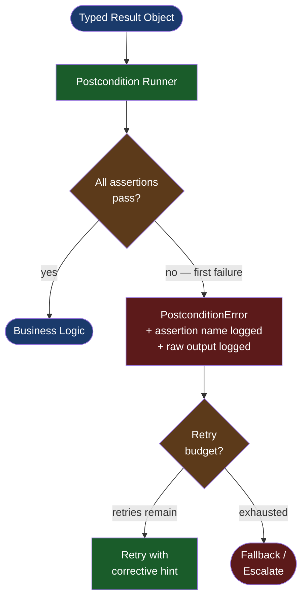

# Programmatic Postcondition

**Family:** O — Output & Integration Boundaries
**Intent:** Assert domain-level invariants on parsed, schema-valid model output before it is consumed by business logic or committed to state.
**Also known as:** Output Invariant Check, Semantic Validation Gate, Post-Parse Assertion

## Problem

Schema validation confirms structural correctness — required fields are present, types match, enum values are in the declared set. It does not confirm semantic correctness. Several classes of failure survive schema validation:

- **Numeric range overflow:** A confidence score of `1.7` passes a `number` type constraint but violates `[0.0, 1.0]`.
- **Temporal inversion:** An event with `end_time < start_time` passes individual field schemas but is semantically impossible.
- **Cross-field inconsistency:** A record where `status = "COMPLETE"` but `completion_date` is null passes field-level validation but violates a business rule.
- **Cardinality constraint violation:** A list of assigned agents has 0 elements when the schema requires `minItems: 1` but the model emits an empty array and the schema was not tight enough.
- **Domain-specific range:** A price of `-50.00` passes a `number` schema but is invalid in the pricing domain.

Schema languages can express some of these constraints, but complex cross-field invariants are difficult or impossible to encode in JSON Schema. Programmatic postconditions express the full domain invariant.

## Solution

After parsing and schema validation succeed, run a set of programmatic assertions against the typed result object. Each assertion targets one domain invariant. If any assertion fails, the output is rejected at the boundary — it does not reach business logic. The rejection path is the same as for schema or parse failures: log the raw output, invoke the retry/fallback strategy.

Postconditions are not business logic — they are boundary guards. They do not transform or use the data; they only verify it is fit to enter the downstream system.

## Structure

<details>
<summary><b>Solution Structure</b></summary>



</details>

## Participants

| Participant | Role |
|---|---|
| **Typed Result Object** | Schema-valid parsed output wrapped in a domain type |
| **Postcondition Runner** | Executes each assertion in sequence; stops at the first failure |
| **Assertion** | A single named predicate over the typed result — returns pass or fail with a message |
| **PostconditionError** | Carries the failed assertion name, expected condition, actual value, and raw model output |
| **Business Logic** | Only reached when all postconditions pass — can trust the semantic correctness of its input |
| **Retry / Fallback** | Same infrastructure as Parse-and-Reject; corrective hint names the violated invariant |

## Implementation Notes

**Pseudocode — postcondition runner with named assertions:**

```
// Define postconditions as named predicates
postconditions = [
  Assertion(
    name    = "confidence_in_range",
    check   = (r) => r.confidence >= 0.0 and r.confidence <= 1.0,
    message = "confidence must be in [0.0, 1.0], got: {r.confidence}"
  ),
  Assertion(
    name    = "end_after_start",
    check   = (r) => r.end_time > r.start_time,
    message = "end_time must be after start_time"
  ),
  Assertion(
    name    = "complete_requires_date",
    check   = (r) => r.status != "COMPLETE" or r.completion_date is not null,
    message = "status=COMPLETE requires completion_date to be set"
  )
]

function run_postconditions(result: TypedResult, raw_output: String):
  for assertion in postconditions:
    if not assertion.check(result):
      log.error("postcondition_failed", {
        assertion:  assertion.name,
        message:    assertion.message.format(r=result),
        raw_output: raw_output
      })
      raise PostconditionError(assertion.name, assertion.message.format(r=result))
  // all passed — result is semantically fit for business logic
  return result

// Usage in output pipeline
parsed    = json_parse(raw_output.content)
validated = schema_validator.validate(parsed, schema)     // structural
result    = TypedResult.from_dict(validated)
safe      = run_postconditions(result, raw_output.content) // semantic
business_logic(safe)
```

**Key guidance:**

- Name every assertion. The assertion name appears in logs and retry hints — unnamed assertions produce unactionable error messages.
- Fail fast: stop at the first failed assertion. Running all assertions on a failed result conflates distinct issues.
- Postconditions must be pure functions — no side effects, no I/O. They are guards, not actions.
- In retry hints, name the violated invariant: `"Your previous response violated the rule: end_time must be after start_time. Please re-check your output."` This gives the model specific signal.
- Distinguish boundary postconditions (output boundary guards — this pattern) from business rule checks (which run inside business logic with full application context). Boundary postconditions have no access to database state; they check only the output itself.
- Keep postcondition count small. A long list of postconditions may indicate the schema should be tighter or the model's task is ambiguous.

## Consequences

**Gains:**
- Semantic violations are caught at the boundary before any downstream state is affected.
- Each invariant is named and testable in isolation — inject violating outputs in unit tests.
- Business logic can trust both structural and semantic correctness of its input.
- Invariant violations produce precise, actionable error messages rather than downstream exceptions.

**Trade-offs:**
- Postcondition maintenance — domain rule changes require postcondition updates.
- Cross-field invariants require the full typed result to be available; this means postconditions run after construction, not during schema validation.
- Some semantic invariants require database context (e.g., referential integrity) — these cannot be checked at the output boundary and must be handled inside business logic.

## Related Patterns

- [Schema Validation](schema-validation.md) — structural predecessor; postconditions run only on schema-valid output
- [Typed Result Object](typed-result-object.md) — provides the structured input to postcondition assertions
- [Parse-and-Reject](parse-and-reject.md) — provides the rejection and retry infrastructure used by postcondition failures
- [Structured Output Boundary](structured-output-boundary.md) — reduces the frequency of postcondition failures by constraining the generation
- [Family D — Verification](../D-verification/README.md) — the programmatic postcondition is the O-family instantiation of the deterministic verifier from the D verification ladder

## When to Use / When Not to Use

**Use when:**
- Domain invariants exist that cannot be fully expressed in the schema (cross-field constraints, numeric ranges, conditional requirements).
- A semantically invalid output reaching business logic would cause an incorrect side effect or data corruption.
- You need auditable proof that semantic invariants were checked at the boundary.

**Do not use when:**
- All semantic invariants can be expressed directly in the schema — prefer tighter schemas over separate code.
- The invariant requires application context not available at the output boundary (e.g., foreign key existence). Handle that inside business logic.
- Output is advisory and semantic violations are tolerable (low-stakes informational output to a human).

## Sources

- **Anthropic Engineering** — AI safety company; authors of Claude. [Building Effective Agents](https://www.anthropic.com/engineering/building-effective-agents)
- **OpenAI Engineering** — AI research company; advocates schema-constrained structured output. [A Practical Guide to Building AI Agents](https://openai.com/business/guides-and-resources/a-practical-guide-to-building-ai-agents/)
- **AWS Prescriptive Guidance** — Amazon Web Services architecture team. [Agentic AI Patterns](https://docs.aws.amazon.com/prescriptive-guidance/latest/agentic-ai-patterns/agent-patterns.html)
- **Microsoft Azure Architecture Center** — Microsoft's cloud architecture team. [AI Agent Design Patterns](https://learn.microsoft.com/en-us/azure/architecture/ai-ml/guide/ai-agent-design-patterns)
