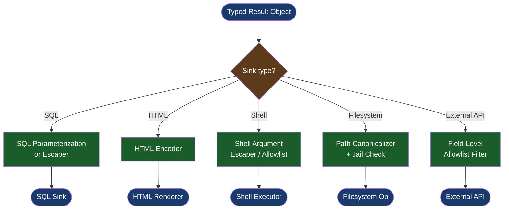

# Sanitized Output Boundary

**Family:** O — Output & Integration Boundaries
**Intent:** Strip or escape model output before it is written to any injection-capable sink — SQL, HTML, shell commands, filesystem paths, or external API fields — regardless of whether the output passed schema validation.
**Also known as:** Output Escaping, Model Output Sanitization, Injection-Safe Output Boundary

## Problem

Schema-valid, semantically correct model output can still carry injection payloads. The model may have been prompted (directly or via indirect prompt injection from retrieved content) to embed metacharacters that are safe in a string field but dangerous in a downstream sink. Key failure modes:

- A `name` field passes schema validation as a non-empty string, but contains `'; DROP TABLE users; --`.
- A `description` field is schema-valid but contains `<script>alert(1)</script>`.
- A `command` field passes type checks but includes shell metacharacters designed to escape the intended command context.
- A `filepath` field is a valid string but contains `../../etc/passwd`.

These attacks are particularly dangerous in agentic systems because: (1) the model may process untrusted retrieved content (RAG, web browsing, tool results) that contains injection instructions; (2) the model's output feeds directly into tool calls and downstream systems without human review; (3) schema validation gives a false sense of security — the injected payload is in the value, not in the structure.

## Solution

At the output boundary, after schema validation and before writing to any injection-capable sink, apply sink-specific sanitization to every field that will be used in that sink. Sanitization is not a generic string clean-up — it is sink-aware escaping or allowlist filtering applied to each field based on the sink it will enter.

The sanitized output boundary is the last transformation before the value enters a deterministic system. It does not alter business logic; it only neutralizes injection vectors.

## Structure

<details>
<summary><b>Solution Structure</b></summary>



</details>

## Participants

| Participant | Role |
|---|---|
| **Typed Result Object** | Schema-valid, semantically checked output entering the sanitization layer |
| **Sink-Aware Sanitizer** | A sanitizer specific to the target sink — SQL, HTML, shell, filesystem, API |
| **SQL Sink** | Database — receives parameterized queries, never string-interpolated SQL |
| **HTML Renderer** | Browser or template engine — receives HTML-encoded values |
| **Shell Executor** | Shell or subprocess — receives escaped arguments or allowlisted commands |
| **Filesystem Op** | File I/O — receives canonicalized, jail-checked paths |
| **External API** | Downstream service — receives allowlist-filtered field values |

## Implementation Notes

**Pseudocode — sink-specific sanitization wiring:**

```
// SQL — use parameterized queries; never interpolate model output into SQL strings
function save_to_db(result: TypedResult, db: Connection):
  // WRONG: db.execute("INSERT INTO items (name) VALUES ('" + result.name + "')")
  // RIGHT:
  db.execute(
    "INSERT INTO items (name, category) VALUES (?, ?)",
    params = [result.name, result.category]   // driver handles escaping
  )

// HTML — encode before rendering
function render_to_html(result: TypedResult) -> String:
  safe_name    = html_encode(result.name)          // & → &amp;  < → &lt;  etc.
  safe_summary = html_encode(result.summary)
  return "<div><h2>" + safe_name + "</h2><p>" + safe_summary + "</p></div>"

// Shell — prefer no-shell execution; if shell is unavoidable, escape arguments
function run_model_command(result: TypedResult):
  // Allowlist the command verb first
  allowed_commands = {"list", "describe", "status"}
  if result.command_verb not in allowed_commands:
    raise SanitizationError("disallowed command verb: " + result.command_verb)
  // Pass arguments as list — no shell interpolation
  subprocess.run(
    args   = ["/usr/bin/tool", result.command_verb, shell_escape(result.target)],
    shell  = false    // never shell=true with model-supplied arguments
  )

// Filesystem — canonicalize and jail-check
function write_model_output(result: TypedResult, base_dir: Path):
  raw_path      = Path(result.filename)
  resolved_path = (base_dir / raw_path).resolve()  // resolve symlinks
  if not resolved_path.is_relative_to(base_dir):
    raise SanitizationError("path traversal attempt: " + result.filename)
  resolved_path.write_text(result.content)
```

**Key guidance:**

- Match the sanitizer to the sink. HTML encoding is not SQL escaping. Shell escaping is not path sanitization. Using the wrong sanitizer provides false protection.
- For SQL, parameterized queries are mandatory — escaping strings yourself is error-prone and should be a last resort.
- For shell, prefer passing arguments as a list to the subprocess API with `shell=false`. Shell interpolation of model output should be considered unsafe by default.
- For filesystem, always resolve to a canonical absolute path and check that it is contained within the intended directory before performing any operation.
- Do not sanitize at the point of use (deep in business logic) — sanitize at the output boundary, once, before the value enters any sink. Multiple sanitization points diverge over time.
- In indirect prompt injection scenarios (model processing retrieved web content, tool results, or documents), treat model output as doubly untrusted — it may have been constructed by an adversary.

## Consequences

**Gains:**
- Injection attacks are neutralized at the output boundary regardless of how the payload entered the model.
- Sanitization is centralized — a single code path handles all output destined for a given sink type.
- Business logic remains clean and does not need to reason about escaping.
- Defense in depth: even if the schema validation passes a malicious value, sanitization prevents it from executing.

**Trade-offs:**
- Sanitization can alter values in ways that surprise downstream logic (e.g., HTML encoding of a name field changes its string representation). Ensure consumers expect encoded values.
- Over-aggressive sanitization (e.g., stripping all special characters from a code field) may corrupt legitimate output. Sanitization must be tuned to the field's domain.
- Parameterized queries require the query structure to be known at write time — dynamic query construction based on model output is a structural anti-pattern that sanitization cannot fix.

## Related Patterns

- [Schema Validation](schema-validation.md) — structural predecessor; sanitization runs after schema validation on conforming values
- [Typed Result Object](typed-result-object.md) — the typed object entering the sanitization layer
- [Structured Output Boundary](structured-output-boundary.md) — reduces the attack surface by constraining the model's output shape
- [Programmatic Postcondition](programmatic-postcondition.md) — semantic checks that can include basic injection-pattern detection as an invariant
- [Family J — Security](../J-security/README.md) — the J family covers the full threat model of prompt injection and agentic security; this pattern is the O-side enforcement point

## When to Use / When Not to Use

**Use when:**
- Model output is written to any injection-capable sink: SQL, HTML, shell, filesystem, external API.
- The system processes untrusted content (web pages, documents, tool results) that the model may summarize or transform — indirect prompt injection is a realistic threat vector.
- The model operates with tools that execute actions — schema-valid tool arguments can carry injection payloads.
- Any agentic system where model output drives automated actions without human review.

**Do not use when:**
- Output is returned to a human in a plain-text medium (e.g., a terminal that does not interpret HTML or execute commands). Human review is the control.
- Output is stored only for future LLM consumption and never enters a deterministic sink. (Though care is still needed to avoid prompt injection in subsequent model calls.)

## Sources

- **OWASP GenAI Security Project** — Open Web Application Security Project; sanitized output prevents injection into downstream systems. [OWASP Top 10 for Agentic Applications 2026](https://genai.owasp.org/resource/owasp-top-10-for-agentic-applications-for-2026/)
- **Anthropic Engineering** — AI safety company; authors of Claude. [Building Effective Agents](https://www.anthropic.com/engineering/building-effective-agents)
- **OpenAI Engineering** — AI research company; advocates schema-constrained structured output. [A Practical Guide to Building AI Agents](https://openai.com/business/guides-and-resources/a-practical-guide-to-building-ai-agents/)
- **Microsoft Azure Architecture Center** — Microsoft's cloud architecture team. [AI Agent Design Patterns](https://learn.microsoft.com/en-us/azure/architecture/ai-ml/guide/ai-agent-design-patterns)
- **AWS Prescriptive Guidance** — Amazon Web Services architecture team. [Agentic AI Patterns](https://docs.aws.amazon.com/prescriptive-guidance/latest/agentic-ai-patterns/agent-patterns.html)
