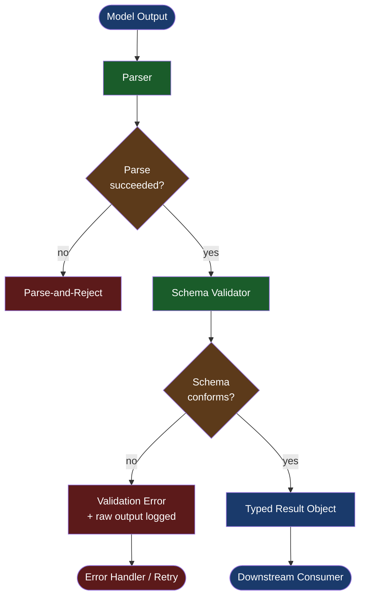

# Schema Validation

**Family:** O — Output & Integration Boundaries
**Intent:** Validate model-generated output against a declared schema immediately after parsing, before the output reaches any downstream consumer.
**Also known as:** Output Schema Enforcement, Structural Validation Gate, JSON Schema Guard

## Problem

Even when a model is instructed to produce structured output, the output may be structurally invalid or contain unexpected field shapes. Several failure modes arise without an explicit validation step:

- Field names are hallucinated — the model invents keys not in the requested schema.
- Required fields are silently omitted because the model judged them irrelevant.
- Type coercion errors appear: numbers returned as strings, booleans returned as `"yes"` / `"no"`, arrays returned as comma-separated strings.
- Nested structure depth mismatches — objects flattened or over-nested relative to the schema.
- Enum values are plausible but unlisted — the model returns a value outside the declared set.

Downstream code that does not validate assumes structural correctness and propagates corrupt data silently. Failures surface far from the boundary, making root-cause analysis difficult.

## Solution

Immediately after parsing model output into an intermediate representation, run a schema validator against a machine-readable schema definition. Treat any validation failure as an output boundary error — do not partially process schema-invalid output. Surface the validation error with the raw model response preserved for debugging.

Schema validation is a hard gate: either the output fully conforms, or it is rejected. It is not a filter that passes the valid subset of a partially valid response.

## Structure

<details>
<summary><b>Solution Structure</b></summary>



</details>

## Participants

| Participant | Role |
|---|---|
| **Model Output** | Raw text or structured response from the model |
| **Parser** | Deserializes raw output into an intermediate representation (e.g., dict, map) |
| **Schema** | Machine-readable contract defining required fields, types, and constraints |
| **Schema Validator** | Evaluates the parsed representation against the schema; produces pass or structured error |
| **Typed Result Object** | Receives only schema-valid output; wraps it in a domain type |
| **Validation Error** | Carries the schema violation details and the raw model response for logging |
| **Error Handler** | Decides retry strategy or fallback based on the validation error |

## Implementation Notes

**Pseudocode — schema validation gate:**

```
schema = load_schema("classification_result.json")  // JSON Schema or equivalent

raw_output = model_api.complete(messages)
parsed = json_parse(raw_output.content)             // may raise ParseError → Parse-and-Reject

errors = schema_validator.validate(parsed, schema)

if errors is not empty:
  log.error("schema_validation_failed", {
    errors:     errors,
    raw_output: raw_output.content,    // preserve raw for debugging
    model:      raw_output.model,
    request_id: raw_output.id
  })
  raise OutputSchemaError(errors)

result = TypedResult.from_dict(parsed)
```

**Key guidance:**

- Use a standards-based schema language (JSON Schema, Pydantic model, TypeScript interface compiled to a validator). Avoid ad-hoc field-presence checks scattered through business logic.
- Set `additionalProperties: false` in JSON Schema — reject output that adds fields the schema does not declare. Silent extra fields are a common source of downstream confusion.
- Validate `enum` fields explicitly. Do not rely on the downstream consumer to range-check an enum value.
- Always log the raw model response alongside the validation error. Parsed-only logs make it impossible to distinguish model errors from parser bugs.
- Do not attempt to coerce schema-invalid output (e.g., converting `"true"` string to boolean). Coercion masks model errors and makes schema drift invisible.
- In typed languages, derive the schema from the type definition (e.g., Pydantic, Zod, io-ts) rather than maintaining a separate schema document.

## Consequences

**Gains:**
- Structural failures are detected at the boundary before they propagate.
- Error messages are precise — the validator reports which field failed, what was expected, and what was received.
- Downstream code can safely assume structural correctness and focus on business logic.
- Schema serves as living documentation of what the model is expected to produce.

**Trade-offs:**
- Schema maintenance cost — every model output change requires a schema update.
- Schema validation catches structural failures but not semantic ones (a valid field value that violates a business rule). Programmatic Postcondition handles the semantic layer.
- Strict schemas may cause high rejection rates during model version transitions. Schema versioning strategy is required for production systems.

## Related Patterns

- [Structured Output Boundary](structured-output-boundary.md) — prevents structural failures at generation time; schema validation is the second line of defense
- [Typed Result Object](typed-result-object.md) — receives schema-valid output and wraps it in a domain type
- [Parse-and-Reject](parse-and-reject.md) — handles parse failures before schema validation runs
- [Programmatic Postcondition](programmatic-postcondition.md) — asserts semantic invariants that the schema cannot express
- [Sanitized Output Boundary](sanitized-output-boundary.md) — sanitizes fields after schema validation before use in injection-capable sinks
- [Family H — Deterministic Control](../H-deterministic-control/README.md) — schema validation is a hard gate in control flow; the H family covers the broader pattern of deterministic gates in agentic pipelines

## When to Use / When Not to Use

**Use when:**
- Model output is consumed by code that requires structural guarantees.
- Multiple consumers share the same model output — a single validation point prevents each consumer from implementing its own defensive checks.
- The output schema is stable enough to define formally.
- You need auditable evidence that output met structural requirements (compliance, logging).

**Do not use when:**
- Output is free-form prose consumed only by humans — schema validation is meaningless.
- The schema is so loose (all fields optional, no type constraints) that it provides no actual enforcement. Tighten the schema first.
- You are validating tool call arguments — use the tool's own input schema instead; this avoids duplicate validation logic.

## Sources

- **Anthropic Engineering** — AI safety company; authors of Claude. [Building Effective Agents](https://www.anthropic.com/engineering/building-effective-agents)
- **OpenAI Engineering** — AI research company; advocates schema-constrained structured output. [A Practical Guide to Building AI Agents](https://openai.com/business/guides-and-resources/a-practical-guide-to-building-ai-agents/)
- **AWS Prescriptive Guidance** — Amazon Web Services architecture team. [Agentic AI Patterns](https://docs.aws.amazon.com/prescriptive-guidance/latest/agentic-ai-patterns/agent-patterns.html)
- **OWASP GenAI Security Project** — Open Web Application Security Project; sanitized output prevents injection into downstream systems. [OWASP Top 10 for Agentic Applications 2026](https://genai.owasp.org/resource/owasp-top-10-for-agentic-applications-for-2026/)
