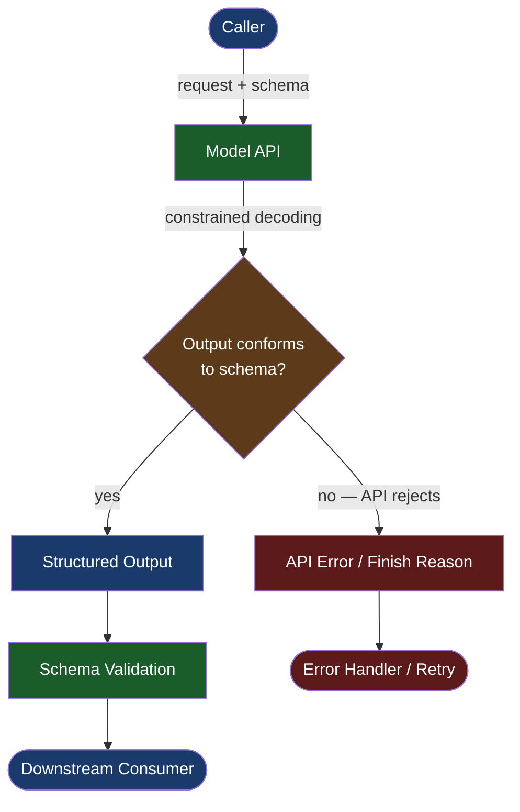

# Structured Output Boundary

**Family:** O — Output & Integration Boundaries
**Intent:** Force the model to produce output in a declared, machine-readable format at generation time rather than relying on post-hoc parsing of free-form prose.
**Also known as:** Constrained Decoding, Format-Constrained Generation, JSON Mode, Guided Generation

## Problem

Without a declared output format, language models default to natural-language prose. Downstream code that receives this output must perform brittle string parsing — extracting values by regex, searching for keywords, or guessing at structure. Several forces make this hazardous:

- Models inconsistently follow informal format instructions ("respond in JSON" vs. actually enforcing JSON at decode time).
- Extra wrapper text ("Here is the result: `{...}`") causes parsers to fail silently or partially.
- Free-form phrasing varies across model versions and prompt changes, so any parser that works today may break on the next model update.
- Partial or malformed output that looks structured can be accepted by lenient parsers and corrupt downstream state.

The fundamental force: the model's generation process is probabilistic; the downstream system's requirements are deterministic. The earlier you impose structure, the less that mismatch can cause damage.

## Solution

Declare the output format as a constraint on generation, not as a guideline in the prompt. Use the model API's native structured-output capability (e.g., `response_format`, `json_schema`, grammar-constrained decoding) so the model's token sampling is restricted to outputs that conform to the schema. This eliminates an entire class of parse failures at the source.

Where the API does not support constrained generation, use a system prompt that specifies the format exactly, combined with a Parse-and-Reject pattern as a safety net.

## Structure

<details>
<summary><b>Solution Structure</b></summary>



</details>

## Participants

| Participant | Role |
|---|---|
| **Caller** | Constructs the request including the schema or format constraint |
| **Model API** | Enforces the format constraint during token sampling (constrained decoding) |
| **Schema / Format Spec** | The machine-readable definition of the required output shape |
| **Structured Output** | The conforming model response — safe to parse without defensive string handling |
| **Schema Validation** | Secondary validation step; even constrained output may have semantic issues |
| **Error Handler** | Receives API-level rejection or finish-reason signals; decides retry vs. fallback |

## Implementation Notes

**Pseudocode — wiring a constrained generation call:**

```
schema = {
  type: "object",
  properties: {
    classification: { type: "string", enum: ["APPROVE", "REJECT", "ESCALATE"] },
    confidence:     { type: "number", minimum: 0, maximum: 1 },
    reason:         { type: "string" }
  },
  required: ["classification", "confidence", "reason"],
  additionalProperties: false
}

response = model_api.complete(
  messages  = [system_prompt, user_message],
  response_format = { type: "json_schema", schema: schema, strict: true }
)

if response.finish_reason != "stop":
  raise OutputBoundaryError("unexpected finish reason: " + response.finish_reason)

parsed = json_parse(response.content)   // safe: constrained decoding guarantees valid JSON
result = TypedResult.from_dict(parsed)  // Typed Result Object pattern
```

**Key guidance:**

- Always pass `additionalProperties: false` and mark all required fields explicitly. This prevents the model from inventing extra fields that your parser ignores silently.
- Check `finish_reason`. A truncated output (`finish_reason = "length"`) will produce syntactically valid JSON (constrained decoding ensures closure) but may have truncated string values. Treat `finish_reason != "stop"` as a soft failure.
- When constrained decoding is unavailable, place the schema in the system prompt as a JSON Schema block and pair with Parse-and-Reject as a fallback. Never rely on the system prompt alone as a format guarantee.
- For enumerated fields, list the allowed values explicitly in the schema rather than in prose instructions.

## Consequences

**Gains:**
- Eliminates free-form prose, wrapper text, and structural variation as failure modes.
- Reduces the complexity of the downstream parser to a straightforward deserializer.
- Makes format violations detectable at the API boundary rather than deep in business logic.
- Enables static typing of model outputs in typed languages.

**Trade-offs:**
- Constrained decoding can reduce the model's ability to express nuance within constrained fields — trade expressiveness for reliability.
- Schema changes require coordination between prompt authors and downstream consumers.
- Not all model providers support strict constrained decoding; behavior varies.
- Tight schemas may cause the model to hallucinate plausible-but-wrong values to satisfy constraints rather than admitting uncertainty.

## Related Patterns

- [Schema Validation](schema-validation.md) — validates the structured output after generation; acts as a second line of defense
- [Typed Result Object](typed-result-object.md) — wraps the parsed output in a domain type; consumes the structured output
- [Parse-and-Reject](parse-and-reject.md) — fallback when constrained decoding is unavailable; rejects non-conforming output
- [Programmatic Postcondition](programmatic-postcondition.md) — asserts semantic invariants that the schema cannot express
- [Sanitized Output Boundary](sanitized-output-boundary.md) — sanitizes structured fields before use in injection-capable sinks

## When to Use / When Not to Use

**Use when:**
- The downstream system requires machine-readable output (API response, database write, function argument).
- The model API supports native constrained decoding or JSON mode.
- Output format stability across model versions is a correctness requirement.
- You need static typing of model outputs.

**Do not use when:**
- The task is inherently open-ended and the value is in the prose (e.g., creative writing, long-form explanation where structure would constrain quality).
- The downstream consumer is a human reading text, not code parsing values.
- You need the model to signal uncertainty through format variation — constrained output forces a value even when the model would otherwise abstain.

## Sources

- **Anthropic Engineering** — AI safety company; authors of Claude. [Building Effective Agents](https://www.anthropic.com/engineering/building-effective-agents)
- **OpenAI Engineering** — AI research company; advocates schema-constrained structured output. [A Practical Guide to Building AI Agents](https://openai.com/business/guides-and-resources/a-practical-guide-to-building-ai-agents/)
- **AWS Prescriptive Guidance** — Amazon Web Services architecture team. [Agentic AI Patterns](https://docs.aws.amazon.com/prescriptive-guidance/latest/agentic-ai-patterns/agent-patterns.html)
