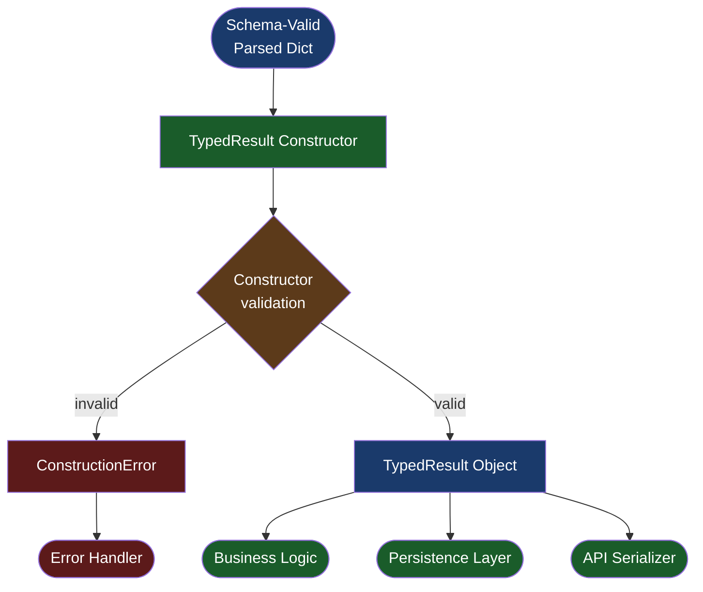

# Typed Result Object

**Family:** O — Output & Integration Boundaries
**Intent:** Wrap validated model output in a typed domain object so that downstream code branches on types and fields, never on raw model text.
**Also known as:** Output Value Object, Parsed Domain Object, Structured Model Response

## Problem

After model output is parsed and schema-validated, downstream code still faces a choice: operate on the parsed dictionary/map directly, or wrap it in a purpose-built type. Operating on raw parsed structures creates several problems:

- Downstream code must know the raw field names returned by the model, coupling business logic to model output conventions.
- Branching on raw string values (e.g., `if result["action"] == "approve"`) ties control flow to the model's exact phrasing. A model update that changes `"approve"` to `"APPROVE"` breaks logic silently.
- Type-unsafe access to dictionary fields bypasses the type system's help; misspelled keys cause runtime errors not caught at compile time.
- There is no single place to apply output-level transformations (unit normalization, default values, domain-specific coercions) — they scatter across every consumer.
- Raw parsed output lacks the semantic meaning needed to reason about its validity in domain terms.

## Solution

Define a typed domain object whose constructor accepts the validated parsed output and maps raw model fields to typed domain properties. All downstream code operates on the typed object. Raw field names and string values are isolated behind the constructor — they never appear in business logic.

The typed result object is the stable public contract between the output boundary and the rest of the system.

## Structure

<details>
<summary><b>Solution Structure</b></summary>



</details>

## Participants

| Participant | Role |
|---|---|
| **Schema-Valid Parsed Dict** | The validated intermediate representation from Schema Validation |
| **TypedResult Constructor** | Maps raw dict fields to typed domain properties; applies any output-level transformations |
| **TypedResult Object** | The immutable domain object consumed by all downstream code |
| **Business Logic** | Operates on typed properties — never on raw strings or dict keys |
| **Persistence / Serializer** | Uses typed properties to produce the downstream representation |
| **Error Handler** | Receives construction errors (e.g., enum value not in domain set despite schema validity) |

## Implementation Notes

**Pseudocode — defining and constructing a typed result:**

```
// Define the domain type — isolated from model field names
enum Decision { APPROVE, REJECT, ESCALATE }

record ClassificationResult {
  decision:   Decision    // mapped from raw "classification" field
  confidence: Float       // [0.0, 1.0]
  reason:     String      // human-readable explanation
}

// Constructor — the only place raw model output field names appear
function ClassificationResult.from_model_output(parsed: Dict) -> ClassificationResult:
  raw_decision = parsed["classification"]          // raw field name here only
  decision = Decision.from_string(raw_decision)    // raises if not in enum

  confidence = Float(parsed["confidence"])
  if confidence < 0.0 or confidence > 1.0:
    raise ConstructionError("confidence out of range: " + confidence)

  return ClassificationResult(
    decision   = decision,
    confidence = confidence,
    reason     = parsed["reason"]
  )

// Downstream usage — no raw strings, no dict access
result = ClassificationResult.from_model_output(validated_dict)

if result.decision == Decision.APPROVE:
  approve_request(result.reason)
elif result.decision == Decision.ESCALATE:
  escalate(result.confidence, result.reason)
```

**Key guidance:**

- Make TypedResult objects immutable after construction. Mutable model output objects are a source of hard-to-trace state bugs.
- The constructor is the single seam between model conventions and domain conventions. Localize all field-name knowledge there.
- Use language-native enum types for enumerated fields — not string constants. This makes exhaustive case analysis possible and prevents silently unhandled values.
- Avoid "pass-through" typed results that just rename dict keys. The type should express domain meaning, not just add a type annotation to the same structure.
- Consider a factory function or static constructor (`.from_model_output()`) over a plain constructor to make the origin of the object explicit.
- In dynamically typed languages, add runtime assertions in the constructor equivalent to what a type system would catch statically.

## Consequences

**Gains:**
- Business logic is decoupled from model output field names and string conventions.
- The type system enforces correct usage of output values across the codebase.
- A single constructor handles all output-level transformations — changes to model output format require changes in one place.
- Domain concepts are expressible in the type (e.g., `Decision.APPROVE` not `"approve"`).

**Trade-offs:**
- Constructor maintenance cost — schema changes require constructor updates.
- Adds a layer of indirection that may feel unnecessary for very simple outputs (single-field responses). Use judgment.
- In dynamically typed languages, the benefit is reduced unless the constructor is disciplined about type assertions.

## Related Patterns

- [Structured Output Boundary](structured-output-boundary.md) — ensures the model produces output the constructor can accept
- [Schema Validation](schema-validation.md) — validates the dict before it reaches the constructor
- [Parse-and-Reject](parse-and-reject.md) — rejects malformed output before construction is attempted
- [Programmatic Postcondition](programmatic-postcondition.md) — post-construction invariant checks complement constructor validation
- [Family G — Tool Design](../../G-tool-action-design/README.md) — typed tool results mirror this pattern applied to tool outputs

## When to Use / When Not to Use

**Use when:**
- Multiple code paths consume the same model output — typed objects prevent each path from re-implementing field access.
- The output contains enumerated values that control downstream branching.
- The codebase uses a static type system and can enforce correct usage at compile time.
- Model output conventions differ from domain conventions (different naming, casing, or value representations).

**Do not use when:**
- The model output is consumed in a single place and immediately serialized (e.g., a proxy that forwards model output unchanged). The indirection adds no value.
- The output structure is highly dynamic with no fixed schema — typed objects require a stable shape.

## Sources

- **Anthropic Engineering** — AI safety company; authors of Claude. [Building Effective Agents](https://www.anthropic.com/engineering/building-effective-agents)
- **OpenAI Engineering** — AI research company; advocates schema-constrained structured output. [A Practical Guide to Building AI Agents](https://openai.com/business/guides-and-resources/a-practical-guide-to-building-ai-agents/)
- **Microsoft Azure Architecture Center** — Microsoft's cloud architecture team. [AI Agent Design Patterns](https://learn.microsoft.com/en-us/azure/architecture/ai-ml/guide/ai-agent-design-patterns)
