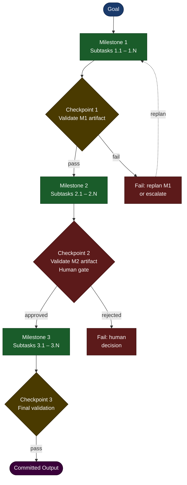

# B5: Milestone / Checkpoint Planning

## Intent

Decompose a long task into discrete milestones separated by explicit validation gates, so that partial failure can be caught early, progress can be persisted, and humans or validators can intervene at safe points.

## Problem

Long multi-step tasks accumulate errors silently. An incorrect assumption made in step 2 may not surface until step 15, by which point significant compute has been spent and irreversible side effects may have occurred. Without explicit stopping points, there is no natural opportunity for human review, no place to persist partial results, and no recovery point if the agent crashes or times out mid-execution.

## Solution

Group the task's subtasks into milestones — cohesive units of work that together produce a meaningful, verifiable intermediate artifact. Between milestones, place checkpoint gates: validation steps that verify the milestone's output before the next milestone begins. Validation can be automated (schema check, test run, assertion), human (reviewer approval), or both. Partial results are persisted at each checkpoint so that if a later milestone fails, work can resume from the last successful checkpoint rather than restarting from zero. Checkpoints also create natural audit points: the full state of the system at each gate is knowable and inspectable.

## In a session: slice a change for review

Use the milestone as a behavior you can inspect, not an arbitrary number of files or lines. This applies while planning work or reorganizing an already large diff; save the existing work before asking for restructuring.

1. Ask the agent for the smallest useful outcome: who does what, and what becomes observable? Include the code and tests across every layer needed to demonstrate it.
2. Review dependencies before implementation. If the first ticket cannot be tried until the last lands, combine them or identify the genuine prerequisite. Stop splitting when the whole change is already coherent and reviewable.
3. Specify one acceptance example and one neighboring behavior that must remain unchanged. When feasible, run the example on the intended base and inspect why it fails; a broken environment does not demonstrate the bug.
4. Ask for the diff and the commands/results for that slice. Review it before expanding to the next outcome. If a large patch already exists, ask for a proposed split and review order before edits; do not throw away working changes merely to satisfy a size target.

**Illustrative prompt:** “The task includes open-item filtering and CSV export. Propose a reviewable first slice for filtering only, including its CLI behavior and tests. Show that ordinary listing still includes completed items. Explain any prerequisite; keep CSV export for later.”

Matt Pocock's ticket guidance supports independently demonstrable slices, explicit dependencies, and avoiding over-splitting. Our adaptation from PAT-0003 adds the review question and paired checks. For a mechanical change that cannot land independently, plan compatibility/migration stages or a declared integration checkpoint instead. No fixed line count or measured review-time saving is implied.

## Structure

<details>
<summary><b>Milestone / Checkpoint Flow</b></summary>



</details>

**Steps:**

1. Decompose the task into milestones; define the artifact and validation criteria for each.
2. Execute the first milestone's subtasks.
3. Run the checkpoint: validate the milestone artifact against its criteria.
4. On failure: replan the milestone, escalate, or abort — do not proceed.
5. On pass: persist the milestone artifact; proceed to the next milestone.
6. Repeat until all milestones complete and the final checkpoint passes.

## When to Use

- The task is long enough that silent error accumulation is a real risk.
- Irreversible actions are taken partway through; checkpoints prevent over-commitment.
- Human review is required at specific decision points (regulatory compliance, high-stakes outputs).
- Partial failure recovery matters; re-running from scratch is expensive.
- The task spans multiple sessions or agents; checkpoints are the handoff protocol.
- Cost control: if an early milestone reveals the task is mis-specified, stopping saves the cost of all later milestones.

## When NOT to Use

- The task is short enough that a single validation at the end is sufficient.
- Milestone artifacts are not independently verifiable — gates add overhead without providing signal.
- Latency is critical and validation gates are synchronous blockers in the critical path.
- The task has no natural groupings; artificially imposing milestones creates awkward dependencies.

## Implementation Notes

**Milestone granularity.** A milestone should produce one coherent artifact — a draft, a schema, a passing test suite, a deployed component. If its output cannot be validated in isolation, revisit the boundary or identify the required integration checkpoint explicitly. Choose the number from observable outcomes and genuine dependencies; there is no required milestone count.

**Checkpoint types.** Three tiers, ordered by cost: (1) automated assertion (fast, cheap, no human needed), (2) automated test suite (slower, more thorough), (3) human review (highest signal, highest latency). Use the cheapest checkpoint that provides adequate signal. Reserve human gates for decisions with significant irreversibility or ambiguity.

**Persistence.** Checkpoint artifacts must be stored durably (not just in memory). Define the artifact schema and storage location before the run starts. On resume, the agent must be able to load the last successful checkpoint and continue without re-running earlier milestones.

**Checkpoint failure handling.** Define the failure policy for each checkpoint before execution begins. Options: replan and retry the milestone, escalate to a human, substitute a degraded output, or abort. Leaving this undefined means failures produce undefined behavior at runtime.

**Milestone dependencies.** Milestones are typically sequential (each depends on the previous). If milestones are partially parallel, represent the dependency explicitly and run parallel milestones concurrently — but require all of them to pass their checkpoints before the next dependent milestone begins.

**Implementation sketch:**

```
function milestoneExecution(goal, milestones):
    checkpointStore = CheckpointStore()
    lastPassed = checkpointStore.loadLatest(goal)

    for milestone in milestones[lastPassed.index:]:
        result = executeMilestone(milestone, lastPassed.artifact)

        checkResult = runCheckpoint(milestone.checkpoint, result)

        if not checkResult.passed:
            if milestone.checkpoint.type == HUMAN:
                decision = awaitHumanDecision(milestone, checkResult)
                if decision == ABORT: return abort(checkResult)
                if decision == REPLAN: continue  // rerun milestone
            else:
                return handleAutomatedFailure(milestone, checkResult)

        checkpointStore.persist(milestone.id, result)
        lastPassed = CheckpointRecord(milestone.id, result)

    return lastPassed.artifact
```

## Related Patterns

- [B1: Plan → Execute](B1-plan-execute.md) — B5 adds validation gates and persistence to B1's two-phase structure.
- [B4: Fixed Decomposition](B4-fixed-decomposition.md) — milestones are groups of fixed subtasks; B5 and B4 compose naturally.
- [B6: Reconnaissance-First](B6-reconnaissance-first.md) — reconnaissance before the first milestone reduces the risk that milestone 1 is mis-scoped.
- [Family A — Topology](../../A-workflow-topology/README.md) — milestone sequences map to chain topologies with gate nodes.
- [Family K — Human Control](../../K-human-control/README.md) — human checkpoints in B5 are a direct instantiation of human-in-the-loop patterns.
- [Family I — Reliability](../../I-reliability-recovery/README.md) — checkpoint persistence is the foundation for retry, resume, and fault-tolerance patterns.

## Example

A code migration agent is tasked with upgrading a 200-file codebase from an old API to a new one. The team decomposes this into four milestones: (1) audit all usages and produce a migration inventory, (2) migrate non-critical utility files, (3) migrate core business logic files, (4) migrate integration and test files. After milestone 1, an automated check verifies the inventory covers all files. After milestone 2, the test suite runs; if it passes, the migrated files are committed. Milestone 3 requires a human to review the diff before proceeding — these files are high-risk. After milestone 4, the full test suite runs again as the final gate. When milestone 3's first attempt fails the human review, only milestone 3 is replanned; milestones 1 and 2 are not re-executed.

## Sources

- **Anthropic Engineering** — AI safety company; authors of Claude. [Building Effective Agents](https://www.anthropic.com/engineering/building-effective-agents)
- **Microsoft Azure Architecture Center** — Microsoft's cloud architecture team. [AI Agent Design Patterns](https://learn.microsoft.com/en-us/azure/architecture/ai-ml/guide/ai-agent-design-patterns)
- **AWS Prescriptive Guidance** — Amazon Web Services architecture team. [Agentic AI Patterns](https://docs.aws.amazon.com/prescriptive-guidance/latest/agentic-ai-patterns/agent-patterns.html)
- **Google Cloud Architecture Center** — Google's cloud architecture team. [Choose a Design Pattern for Agentic AI](https://docs.cloud.google.com/architecture/choose-design-pattern-agentic-ai-system)

- Matt Pocock — [The /to-tickets Skill](https://www.aihero.dev/skills-to-tickets): practitioner guidance on reviewable slices, dependencies, and wide-refactor exceptions; consulted 2026-11-21.

