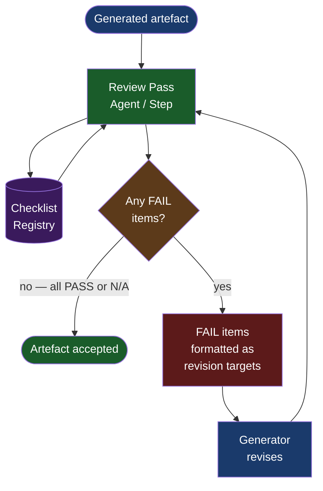

# D05: Review Pass

**Intent** — Run a structured, pre-defined checklist over completed output to verify that all required properties are present before acceptance.  
**Also known as** — Checklist Review, Post-Generation Audit, Quality Gate Pass, Structured Self-Review.

## Problem

Unstructured self-review ("does this look good?") is unreliable because agents satisfice — they stop checking once the output seems reasonable, missing specific required properties that are not salient in the moment. Required properties (security headers, accessibility attributes, regulatory disclosures, required sections) are systematically omitted not because the agent couldn't produce them but because it wasn't reminded to look for them at review time.

## Solution

Maintain a per-task-type checklist of required properties. After generation, the agent (or a separate review step) works through the checklist item by item, marking each as PASS, FAIL, or N/A. Items marked FAIL are returned to the generator as specific revision targets. The checklist is authored separately from the generation prompt and is not modified during the review loop. A Review Pass is declared complete only when all required items are PASS or explicitly waived.

## In a session: review AI changes before accepting them

Use a human review pass when you can repeat the agent's summary but cannot explain its diff, or when a fix changes the test that was supposed to expose the bug. You need the agreed behavior, the actual diff, and relevant checks. No custom review harness is required.

1. Ask the agent to connect each material change to the requested behavior. Read the implementation, assertions, expected outputs, fixtures, and configuration changes yourself. Remove unrelated work from the proposed change.
2. For each changed or deleted regression test, ask which requirement justifies the change and what will now detect the original failure. A legitimate behavior change can require updated tests; a passing suite with weakened expectations is insufficient evidence.
3. Exercise the reported case and an adjacent behavior that should still work. Where feasible, compare the base and candidate. Ask for actual commands/results and unavailable checks; do not accept an execution claim you cannot substantiate.
4. Explain the behavior and remaining limits in your own words. Follow the target project's contribution and disclosure rules and respond to later review or regression reports. Moby/Docker's policy is a project-specific example, not a universal approval workflow.

**Original illustration:** An empty CSV export should retain its header. The agent changes the empty-export fixture. Check that the requirement authorizes that expectation and that a populated export still has one header and its data row. Inspect whether another check was removed to make the suite pass.

If the patch is too large to inspect, first use [reviewable milestones](../../B-task-decomposition/patterns/B5-milestone-checkpoint.md#in-a-session-slice-a-change-for-review). A review request is not an enforced write restriction; for protected files use configured permissions. This PAT-0008 adaptation is a review procedure, not proof that passing selected checks establishes all correctness.

## Structure

<details>
<summary><b>Review Pass — Checklist Loop Diagram</b></summary>



</details>

## When to Use

- Outputs with mandatory sections or attributes: API responses, legal documents, accessibility-compliant UI, data pipeline outputs.
- Regulated domains where a documented audit trail of what was checked is required.
- When D01 (deterministic validator) covers structural checks but qualitative properties also need systematic review.
- Team workflows where the checklist encodes shared quality standards across agents and humans.

## When NOT to Use

- Open-ended creative tasks with no fixed required properties.
- Tasks so simple that the checklist overhead exceeds the generation time.
- When the checklist is vague or subjective — vague items produce inconsistent PASS/FAIL verdicts and false confidence. Tighten item wording or move to D09 for qualitative assessment.

## Implementation Notes

**Checklist item structure:**

```
struct ChecklistItem:
    id: string                        // e.g. "SEC-01"
    description: string               // human-readable
    check_type: enum [DETERMINISTIC, LLM_ASSISTED, HUMAN_REQUIRED]
    required: bool                    // false = advisory only
    waivable: bool                    // can be explicitly skipped with justification
```

**Review loop pseudocode:**

```
function review_pass(artefact, checklist, max_revisions=3):
    for revision in 1..max_revisions:
        results = []
        for item in checklist:
            if item.check_type == DETERMINISTIC:
                result = run_deterministic_check(artefact, item)
            else:
                result = llm_check(artefact, item)  // slower; use sparingly
            results.append(result)

        failures = [r for r in results if r.verdict == FAIL and r.item.required]
        if failures is empty:
            return PASS(results)

        revision_prompt = format_revision_targets(failures)
        artefact = generator.revise(artefact, revision_prompt)

    return FAIL(failures)  // escalate

function format_revision_targets(failures):
    return "The following required checklist items failed. Fix each:\n" +
           "\n".join("[{f.item.id}] {f.item.description}\nIssue: {f.rationale}" for f in failures)
```

**Checklist authoring rules:**
- Each item must be independently checkable — no compound items ("is it clear AND correct?").
- Binary verdicts only: PASS / FAIL / N/A. No numeric scores (use D09 for that).
- Separate required items from advisory items. Advisories are logged, not gated.
- Version the checklist — breaking checklist changes should bump a version so historical reviews remain interpretable.

## Cost Profile

| Dimension           | Rating   |
|---------------------|----------|
| Latency added       | Low–Med  |
| Token cost          | Low–Med  |
| Implementation      | Low      |
| False-positive risk | Med      |

## Related Patterns

- [D01: Deterministic Validator](D01-deterministic-validator.md) — machine-checkable items in the checklist should be delegated to D01.
- [D03: Evidence-Based Completion](D03-evidence-based-completion.md) — evidence requirements can be one section of the checklist.
- [D09: LLM-as-Judge](D09-llm-as-judge.md) — for checklist items that require qualitative judgment, invoke D09 per item.
- [D10: Human Calibration](D10-human-calibration.md) — items tagged `check_type: HUMAN_REQUIRED` route to human review.

## Anti-Patterns Addressed

- **Self-Certified Completion** — the agent cannot accept its own output without working through the checklist; omissions are surfaced explicitly.

## Sources

- **Anthropic Engineering** — AI safety company; authors of Claude. [Building Effective Agents](https://www.anthropic.com/engineering/building-effective-agents)
- **OpenAI Engineering** — AI research company; authors of GPT and Codex. [A Practical Guide to Building AI Agents](https://openai.com/business/guides-and-resources/a-practical-guide-to-building-ai-agents/)
- **AWS Prescriptive Guidance** — Amazon Web Services architecture team. [Agentic AI Patterns](https://docs.aws.amazon.com/prescriptive-guidance/latest/agentic-ai-patterns/agent-patterns.html)

- Moby / Docker maintainers — [AI Usage Policy](https://github.com/moby/.github/blob/512ca97347590b4ecaf892adaf780797b1e637b9/AI_POLICY.md): human verification, focused changes, contributor accountability, and project-specific disclosure requirements; consulted 2026-11-21.

