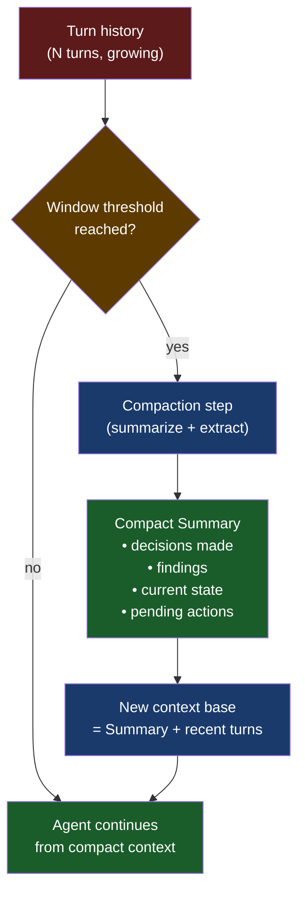

# Context Compaction

**Family:** E — Context Engineering

## Problem

Long-running agentic tasks accumulate conversation history, tool outputs, and intermediate reasoning across many turns. As the context window fills, earlier content scrolls out of the effective attention range or is truncated entirely. The model loses track of earlier decisions, repeats work, or produces inconsistent outputs. Simply truncating the oldest messages discards information that may still be relevant.

## Solution

Periodically compress accumulated history into a dense summary that preserves decisions, key findings, and current state — while discarding turn-by-turn noise, retracted attempts, and verbose tool outputs. The summary replaces the raw history and is treated as the new base context. The agent continues from the summary as if it had always known those facts.

## Structure

<b>Solution Structure</b>

1. Set a compaction trigger: a token threshold (e.g., 75% of window used) or a turn count.
2. When triggered, run a compaction prompt against the current history: "Summarize the decisions made, findings, current state, and next steps from this conversation."
3. Replace the accumulated history with the summary. Retain the most recent N turns verbatim for continuity.
4. Append the summary to the system prompt or as the first user/assistant turn of the new context.
5. Continue the task. The next compaction trigger restarts the cycle.

## When to Use

- A task runs for many turns and will reach or exceed the context window.
- The task has state that must persist across a long session (decisions, discovered facts, progress markers).
- The history contains significant noise (tool call outputs, retracted attempts) that dilutes the signal.
- The agent is the only actor — no handoff to another agent is planned.

## When NOT to Use

- Handing off to another agent: use [Minimal-Context Handoff](minimal-context-handoff.md) or [Artifact-Based Handoff](artifact-based-handoff.md) instead.
- The task is short enough that the window will not fill.
- Lossless history is required for audit (preserve raw history externally; compact only the in-context version).

## Tradeoffs

| Benefit | Cost |
|---------|------|
| Enables indefinitely long agentic tasks within a fixed window | Compaction is itself a model call — latency and cost |
| Preserves decisions and state across many turns | Summary quality depends on the compaction prompt; poor prompts lose information |
| Cleaner context improves instruction-following in later turns | Nuance from early turns may not survive compression |
| Transparent to the agent — it simply continues | Compaction timing must be tuned; too early wastes detail, too late causes truncation |

For a person deciding whether to summarize or restart a drifting conversation, use [the checked session handoff](../../I-reliability-recovery/patterns/fresh-context-retry.md#in-a-session-recover-decisions-without-losing-useful-work). Length alone is not its reset trigger, and preserving useful file changes is separate from resetting a chat.

## Related Patterns

- [Context Offloading](context-offloading.md) — offloading moves content to external storage; compaction keeps it in context but compressed.
- [Minimal-Context Handoff](minimal-context-handoff.md) — when handing off between agents, a handoff is preferred over passing a compacted history.
- [Progressive Disclosure](progressive-disclosure.md) — prevents accumulation at the start; compaction manages accumulation mid-task.
- [Artifact-Based Handoff](artifact-based-handoff.md) — the compaction summary can become the artifact passed at handoff.

## Anti-Patterns Addressed

- **Giant Instruction Manual** — runaway context accumulation during a task is the dynamic form of this anti-pattern; compaction is the runtime remedy.

## Example

An agent performs a multi-hour code refactoring task across 40 files. After 30 turns, the context approaches 80% of the window limit. The harness triggers compaction: it passes the turn history to a compaction prompt and receives a 600-token summary listing which files have been refactored, which patterns were applied, and the 3 files still pending. The summary replaces the 30-turn history. The agent continues the task with a clean context, aware of all prior work, consuming only 600 tokens of prior-turn budget instead of 12000.

## Sources

- **Anthropic Engineering** — AI safety company; authors of Claude. Describes context compaction (summarization of prior turns) as the primary technique for sustaining long-running agentic tasks within a finite window. [Effective Context Engineering for AI Agents](https://www.anthropic.com/engineering/effective-context-engineering-for-ai-agents) | [Building Effective Agents](https://www.anthropic.com/engineering/building-effective-agents)
- **Microsoft Azure Architecture Center** — Microsoft's cloud architecture team. Recommends periodic summarization of agent history as a standard long-session management technique. [AI Agent Design Patterns](https://learn.microsoft.com/en-us/azure/architecture/ai-ml/guide/ai-agent-design-patterns)
