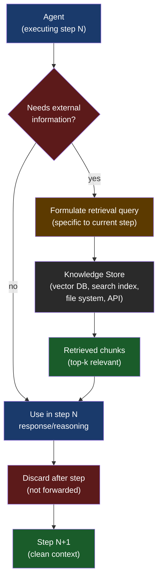

# Just-in-Time Retrieval

**Family:** E — Context Engineering

## Related practitioner guidance

Read [Verify an unfamiliar API](../../D-verification-evaluation/guides/verify-unfamiliar-api.md) for the corresponding manual session procedure and its applicability limits.

## Problem

When relevant documents, facts, or records are loaded into context at task start — before it is known which specific pieces will be needed — the context window fills with material that may never be used. The model attends to all loaded content equally; irrelevant retrieved chunks introduce noise that degrades precision. Conversely, when nothing is pre-loaded and the model lacks access to a retrieval mechanism, it hallucinates or answers from stale parametric knowledge.

## Solution

Defer retrieval until the exact moment a step requires external information. The agent (or harness) issues a targeted retrieval query at the point of need, pulls only the matching chunks, uses them for that step, and does not carry them forward unless explicitly needed. The context contains retrieved content only while it is being used.

## Structure

<b>Solution Structure</b>

1. Identify which steps in the workflow require information not present in the base context.
2. For each such step, define the retrieval interface: query format, store type, result limit (top-k), and relevance threshold.
3. At the step boundary, the agent or harness issues the query and injects results into the prompt for that step only.
4. After the step completes, retrieved content is not forwarded to subsequent steps unless it is explicitly included in the handoff artifact.

## When to Use

- The task requires consulting a large knowledge base (documentation, code, records) but different steps need different parts of it.
- The full corpus is too large to load upfront.
- Retrieval precision matters — noisy broad retrieval is worse than targeted just-in-time retrieval.
- The workflow has well-defined steps with identifiable information needs.

## When NOT to Use

- The same document is needed across all steps — load it once at the start.
- Retrieval latency is prohibitive and the full corpus fits in the context window.
- The knowledge base is so small that full load costs less than the retrieval infrastructure.

## Tradeoffs

| Benefit | Cost |
|---------|------|
| Only relevant content is in context at each step | Retrieval adds latency per step |
| Reduces noise; improves precision of step outputs | Requires a retrieval tool and query formulation logic |
| Scales to knowledge bases larger than any context window | Query quality determines retrieval quality — bad queries miss relevant content |
| Retrieved content can be scoped to the step's permission level | More moving parts; retrieval failures must be handled gracefully |

## Related Patterns

- [Map-Not-Manual](map-not-manual.md) — the map tells the agent what stores exist; just-in-time retrieval is the fetch mechanism.
- [Progressive Disclosure](progressive-disclosure.md) — disclosure is a structured form of just-in-time injection; retrieval is the dynamic, query-driven form.
- [Context Offloading](context-offloading.md) — offloading moves content out of the prompt permanently; retrieval brings it back on demand.
- [Role-Scoped Context](role-scoped-context.md) — retrieval queries can be scoped by role to enforce access boundaries.

## Anti-Patterns Addressed

- **Giant Instruction Manual** — loading the entire knowledge base upfront is the retrieval-specific form of this anti-pattern.

## Example

A customer-support agent handles inquiries about product defects. Rather than loading all 2000 product knowledge-base articles at the start of each conversation, the agent identifies the product model from the user's message, queries the vector store with the model number and defect description, and retrieves the 3 most relevant articles. Those 3 articles are injected into the context for the response step. The next turn's retrieval query is formulated fresh based on the follow-up question. Average context size: 1800 tokens versus 40000 if the full KB were loaded.

## Sources

- **Anthropic Engineering** — AI safety company; authors of Claude. Identifies just-in-time retrieval as the preferred mechanism for grounding agents in external knowledge without overloading the context window. [Effective Context Engineering for AI Agents](https://www.anthropic.com/engineering/effective-context-engineering-for-ai-agents)
- **AWS Prescriptive Guidance** — Amazon Web Services architecture team. Documents retrieval-augmented generation and on-demand knowledge injection as core agentic patterns. [Agentic AI Patterns](https://docs.aws.amazon.com/prescriptive-guidance/latest/agentic-ai-patterns/agent-patterns.html)
- **Google Cloud Architecture Center** — Google's cloud architecture team. Recommends retrieval at the point of need as part of context-aware agentic design. [Choose a Design Pattern for Agentic AI](https://docs.cloud.google.com/architecture/choose-design-pattern-agentic-ai-system)
