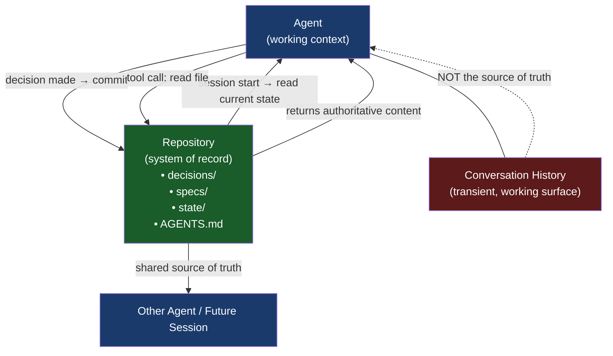

# Repository-as-System-of-Record

**Family:** E — Context Engineering

## Problem

When facts, decisions, and state live only in the conversation history or in the agent's parametric memory, they are ephemeral: they degrade across compaction cycles, disappear when a session ends, and are invisible to other agents or future sessions. An agent that relies on "what was said earlier in this conversation" as its source of truth is fragile. The prompt is transient; decisions made in it need to outlast it.

## Solution

Treat the repository — or a designated persistent store with repository-like properties (versioned, diffable, auditable) — as the authoritative source of truth for all decisions, specifications, and state that must persist. The prompt is a working surface, not a ledger. When an agent makes a decision, it writes it to the repository. When an agent needs to know the current state, it reads from the repository — not from its conversation history.

## Structure

<b>Solution Structure</b>

1. Designate the repository (or a structured persistent store) as the canonical location for decisions, specifications, and current state.
2. At the start of each session or task, the agent reads the relevant repository files to orient itself — not conversation history.
3. When the agent makes a decision that must persist, it writes the decision to a repository file (not just states it in the conversation).
4. Design repository structure so agents can orient quickly: a top-level index (AGENTS.md or equivalent), decision logs, spec files, and state files.
5. Conversation history is treated as a working scratchpad; only results that are explicitly committed to the repository are durable.

## When to Use

- Multiple agents or sessions must share a consistent view of decisions and state.
- Tasks span multiple sessions or agents and continuity is required.
- Decisions made during agentic work must be auditable or reversible.
- The repository already contains structured documentation that parallels what agents are deciding.

## When NOT to Use

- The task is truly single-session and single-agent with no continuity requirement — overhead isn't justified.
- The agent has no write access to the repository.
- State changes at a frequency that makes per-commit persistence prohibitive (use a structured external state store instead; see Family L).

## Tradeoffs

| Benefit | Cost |
|---------|------|
| Decisions survive session boundaries and context compaction | Agent must be prompted to read from and write to the repo; it won't do this by default |
| Multiple agents share a consistent, versioned source of truth | Write discipline required — partial commits or inconsistent writes cause drift |
| Full audit trail via version control (git log, diffs) | Repository structure must be designed for agent navigation, not just human navigation |
| Human reviewers can inspect and override decisions via normal git workflow | Latency: reading and writing files adds round-trips |

Before recording a disputed term as authoritative, use [Clarify domain terms](../guides/clarify-domain-terms.md) to obtain the responsible person's decision. A plausible assistant-written definition does not settle an unresolved requirement.

## Related Patterns

- [Map-Not-Manual](map-not-manual.md) — the map (AGENTS.md) is the entry point to the repository as system of record.
- [Context Offloading](context-offloading.md) — offloading moves reference material to the repo; this pattern extends the same principle to decisions and state.
- [Artifact-Based Handoff](artifact-based-handoff.md) — artifacts can be committed to the repository, making handoffs durable and auditable.
- [Just-in-Time Retrieval](just-in-time-retrieval.md) — reading from the repository at the start of a step is a form of just-in-time retrieval from the system of record.

## Anti-Patterns Addressed

- **Giant Instruction Manual** — when agents write decisions back to the repo, the repo evolves as a structured reference rather than requiring the prompt to be updated manually each time state changes.

## Example

A long-running refactoring agent works on a codebase over several sessions. Rather than reconstructing progress from conversation history, at the start of each session it reads `refactor/status.md` (which files are done, which are pending, which have known issues) and `refactor/decisions.md` (architectural choices made in prior sessions). When it makes a new architectural decision, it commits an update to `refactor/decisions.md` before continuing. A second agent working in parallel reads the same files. When a human engineer reviews progress, they read the same markdown files the agent maintains. The conversation history from prior sessions is irrelevant — the repository is the source of truth.

## Sources

- **Anthropic Engineering** — AI safety company; authors of Claude. States that the repository is the durable artifact of agentic work; conversation history is transient scaffolding, not the record. [Effective Context Engineering for AI Agents](https://www.anthropic.com/engineering/effective-context-engineering-for-ai-agents)
- **OpenAI Engineering** — AI research company; authors of GPT and Codex. The Codex harness is built around the repository as the source of truth: agents read repo state to orient, write results back as commits. [Harness Engineering](https://openai.com/index/harness-engineering/) | [Unlocking the Codex Harness](https://openai.com/index/unlocking-the-codex-harness/)
