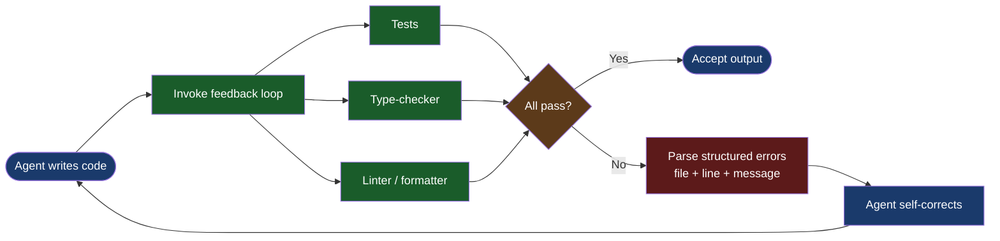

# F03 — Executable Feedback Loop

## Related practitioner guidance

Read [Verify an unfamiliar API](../../D-verification-evaluation/guides/verify-unfamiliar-api.md) for the corresponding manual session procedure and its applicability limits.

## Problem

Without fast, executable feedback, agents cannot self-correct. An agent that writes code and cannot run tests must either submit blind output or rely on static reasoning to verify correctness — both of which are unreliable for non-trivial logic. When feedback is slow (minutes-long CI runs), non-executable (human review only), or unstructured (wall-of-text output), agents cannot iterate effectively. Silent failures are the worst case: the agent believes the output is correct, but the feedback loop never fired or checked the wrong thing.

## Solution

Wire the repository so agents can invoke tests, type-checkers, and linters directly and receive structured, actionable output within seconds. Every check must be: (1) agent-invocable without human mediation, (2) fast enough for an inner-loop iteration (under 60 seconds for unit-level work), and (3) structured so the agent can parse file, line, and message without ambiguity. The feedback loop is the agent's primary source of ground truth about whether its output is correct.

## Structure

<details>
<summary><b>Executable Feedback Loop</b></summary>



</details>

**Key components:**

- **Unit tests** — fast, isolated; cover the logic being modified; runnable by the agent without setup
- **Type-checker** — validates type correctness; output includes file path, line number, and message
- **Linter / formatter** — enforces style; auto-fixable where possible so the agent can apply fixes, not just read them
- **Skill / command wrapper** — a single invocable command (e.g., a skill) the agent calls instead of remembering raw tool flags
- **Structured output contract** — failure messages always include `file:line: message` format; no wall-of-text

## Implementation

1. Identify the three feedback channels for the repo: tests (unit), types, and lint. If any are missing, add them before wiring agents.
2. Wrap each channel in a single invocable command or skill so the agent calls one thing, not three separate commands with flags.
3. Ensure unit tests run in under 60 seconds when filtered to the modified module (use test-filter flags).
4. Configure type-checker output to emit `file:line:col: message` format (standard for tsc, mypy, pyright, etc.).
5. Configure linter to auto-fix where possible; for non-auto-fixable violations, emit `file:line: rule: message`.
6. Add a fast-path script that runs all three in sequence and exits non-zero on any failure — this is what the agent invokes.
7. Validate the loop: have an agent introduce a deliberate type error and a test failure; verify it catches both and self-corrects.

## Signals (how to know it's working)

- Agent self-corrects without human prompting when tests or types fail
- Agent does not submit output that fails local checks (no "it passed my checks but CI failed" regressions)
- Feedback round-trip (write → check → see error) takes under 60 seconds for unit-level work
- Error messages are specific enough that the agent fixes the correct line on the first attempt

## Anti-Patterns

- **Human-mediated feedback only:** Agent writes code, human runs tests, human reports results — the inner loop requires a human and cannot iterate autonomously.
- **Slow feedback:** Full integration test suite takes 10 minutes; agent blocks or abandons self-correction rather than waiting.
- **Unstructured output:** Errors emitted as prose ("something went wrong in the auth module") — agent cannot locate the specific line.
- **Wrong feedback:** Tests pass but check the wrong behavior — agent believes it's correct; bug ships. The feedback loop must check what matters.
- **Feedback only in CI:** Checks only run in CI, not locally — agent cannot close the loop without pushing a commit.

## Related Patterns

- [F04 — Mechanical Architecture Constraints](F04-mechanical-architecture-constraints.md) — constraints enforced via the same feedback loop (pre-commit hooks)
- [F08 — Sandboxed Execution](F08-sandboxed-execution.md) — test runs should be isolated to prevent cross-contamination
- [F11 — Capability-Gap Feedback](F11-capability-gap-feedback.md) — when the feedback loop fires repeatedly on the same error, it signals a capability gap

## Examples

**Single-command feedback invocation (pseudocode):**

```
skill: /sl-test
  → runs: npm run test-mocha-with-filter --filter <changed-module>
  → then: tsc --noEmit
  → then: eslint <changed-files>
  → exits non-zero if any fail
  → outputs: structured JSON { file, line, rule, message }[]
```

**Structured error output contract:**

```
# Good (structured, actionable):
service/routes/auth.ts:42:5: error TS2345: Argument of type 'string' is not assignable to parameter of type 'number'.

# Bad (unstructured, not actionable):
Type error found in auth module. Please check the route handler.
```

**Test filter pattern:**

```
# Agent runs only tests for the modified file:
npm run test-mocha-with-filter --filter service/routes/auth.test.ts
# Not the full suite (too slow for inner loop)
```

## Sources

- **OpenAI Engineering** — AI research company; authors of GPT and Codex; coined "harness engineering." [Harness Engineering: Leveraging Codex in an Agent-First World](https://openai.com/index/harness-engineering/)
- **OpenAI Engineering** — AI research company; authors of GPT and Codex; coined "harness engineering." [Unlocking the Codex Harness](https://openai.com/index/unlocking-the-codex-harness/)
- **Anthropic Engineering** — AI safety company; authors of Claude. [Building Effective Agents](https://www.anthropic.com/engineering/building-effective-agents)
- **Google Cloud Architecture Center** — Google's cloud architecture team. [Choose a Design Pattern for Agentic AI](https://docs.cloud.google.com/architecture/choose-design-pattern-agentic-ai-system)
