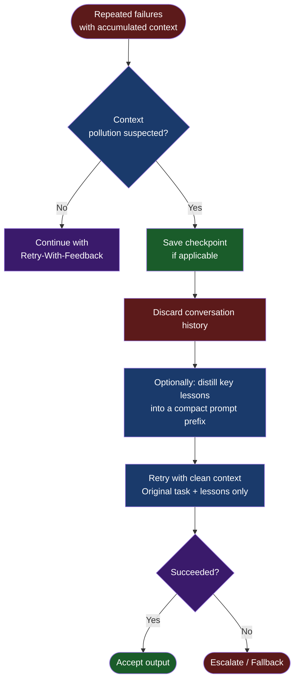

# Fresh-Context Retry

**Family:** I — Reliability & Recovery
**Type:** Pattern

## Problem

As an agent accumulates conversation history across multiple failed attempts, that history can become the source of new failures. Errors, incorrect assumptions, and bad intermediate outputs embedded in the context subtly bias every subsequent generation. The model anchors on prior mistakes, over-corrects for phantom constraints, or gets confused by contradictory information it produced earlier. More retries with the same polluted context make things worse, not better.

## Solution

Discard the accumulated conversation context entirely and retry the task from a clean state, as if it were the first attempt. The new run starts with only the original task description — or a freshly constructed prompt incorporating only the actionable lessons learned — without the failure history weighing on it.

## In a session: recover decisions without losing useful work

Use this when a conversation keeps restoring a rejected approach. Length alone is not a reason to reset. If the agent is still following the goal and uncovering different defects, continue investigating.

1. Point to one mismatch between the latest proposal and the agreed requirement. Resolve an undecided or contradictory requirement first.
2. Before changing conversations, ask for a short handoff: current goal, governing decision and rationale, rejected approach and why, useful findings with file locations, edits worth keeping, open questions, and the next observable check. Review it against the actual files and original decision. For chat-only work, keep a reviewed note you can paste.
3. If the conversation is aligned but buried in output, summarize around those facts. If it repeatedly returns to the same rejected premise, start a fresh conversation with the checked handoff. A new chat does not revert files: inspect and preserve the useful diff separately. Do not discard edits just to clear conversation history.
4. Ask the agent to apply the decision to one distinguishing example before editing. Afterward, inspect the actual result and any changed checks. A correct explanation is not evidence that the implementation works.

**Illustrative prompt:** “We rejected alphabetical ordering; the agreed rule is input order. Before editing, predict the output for Zebra followed by Apple. Keep the working escaped-title fix. Read the ordering decision and show which check will distinguish these behaviors.”

This is our practitioner adaptation of research method PAT-0001, informed by Anthropic's session guidance. It is not a guaranteed cure or a diagnosis of model attention. A summary can carry forward a mistaken rule; a fresh chat cannot settle a product decision. For terminology disagreements, use [Clarify domain terms](../../E-context-engineering/guides/clarify-domain-terms.md).

## Solution Structure

<details>
<summary><b>Fresh-Context Retry — Context Reset Flow</b></summary>



</details>

## Structure

```
function freshContextRetry(originalTask, failureHistory, maxFreshAttempts):
    lessons = distillLessons(failureHistory)
    # distillLessons extracts only: what was tried, why it failed
    # It does NOT include failed outputs or confusing intermediate steps

    freshPrompt = buildCleanPrompt(
        task    = originalTask,
        context = lessons  # brief, structured, no failed text artifacts
    )

    attempt = 0
    while attempt < maxFreshAttempts:
        newContext = [freshPrompt]  # no history appended
        output = generate(newContext)

        if succeeded(output):
            return output

        attempt += 1

    return Failure("Fresh-context retry exhausted")

# Trigger heuristics for switching to this pattern:
# - same error repeated N times despite feedback injection
# - a checked handoff is ready and repeated failures revisit the same premise
# - model output quality is degrading across retries
```

## When to Use

- The same error recurs across multiple feedback-enriched retries, suggesting the model is stuck in a local failure mode reinforced by context.
- Repeated mistakes persist after clarifying the requirement; check whether to summarize useful context or restart with a reviewed handoff.
- Output quality is visibly degrading across iterations (the model seems confused, not just wrong).
- A prior attempt produced content that directly contradicts the task goal and cannot easily be counteracted by appending new instructions.

## When Not to Use

- Failures are caused by missing information or capability, not context pollution — discarding context does not add capability.
- The task is stateful and prior context contains essential information (use [Checkpoint and Resume](checkpoint-and-resume.md) to preserve state, then discard only the failure noise).
- The failure is transient (network, rate limit) — context is not the problem; just retry with backoff.
- The current attempt is making verifiable progress. There is no universal retry count that diagnoses a context problem.

## Trade-offs

| Pro | Con |
|-----|-----|
| Breaks the failure cycle when context accumulation is the root cause | Loses the conversation history — any useful information must be explicitly extracted first |
| Gives a new attempt less failed-history context to reuse | Distilling lessons adds complexity; done poorly, it carries forward the same bad assumptions |
| Can recover from confusing multi-turn dialogues | A fresh context does not fix a fundamental capability gap or a bad original prompt |
| Works across model sessions and agent restarts | Must be paired with Checkpoint and Resume if work was done before the context reset |

## Example

A coding agent is asked to refactor a module. After three feedback-injected retries it is still producing code that re-introduces a removed pattern. Inspection shows the context is 12,000 tokens and contains two full versions of incorrect code. A fresh-context retry is triggered: a two-sentence summary of what to avoid is prepended to the original task, all prior turns are dropped. The fourth attempt (first fresh one) succeeds.

## Related Patterns

- [Retry-With-Feedback](retry-with-feedback.md) — the pattern to exhaust first; switch to this when feedback injection is not working
- [Checkpoint and Resume](checkpoint-and-resume.md) — preserve completed work before discarding context
- [Bounded Retry](bounded-retry.md) — cap fresh-context retries just as any other retry loop
- [Root-Cause-Before-Retry](root-cause-before-retry.md) — diagnose whether context is actually the cause before discarding it

## Related Anti-Patterns

- [Retry Without New Information](../anti-patterns/retry-without-new-information.md) — fresh-context retry without lesson distillation is this anti-pattern in disguise

## Evidence scope

The session procedure is guidance, not a measured repository-level success rate. Preserving a rejected alternative and checking a distinguishing input are our adaptations. The structural retry loop above remains useful when implementing recovery in a harness.

## Sources

- **Anthropic Engineering** — AI safety company; authors of Claude. [Building Effective Agents](https://www.anthropic.com/engineering/building-effective-agents)
- **OpenAI Engineering** — AI research company; authors of GPT and Codex. [A Practical Guide to Building AI Agents](https://openai.com/business/guides-and-resources/a-practical-guide-to-building-ai-agents/)
- **AWS Prescriptive Guidance** — Amazon Web Services architecture team; defines Validation-Retry Loop and Structured Error Classification. [Agentic AI Patterns](https://docs.aws.amazon.com/prescriptive-guidance/latest/agentic-ai-patterns/agent-patterns.html)

- Anthropic — [Best practices for Claude Code](https://code.claude.com/docs/en/best-practices#steer-the-session): session steering and separating conversation recovery from file changes; consulted 2026-11-21.
