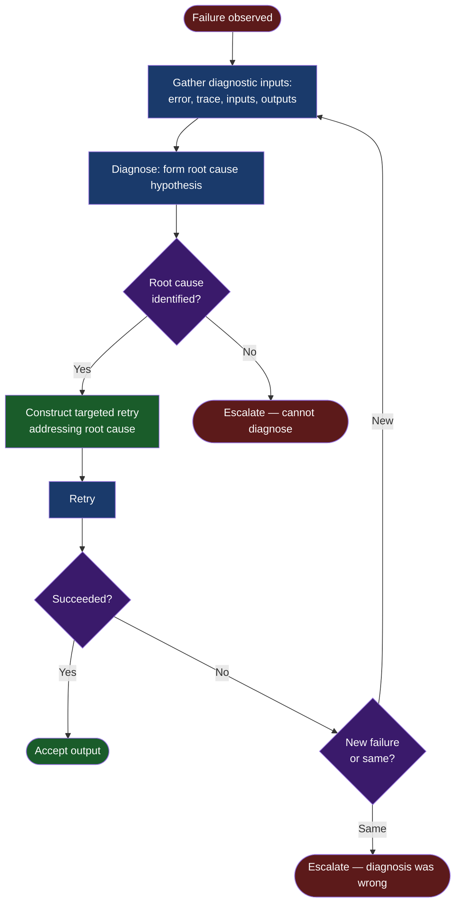

# Root-Cause-Before-Retry

**Family:** I — Reliability & Recovery
**Type:** Pattern

## Problem

When an agent fails, the instinct is to retry. But retrying without understanding why the failure occurred means the next attempt is a guess. If the root cause is a wrong assumption in the prompt, a missing tool, an incorrect approach, or an ambiguity in the task definition, no number of retries will help — each attempt just re-encounters the same underlying problem from a slightly different angle. Repeated guessing wastes budget and can entrench wrong behavior.

## Solution

Before retrying, spend one explicit diagnostic step investigating the failure. The agent (or a dedicated diagnostic sub-agent) examines the error, the inputs, the intermediate outputs, and the execution trace to form a hypothesis about the root cause. The retry prompt is then constructed to address that specific cause — not just to "try again."

## In a session: assess before naming a fix

Use this when your request contains an unverified diagnosis, or each attempted fix assumes the previous explanation was correct. You need observations and control over the conversation; access to code or logs helps distinguish explanations.

**Quick tip:** Describe expected versus observed behavior before asking for a particular repair. Ask for an assessment before edits and one check that could distinguish plausible explanations. Then introduce your own diagnosis as a hypothesis.

1. Preserve relevant observations, reproduction conditions, and binding requirements. Separate them from your proposed cause; do not withhold a useful clue to make the question seem neutral.
2. Ask what supports the initial explanation and what credible alternative would predict a different result. If the evidence already identifies the cause, a direct check is enough.
3. Compare your hypothesis with the assessment. Run or request the distinguishing check. Agreement, disagreement, and confident language do not settle the cause.
4. Choose a change consistent with the result and requirements. Recheck the failing case and neighboring behavior. If the result cannot distinguish the explanations, collect the missing evidence before patching.

**Original illustration:** “Fix cache invalidation” already assigns a cause. Try: “After updating an order, the list shows its old status. Before editing, assess the cause and identify the smallest useful check.” A cache-hit trace remains relevant evidence and should be included.

This adapts PAT-0007. Sharma et al.'s [Towards Understanding Sycophancy in Language Models](https://arxiv.org/html/2310.13548v4), §§3.2–3.3, finds that suggestions and unsupported challenges can sway tested QA answers. It does not test this debugging procedure or establish that disagreement improves correctness. Anthropic's [specific-prompt and verification advice](https://code.claude.com/docs/en/best-practices#write-a-specific-prompt) supports supplying observations and checking results. The staged assessment and illustration are catalog adaptations. Sources consulted 2026-11-22. Skip the extra assessment when the cause and fix are already verified.

For an unclear goal, use [Clarify an idea](../../K-human-control/guides/clarify-an-idea.md). For choosing between implementations, use [Repair or a fresh attempt](../guides/repair-or-fresh-attempt.md).

## Solution Structure

<details>
<summary><b>Root-Cause-Before-Retry — Diagnose Then Retry</b></summary>



</details>

## Structure

```
function rootCauseBeforeRetry(task, failure, maxRetries):
    attempt = 0

    while attempt < maxRetries:
        diagnosis = diagnose(task, failure):
            # Examine: error message, stack trace, inputs, intermediate outputs
            # Ask: what assumption does this failure contradict?
            # Form: a falsifiable hypothesis, e.g. "the model assumed X but X is false"

        if not diagnosis.confident:
            return escalate(task, failure, diagnosis)

        retryPrompt = buildPrompt(task, diagnosis.findings, diagnosis.correction)
        result = execute(retryPrompt)

        if result.succeeded:
            return result

        if sameFailure(result.failure, failure):
            # Diagnosis was wrong — escalate rather than loop
            return escalate(task, failure, diagnosis, result)

        # New failure — diagnose again
        failure = result.failure
        attempt += 1

    return escalate(task, failure)
```

## When to Use

- The failure mode is not immediately obvious from the error message alone.
- The same retry has been attempted once with feedback and failed again unchanged.
- The task involves complex multi-step reasoning where a wrong intermediate step propagates forward.
- The agent has a self-reflection or tool-use capability that can examine its own outputs.
- Per the OpenAI principle: treat failures as evidence of a missing capability or constraint, not just a cue to try harder.

## When Not to Use

- The error is self-evidently actionable (e.g., a JSON parse error with the exact field name) — skip diagnosis and go straight to [Retry-With-Feedback](retry-with-feedback.md).
- The failure is transient (network timeout, rate limit) — no diagnosis needed, just wait and retry.
- Diagnostic cost (tokens, latency) outweighs the benefit — short tasks may not justify a full diagnostic step.
- The agent lacks the tools or access needed to meaningfully diagnose (e.g., no trace, no intermediate output visibility).

## Trade-offs

| Pro | Con |
|-----|-----|
| Addresses root causes rather than symptoms — fewer total retries | Adds a diagnostic step with its own token and latency cost |
| Each retry is qualitatively better, not just repeated | Diagnosis can be wrong — a wrong hypothesis leads to a wrong retry |
| Surfaces unknown unknowns: discovers missing constraints or capabilities | Requires the agent to have introspective access to its execution trace |
| Prevents budget exhaustion from repeated symptom-treating retries | Adds code complexity — diagnostic logic must be maintained alongside task logic |

## Example

A data transformation agent fails three times. The error says "KeyError: customer_id." A naive retry injects "fix the KeyError." Root-cause diagnosis finds the input schema changed last week and `customer_id` was renamed to `cust_id`. The diagnostic step surfaces this as the hypothesis. The retry is constructed with the corrected field name in the prompt. It succeeds on the first root-cause-informed attempt.

## Related Patterns

- [Retry-With-Feedback](retry-with-feedback.md) — used after diagnosis to construct the informed retry
- [Structured Error Classification](structured-error-classification.md) — classification is a lightweight form of diagnosis; use this pattern for deeper investigation
- [Fresh-Context Retry](fresh-context-retry.md) — if diagnosis reveals context pollution as the root cause
- [Human Escalation](human-escalation.md) — when diagnosis cannot identify the root cause

## Related Anti-Patterns

- [Retry Without New Information](../anti-patterns/retry-without-new-information.md) — what happens when this diagnostic step is skipped

## Sources

- **OpenAI Engineering** — AI research company; authors of GPT and Codex. [A Practical Guide to Building AI Agents](https://openai.com/business/guides-and-resources/a-practical-guide-to-building-ai-agents/)
- **Anthropic Engineering** — AI safety company; authors of Claude. [Building Effective Agents](https://www.anthropic.com/engineering/building-effective-agents)
- **AWS Prescriptive Guidance** — Amazon Web Services architecture team; defines Validation-Retry Loop and Structured Error Classification. [Agentic AI Patterns](https://docs.aws.amazon.com/prescriptive-guidance/latest/agentic-ai-patterns/agent-patterns.html)
