# SL SVG Diagram — make explanations move

Create animated SVG explanations embedded in Markdown using the pinned [AnimDiagram](https://github.com/praveenvijayan/animdiagram) template and native motion JSON. Claude authors the static SVG and a sibling `.agent.md` explanation; upstream compiles the animation. No custom layout engine, semantic schema or scenario selector is installed.



Illustrative mechanisms, not live telemetry. [Meaning](sl-diagrams/readme-motion-showcase.agent.md) · [Native editable JSON](sl-diagrams/readme-motion-showcase.spec.json).

## Install and use

Requires Git, Bash and Python 3.10+:

```sh
git clone https://github.com/SharonLanger/claude-backstage.git
cd claude-backstage
bash skills/sl-svg-diagram/scripts/setup-animdiagram.sh
```

If already cloned, reuse that checkout: update it to the reviewed revision and run setup. The shell launcher stays in the repository. The installed Python wrapper can also run setup:

```sh
python3 -I ~/.claude/skills/sl-svg-diagram/scripts/run-animdiagram.py setup
```

Default skill: `~/.claude/skills/sl-svg-diagram/`. Separate dependency: `~/.local/share/sl-svg-diagram/animdiagram/a8edca75f041ebb75c74ac9d3b3fbec3b9cd5486/`. Supported arguments are `--skill-dir /absolute/fresh/skill` and `--dependency-dir /absolute/cache/animdiagram`. A clean matching cached dependency is reused; it is not replaced or pruned.

Setup installs exactly five assets: `SKILL.md`, `references/reading-diagrams.md`, `scripts/run-animdiagram.py`, `audit/verified-files.sha256`, and `notices/animdiagram-MIT.txt`. It generates `.installation.json` with the dependency path. Tests, README, audit prose, showcase and caches stay in the repository. The complete dependency checkout stays intact. Setup runs upstream tests and verifies the installed configuration.

Setup refuses differing/customized installations, extra files and symlinks; it never deletes user files. Earlier larger installations need a fresh `--skill-dir` or a backup/move of the old destination before reinstalling. Personal preferences stay outside the bundle and are preserved.

In projects with diagrams, optionally add this plain path guidance to their `CLAUDE.md` (adjust custom installation paths):

> When reading a diagram, follow `~/.claude/skills/sl-svg-diagram/references/reading-diagrams.md`: read surrounding Markdown and the matching `.agent.md` before SVG source.

This is conditional guidance, not an `@` import or an access restriction. Start a new session:

```text
/sl-svg-diagram docs/design.md Explain enabled=true and enabled=false and their actual method calls
```

**Compatibility:** this native-only skill no longer builds `sl-diagram/v1` semantic specs introduced by the earlier version. Existing generated SVGs remain viewable. Semantic JSON needs its prior generator or manual conversion to static SVG plus native motion JSON; there is no automatic migration.

## Native authoring

`<skill>` below is the absolute installed directory. Each command verifies the audited dependency first, silently on success:

```sh
python3 -I <skill>/scripts/run-animdiagram.py template /absolute/diagrams/request.svg
# Claude authors static nodes, orthogonal routes and labels, retaining motion markers.
# Claude saves native motion JSON beside the SVG:
python3 -I <skill>/scripts/run-animdiagram.py timeline /absolute/diagrams/request.spec.json --inject /absolute/diagrams/request.svg
python3 -I <skill>/scripts/run-animdiagram.py check /absolute/diagrams/request.svg
```

A minimal illustrative schedule, using coordinates chosen in the static SVG:

```json
{"events":[{"id":"request","kind":"packet","at":0.3,"from":[208,148],"to":[320,148]}]}
```

Omit optional styling/timing fields unless needed; reuse the pinned template/compiler defaults. Use native `after`/`gap` for order, `with` for actual concurrency and `via` for bends. Upstream supports packets, pulses, streams, bars, moving groups and phase captions. Keep boolean/enum cases in one authored loop with visible input, inactive routes muted, readable outcomes and reset. Use upstream template typography/palette, a 4px layout grid, 28px outer margin and ordinary 660px canvas. Reserve side explanation regions and clearance around long tags, bottom labels and moving effects; wrap/rearrange before shrinking. Keep ordered flows ordered and use up to three columns for many independent peers. No decorative motion or changing node positions between cases.

Read only needed upstream references under the dependency path in `.installation.json`: `references/layout.md`, `storyboard.md` or `motion-grammar.md`. The common path does not require loading the full upstream skill. No custom generation defaults duplicate those native references.

Claude writes `<stem>.agent.md` from grounded purpose, inputs/conditions, ordered/concurrent events, outcomes, assumptions and source links. This is authored explanation, not an automatic summary inferred from SVG coordinates. Keep it consistent with the SVG, JSON and nearby prose. Place the three sibling assets according to the project's convention, otherwise in `diagrams/` beside the Markdown, and embed relative links with spaces URL-encoded:

```markdown

[Diagram meaning](diagrams/request.agent.md)
```

Optional personal preferences: read an existing `~/.claude/sl-svg-diagram/preferences.md`; missing means use the defaults. Task directions override preferences. A correction updates the current diagram; save a scoped personal rule only on explicit request or accepted proposal. Setup never creates or overwrites that file. Factual correctness, integrity and privacy remain mandatory.

## Optional native preview and visual checks

HTML is created **only on explicit request**, adding a tool call and derivative output file:

```sh
python3 -I <skill>/scripts/run-animdiagram.py preview /absolute/diagrams/request.svg
python3 -I <skill>/scripts/run-animdiagram.py skin /absolute/diagrams/request.svg --to light
```

Preview uses the unchanged upstream HTML with its ordinary scrub/static/background/zoom controls. Scenario dropdowns are deferred. The pinned preview pause handler stops UI updates but does not reliably freeze CSS animations; use scrub/static frame for inspection. No custom playback fix is shipped. SVG remains the normal standalone deliverable.

Render only in an approved environment with enforced outbound network denial covering browser subprocesses. Check intended/narrow document widths, route exclusivity/order, actual concurrency, arrivals/effect tails, pauses/reset, text/tag clipping, side/bottom clearance and reduced motion. If safe rendering is unavailable, report visual verification pending. The checker is structural, not a visual-layout or security pass. No automatic browser installation or policy changes.

## Integrity and privacy

Pinned commit: **`a8edca75f041ebb75c74ac9d3b3fbec3b9cd5486`**. The wrapper verifies actual HEAD, the complete tracked-file set and all 62 audited hashes before executing a temporary snapshot of verified bytes. A changed/missing tracked file or a different commit blocks execution; untracked code is not executed. There are no automatic updates/repairs. Verify explicitly when troubleshooting:

```sh
python3 -I <skill>/scripts/run-animdiagram.py verify
```

[Audit and limitations](audit/animdiagram-audit.md): tested core generation made no network syscalls; upstream tests passed 8/8 and 11/11 examples regenerated exactly during that audit. **The whole checkout is not guaranteed offline**: its gallery loads Google Fonts, browser background traffic was blocked, and its checker misses some external-resource forms. The wrapper blocks gallery execution, browser launch and export. Keep authored SVG script-free/self-contained, without external fonts/resources, event handlers or `foreignObject`. Never upload private diagrams/source/specs to an external diagram service; the approved Claude connection is separate.

The wrapper is project-owned code; dependency hashes do not certify arbitrary SVG/runtime or changes to the wrapper itself. The [MIT copyright/permission notice](notices/animdiagram-MIT.txt) accompanies the dependency attribution. Re-audit before changing the pin or manifest.

## Development checks

Repository tests run against a disposable installed runtime; tests are not installed. Reuse a cached exact audited checkout to run offline:

```sh
python3 -I skills/sl-svg-diagram/tests/run.py /absolute/cached/animdiagram
bash skills/sl-svg-diagram/scripts/setup-animdiagram.sh --skill-dir /temporary/fresh-skill --dependency-dir /absolute/cached/animdiagram
python3 -I skills/sl-svg-diagram/tests/smoke.py --skill-dir /temporary/fresh-skill --output-dir /temporary/fresh-output
# Explicit HTML variant:
python3 -I skills/sl-svg-diagram/tests/smoke.py --skill-dir /temporary/fresh-skill --output-dir /temporary/other-fresh-output --preview
```

The smoke runner authors a small known static SVG/native schedule/companion, compiles through the installed wrapper, checks XML/structure/repeatability and nested Markdown/companion links, then runs repository integration/integrity tests against that runtime. Default smoke creates no HTML. `--preview` explicitly exercises the native preview without changing SVG. `--skip-integration` runs only fixture smoke and clearly reports the skipped suite. Outputs must be fresh; omitted `--output-dir` retains a temporary directory. Test dependency/profile mutations use disposable copies, never the user's real files.

Deterministic tests and structural smoke do not establish visual quality or a live Claude skill invocation. Live Claude acceptance remains pending where CLI/authentication are unavailable; inspect real tool calls, authored companion meaning and resulting assets before claiming it. No token-saving percentage is measured or claimed.

[Skill instructions](SKILL.md) · [All skills](../README.md)
